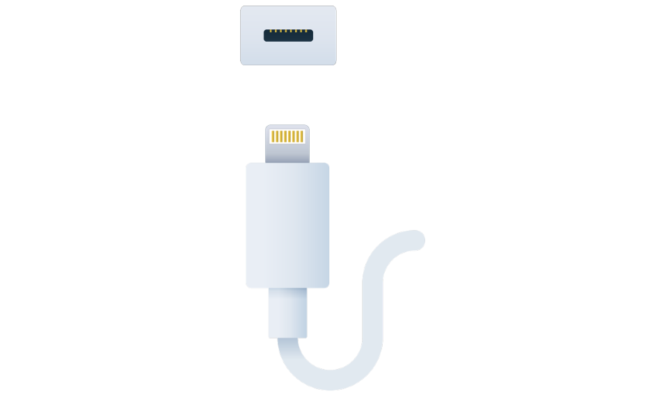
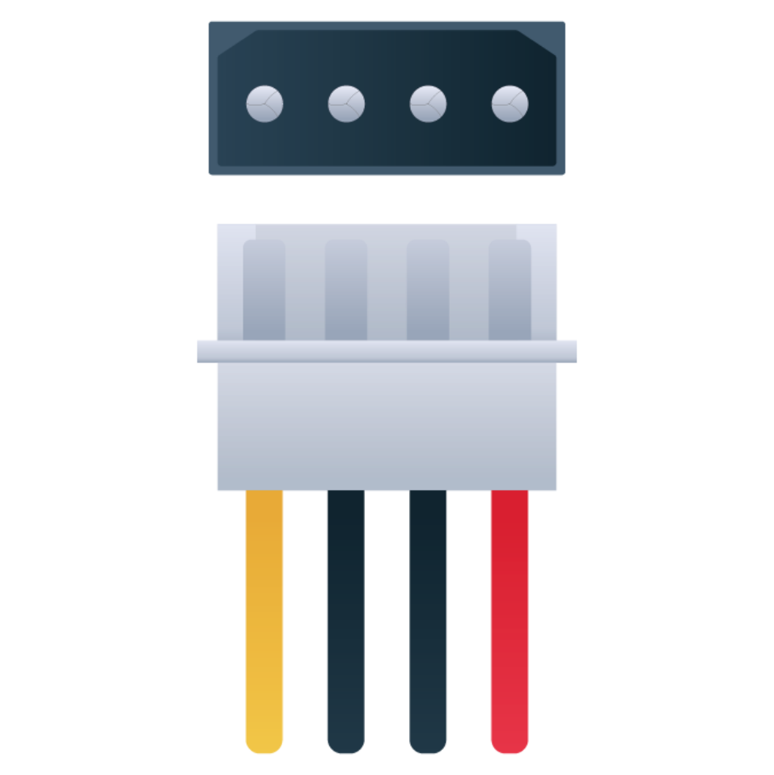

## pc-peripherals
- front-en: Name the three functions peripheral devices typically perform.
- front-hu: Melyik három funkciót látják el jellemzően a perifériák?
- back-en: **Input** (keyboard, mouse, microphone, camera), **output** (monitor, speakers) and **external storage**.
- back-hu: **Bemenet** (billentyűzet, egér, mikrofon, kamera), **kimenet** (monitor, hangszóró) és **külső tárolás**.

## pc-case
- front-en: What is an all-in-one PC?
- front-hu: Mi az all-in-one PC?
- back-en: A PC whose internal components (motherboard, CPU, memory, PSU…) are built into the **monitor's case**, instead of a separate tower.
- back-hu: Olyan PC, amelynek belső alkatrészei (alaplap, CPU, memória, tápegység…) a **monitor házába** vannak építve, nem külön toronyházban.

## pc-opening
- front-en: How is the side cover of a tower case usually secured?
- front-hu: Mi rögzíti általában a toronyház oldallapját?
- back-en: **Screws or retaining clips**, sometimes with **anti-tamper** mechanisms – check the system documentation before opening.
- back-hu: **Csavarok vagy rögzítőpatentek**, néha **illetéktelen hozzáférés elleni** védelemmel – kinyitás előtt nézd meg a dokumentációt.

## pc-front-panel
- front-en: What do you typically find on the front panel of a PC case?
- front-hu: Mi található jellemzően a PC-ház előlapján?
- back-en: Removable media drives, the **power on/off switch**, drive activity **LEDs** (and often front USB/audio ports).
- back-hu: Cserélhető adathordozós meghajtók, a **be-/kikapcsoló**, a meghajtók működését jelző **LED-ek** (és gyakran elülső USB/audio portok).

## pc-rear-panel
- front-en: Why must the PSU fan exhaust on the rear panel never be obstructed?
- front-hu: Miért nem szabad soha eltakarni a tápegység ventilátorának kifúvóját a hátlapon?
- back-en: Because it would **impair cooling** of the PC.
- back-hu: Mert **rontaná a gép hűtését**.

## pc-blanking-plate
- front-en: A technician removes an adapter card. Should a blanking plate be installed? Why?
- front-hu: Egy technikus kiszerel egy bővítőkártyát. Kell takarólemezt betenni? Miért?
- back-en: **Yes.** An open slot disrupts the **airflow**, causing **overheating** and more **dust** in the system.
- back-hu: **Igen.** A nyitott rés megzavarja a **légáramlást**, ami **túlmelegedést** és több **port** okoz.

## io-port
- front-en: Where can a PC's external I/O ports be provided from?
- front-hu: Mi biztosíthatja a PC külső I/O portjait?
- back-en: The **motherboard** (rear I/O panel, front ports) or an **expansion card**.
- back-hu: Az **alaplap** (hátsó I/O panel, elülső portok) vagy egy **bővítőkártya**.

## port-bus-connector
- front-en: What is the difference between a port and a connector?
- front-hu: Mi a különbség a port és a csatlakozó (connector) között?
- back-en: The **port** is the external connection point of a bus interface on the device; the **connector** is the end of the cable that plugs into a port of the same form factor.
- back-hu: A **port** egy buszinterfész külső csatlakozási pontja az eszközön; a **csatlakozó** a kábel vége, amely az azonos formájú portba illeszkedik.

## keying
- front-en: What is "keying" on a connector?
- front-hu: Mit jelent a csatlakozó „kódolása” (keying)?
- back-en: An **asymmetric design** that prevents the connector from being inserted the wrong way around.
- back-hu: **Aszimmetrikus kialakítás**, amely megakadályozza a csatlakozó fordított bedugását.

## bits-bytes
- front-en: What is the difference between "Mbps" and "MBps"?
- front-hu: Mi a különbség a „Mbps” és az „MBps” között?
- back-en: Lowercase **b = bits**, uppercase **B = bytes**; 1 byte = 8 bits, so MBps is 8× more than Mbps.
- back-hu: Kis **b = bit**, nagy **B = bájt**; 1 bájt = 8 bit, így az MBps nyolcszor annyi, mint az Mbps.

## transfer-units
- front-en: How many bits per second is 1 Gbps?
- front-hu: Hány bit másodpercenként 1 Gbps?
- back-en: 1000 × 1000 × 1000 = **1,000,000,000 bits per second** (decimal multiples).
- back-hu: 1000 × 1000 × 1000 = **1 000 000 000 bit másodpercenként** (decimális többszörösök).

## usb-classes
- front-en: Give three examples of USB device classes.
- front-hu: Mondj három példát USB-eszközosztályra!
- back-en: **Human interface** (keyboard, mouse), **mass storage** (disk drives), **printer**, **audio device**.
- back-hu: **Emberi interfész** (billentyűzet, egér), **háttértár** (lemezmeghajtó), **nyomtató**, **audioeszköz**.

## usb-host-controller
- front-en: How many devices can theoretically connect to one USB host controller?
- front-hu: Elméletben hány eszköz csatlakozhat egy USB host controllerhez?
- back-en: **127** – but devices share the bandwidth, so motherboards have several controllers with 3–4 ports each.
- back-hu: **127** – de az eszközök osztoznak a sávszélességen, ezért az alaplapon több vezérlő van, egyenként 3–4 porttal.

## usb-2-highspeed
- front-en: Data rate and duplex mode of USB 2.0 HighSpeed?
- front-hu: Mekkora az USB 2.0 HighSpeed sebessége, és milyen a duplex módja?
- back-en: **480 Mbps**, shared by all devices on the controller; **half-duplex**.
- back-hu: **480 Mbps**, a vezérlő összes eszköze osztozik rajta; **félduplex**.

## usb-3-full-duplex
- front-en: Why don't legacy USB 2.0 devices slow down SuperSpeed devices on a USB 3 controller?
- front-hu: Miért nem lassítják a régi USB 2.0 eszközök a SuperSpeed eszközöket egy USB 3 vezérlőn?
- back-en: USB 3 controllers have **two sub-controllers**: one for SuperSpeed and one for legacy LowSpeed/FullSpeed/HighSpeed devices.
- back-hu: Az USB 3 vezérlőben **két alvezérlő** van: egy a SuperSpeed, egy a régi LowSpeed/FullSpeed/HighSpeed eszközöknek.

## usb-32-gen1
- front-en: USB 3.2 Gen 1 – speed and legacy name?
- front-hu: USB 3.2 Gen 1 – sebesség és régi elnevezés?
- back-en: SuperSpeed **5 Gbps**; formerly **USB 3.0**.
- back-hu: SuperSpeed **5 Gbps**; korábban **USB 3.0**.

## usb-32-gen2x1
- front-en: USB 3.2 Gen 2x1 – speed and legacy name?
- front-hu: USB 3.2 Gen 2x1 – sebesség és régi elnevezés?
- back-en: SuperSpeed **10 Gbps**; formerly **USB 3.1 SuperSpeed+**.
- back-hu: SuperSpeed **10 Gbps**; korábban **USB 3.1 SuperSpeed+**.

## usb-32-gen2x2
- front-en: USB 3.2 Gen 2x2 – speed and connector?
- front-hu: USB 3.2 Gen 2x2 – sebesség és csatlakozó?
- back-en: **20 Gbps** (2 × 10 Gbps), **USB-C only**.
- back-hu: **20 Gbps** (2 × 10 Gbps), **csak USB-C**.

## usb2-type-a-b
- front-en: Describe the shapes of USB Type A and Type B, and what each connects to.
- front-hu: Írd le az USB Type A és Type B alakját, és hogy mihez csatlakoznak!
- back-en: **Type A**: flat rectangle, connects to the **host** (and some peripherals). **Type B**: square with a beveled top, for large devices such as **printers**.
- back-hu: **Type A**: lapos téglalap, a **hosthoz** (és néhány perifériához). **Type B**: négyzetes, levágott felső sarkokkal, nagyobb eszközökhöz, pl. **nyomtatóhoz**.

## usb2-mini-micro
- front-en: Which USB connector replaced Mini-B on smartphones and tablets, and how do they differ?
- front-hu: Melyik USB-csatlakozó váltotta fel a Mini-B-t okostelefonokon és tableteken, és miben különböznek?
- back-en: **Micro-B** – it is distinctly **flatter** than Mini-B (which was used on early digital cameras).
- back-hu: A **Micro-B** – jóval **laposabb**, mint a Mini-B (amely régi digitális fényképezőgépeken volt).

## usb3-connectors
- front-en: Can a USB 3 Type B cable plug into a USB 2 Type B port? Can a USB 2 Type A cable plug into a USB 3 Type A port?
- front-hu: Bedugható USB 3 Type B kábel USB 2 Type B portba? És USB 2 Type A kábel USB 3 Type A portba?
- back-en: Type B: **no** (USB 3 Type B has extra pins). Type A: **yes** – USB 3 Type A is physically backward compatible.
- back-hu: Type B: **nem** (az USB 3 Type B-ben plusz érintkezők vannak). Type A: **igen** – az USB 3 Type A fizikailag visszafelé kompatibilis.

## usb-c
- front-en: Name two physical advantages of USB-C over Mini-B/Micro-B.
- front-hu: Nevezz meg két fizikai előnyt, amivel az USB-C többet tud a Mini-B/Micro-B-nél!
- back-en: It is **reversible** (either way up) and **more robust**.
- back-hu: **Megfordítható** (bármelyik állásban bedugható) és **strapabíróbb**.

## usb-cable-length
- front-en: Maximum USB cable length for LowSpeed and for FullSpeed/HighSpeed?
- front-hu: Mekkora a maximális USB-kábelhossz LowSpeed, illetve FullSpeed/HighSpeed esetén?
- back-en: LowSpeed **3 m**; FullSpeed/HighSpeed **5 m** (SuperSpeed: no official limit, ~3 m recommended).
- back-hu: LowSpeed **3 m**; FullSpeed/HighSpeed **5 m** (SuperSpeed: nincs hivatalos határ, kb. 3 m ajánlott).

## usb-power
- front-en: How much power can a basic USB port and a USB Power Delivery (PD) port supply?
- front-hu: Mennyi teljesítményt ad egy alap USB-port, illetve egy USB Power Delivery (PD) port?
- back-en: Basic port: about **4.5 W**; PD port: up to **100 W** (with suitable connectors and cabling).
- back-hu: Alap port: kb. **4,5 W**; PD port: akár **100 W** (megfelelő csatlakozóval és kábellel).

## video-bandwidth
- front-en: Which two factors determine the bandwidth a video cable needs?
- front-hu: Melyik két tényező határozza meg, mekkora sávszélesség kell egy videokábelnek?
- back-en: The **resolution** and the **refresh/frame rate** (Hz / fps). E.g. 4K at 60 fps ≈ 8.91 Gbps.
- back-hu: A **felbontás** és a **frissítési/képkocka-sebesség** (Hz / fps). Pl. 4K 60 fps-sel ≈ 8,91 Gbps.

## fps-vs-hz
- front-en: How should the display refresh rate relate to the video frame rate to avoid tearing?
- front-hu: Hogyan viszonyuljon a kijelző frissítési frekvenciája a videó képkockasebességéhez, hogy ne legyen képszakadás?
- back-en: It should **match it or be evenly divisible by it** (e.g. 60 fps on 120 Hz).
- back-hu: **Egyezzen meg vele, vagy legyen az egész számú többszöröse** (pl. 60 fps 120 Hz-en).

## lcd-oled
- front-en: Why do OLED displays have better contrast than LED-backlit LCDs?
- front-hu: Miért jobb az OLED kijelzők kontrasztja, mint a LED-háttérvilágítású LCD-ké?
- back-en: In OLED **each pixel is its own light source** – no backlight is needed.
- back-hu: Az OLED-nél **minden pixel saját fényforrás** – nincs szükség háttérvilágításra.

## hdmi
- front-en: Besides video, what does HDMI carry?
- front-hu: A képen kívül mit visz még át a HDMI?
- back-en: **Audio**, remote control signals and **HDCP** digital content protection.
- back-hu: **Hangot**, távvezérlő jeleket és **HDCP** digitális tartalomvédelmet.

## hdmi-connectors
- front-en: Name the three HDMI connector sizes and their type letters.
- front-hu: Sorold fel a három HDMI csatlakozóméretet és a típusbetűiket!
- back-en: Full-size = **Type A**, mini = **Type C**, micro = **Type D**.
- back-hu: Teljes méretű = **Type A**, mini = **Type C**, micro = **Type D**.

## hdmi-cable-ratings
- front-en: Maximum bandwidth of HDMI Premium High Speed and Ultra High Speed cables?
- front-hu: Mekkora a HDMI Premium High Speed és Ultra High Speed kábelek maximális sávszélessége?
- back-en: Premium High Speed: **18 Gbps**; Ultra High Speed: **48 Gbps**.
- back-hu: Premium High Speed: **18 Gbps**; Ultra High Speed: **48 Gbps**.

## displayport
- front-en: Who developed DisplayPort, and how does its licensing differ from HDMI?
- front-hu: Ki fejlesztette a DisplayPortot, és miben tér el a licencelése a HDMI-étől?
- back-en: **VESA**; DisplayPort is **royalty-free**, HDMI requires a royalty.
- back-hu: A **VESA**; a DisplayPort **jogdíjmentes**, a HDMI jogdíjas.

## dp-lanes
- front-en: How many lanes does DisplayPort use, and how fast is each lane in version 2.0?
- front-hu: Hány sávot használ a DisplayPort, és milyen gyors egy sáv a 2.0-s verzióban?
- back-en: Up to **4 bonded lanes**; up to **20 Gbps per lane** (originally 2.7 Gbps).
- back-hu: Legfeljebb **4 összevont sáv**; sávonként akár **20 Gbps** (eredetileg 2,7 Gbps).

## dp-daisy-chain
- front-en: One graphics card port drives two monitors over two cables. Which interface allows this, and what is the technique called?
- front-hu: A videokártya egyetlen portja két kábelen két monitort hajt meg. Melyik interfész teszi ezt lehetővé, és mi a technika neve?
- back-en: **DisplayPort** (or Thunderbolt) – **daisy-chaining**. HDMI needs one port per monitor.
- back-hu: A **DisplayPort** (vagy Thunderbolt) – **láncba fűzés** (daisy chain). HDMI-nél monitoronként egy port kell.

## tb-1-2
- front-en: Which physical interface do Thunderbolt 1 and 2 use, and how are their ports marked?
- front-hu: Milyen fizikai csatlakozót használ a Thunderbolt 1 és 2, és hogyan jelölik a portjaikat?
- back-en: The **MiniDP** interface (DisplayPort-compatible); ports are marked with a **lightning bolt / flash icon**.
- back-hu: A **MiniDP** csatlakozót (DisplayPort-kompatibilis); a portot **villám ikon** jelöli.

## tb-3
- front-en: Thunderbolt 3 – connector type and maximum speed?
- front-hu: Thunderbolt 3 – csatlakozótípus és maximális sebesség?
- back-en: **USB-C**; up to **40 Gbps** over a short (≤ 0.5 m) high-quality cable.
- back-hu: **USB-C**; akár **40 Gbps** rövid (≤ 0,5 m), jó minőségű kábelen.

## lightning
- front-en: True or false: USB-C ports and connectors are compatible with Apple Lightning.
- front-hu: Igaz vagy hamis: az USB-C portok és csatlakozók kompatibilisek az Apple Lightninggal.
- back-en: **False.** Lightning is proprietary; you need an adapter cable (e.g. Lightning-to-USB C).
- back-hu: **Hamis.** A Lightning gyártóspecifikus; átalakító kábel kell (pl. Lightning–USB C).

## lightning (2)
- front-en: Which connector is this, and on which devices is it found?
- front-hu: Melyik csatlakozó ez, és milyen eszközökön található?
- back-en: Apple **Lightning** – only on Apple mobile devices (iPhone, iPad).
- back-hu: Apple **Lightning** – csak az Apple mobileszközein (iPhone, iPad).
- figure: 

## sata-interface
- front-en: SATA data cable: maximum length, pin count, devices per port?
- front-hu: SATA adatkábel: maximális hossz, tűszám, eszközök száma portonként?
- back-en: Up to **1 m**, **7-pin** connectors, **one device** per port.
- back-hu: Legfeljebb **1 m**, **7 tűs** csatlakozó, portonként **egy eszköz**.

## sata-power
- front-en: Does the SATA data connector carry power? What powers a SATA drive?
- front-hu: Visz tápot a SATA adatcsatlakozó? Mi adja a SATA meghajtó tápellátását?
- back-en: **No.** A separate **15-pin SATA power** connector from the PSU.
- back-hu: **Nem.** Egy külön **15 tűs SATA tápcsatlakozó** a tápegységről.

## sata-revisions
- front-en: Speeds of SATA revision 1, 2 and 3?
- front-hu: Mekkora a SATA 1., 2. és 3. revíziójának sebessége?
- back-en: **150 MBps**, **300 MBps**, **600 MBps**.
- back-hu: **150 MBps**, **300 MBps**, **600 MBps**.

## molex
- front-en: Molex connector wire colours – what voltage does each carry?
- front-hu: Molex csatlakozó vezetékszínei – melyik milyen feszültséget visz?
- back-en: **Red = 5 VDC**, **yellow = 12 VDC**, **black = ground**.
- back-hu: **Piros = 5 V DC**, **sárga = 12 V DC**, **fekete = föld**.

## molex (2)
- front-en: What is this plug for, and can unused ones be left unconnected?
- front-hu: Mire való ez a dugó, és szabadon hagyhatók-e a nem használtak?
- back-en: A **Molex** power connector supplying **legacy** devices from the PSU. **Yes**, unused ones can stay unconnected.
- back-hu: **Molex** tápcsatlakozó, a **régebbi** eszközöket látja el a tápegységről. **Igen**, a nem használtak szabadon maradhatnak.
- figure: 

## esata
- front-en: Can you connect an external eSATA port with an internal SATA cable? Max eSATA cable length?
- front-hu: Köthető külső eSATA port belső SATA kábellel? Mekkora a maximális eSATA kábelhossz?
- back-en: **No** – you must use an eSATA cable; up to **2 m**.
- back-hu: **Nem** – eSATA kábelt kell használni; legfeljebb **2 m**.
