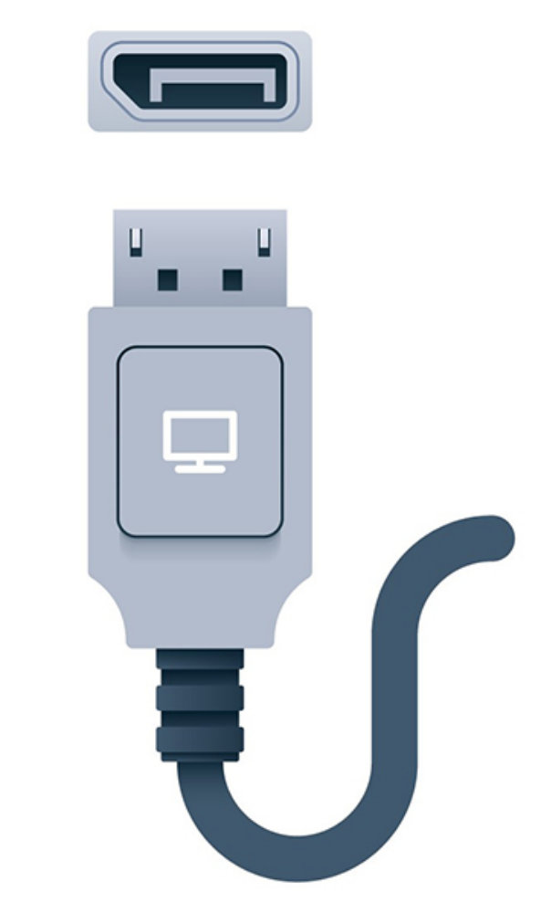
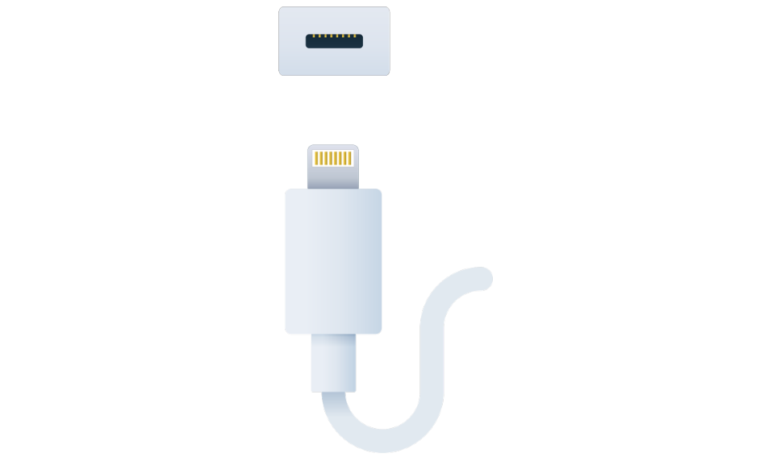
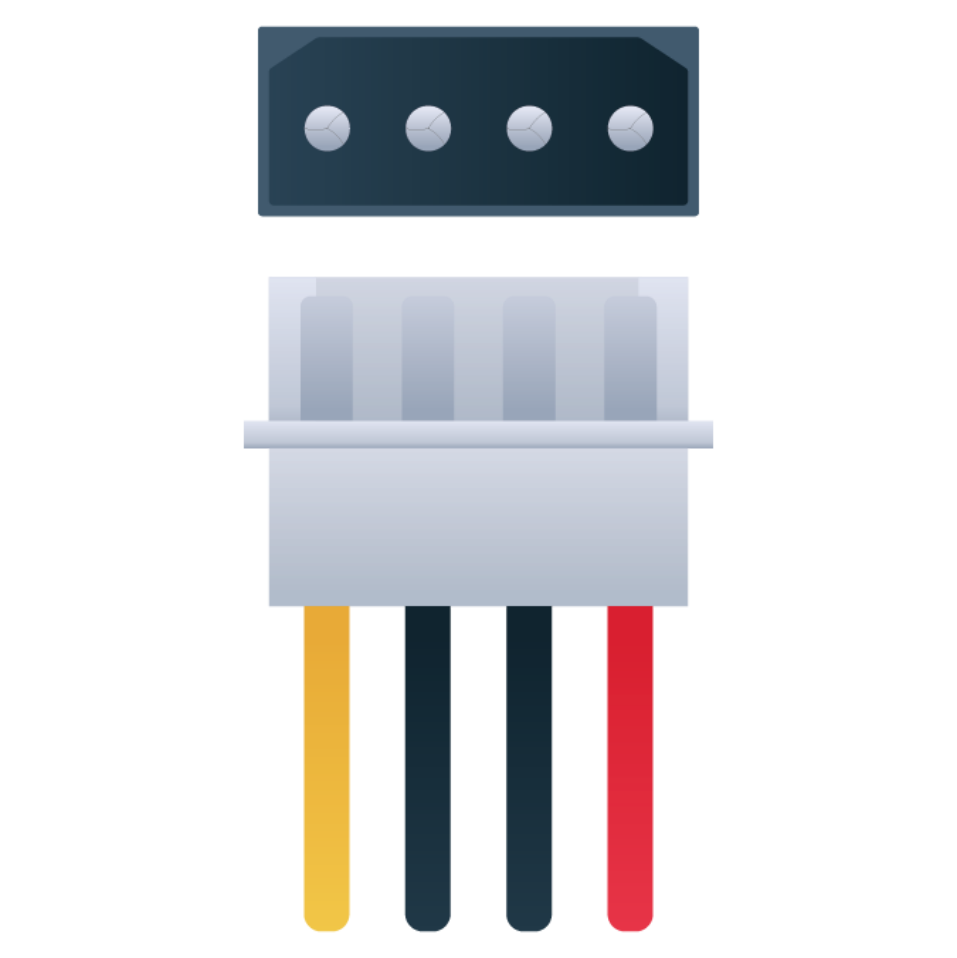

## pc-peripherals
- q-en: Which of the following is an **output** peripheral?
- q-hu: Az alábbiak közül melyik **kimeneti** periféria?
- [ ] Microphone | Mikrofon
- [ ] Keyboard | Billentyűzet
- [x] Speakers | Hangszóró
- [ ] Webcam | Webkamera
- why-en: Speakers (and monitors) output information; microphones, keyboards and cameras are input devices.
- why-hu: A hangszóró (és a monitor) kimeneti eszköz; a mikrofon, a billentyűzet és a kamera bemeneti.

## pc-case
- q-en: Which PC design places the motherboard, CPU and other internal components inside the monitor's case?
- q-hu: Melyik PC-kialakításnál kerül az alaplap, a CPU és a többi belső alkatrész a monitor házába?
- [x] All-in-one | All-in-one
- [ ] Tower | Toronyház (tower)
- [ ] Rack server | Rackszerver
- [ ] Docking station | Dokkolóállomás
- why-en: All-in-one units combine the case and the monitor; a tower is a separate, vertically oriented case.
- why-hu: Az all-in-one gépeknél a ház és a monitor egy egység; a toronyház különálló, függőleges ház.

## pc-opening
- q-en: Before removing the side cover of an unfamiliar tower case, what should you do first?
- q-hu: Mit tegyél először, mielőtt leveszed egy ismeretlen toronyház oldallapját?
- [ ] Remove the front cover | Levenni az előlapot
- [ ] Unplug all USB devices only | Csak az USB-eszközöket kihúzni
- [ ] Remove the PSU | Kiszerelni a tápegységet
- [x] Check the system documentation for the recommended steps | Megnézni a rendszer dokumentációjában az ajánlott lépéseket
- why-en: Cases may use screws, retaining clips or anti-tamper mechanisms; the documentation describes the correct procedure. The front cover often comes off only after the side panel.
- why-hu: A ház csavarokkal, patentekkel vagy illetéktelen hozzáférés elleni megoldással is rögzülhet; a dokumentáció írja le a helyes lépéseket. Az előlap gyakran csak az oldallap után vehető le.

## pc-front-panel
- q-en: What do the LEDs on the front panel of a PC case typically indicate?
- q-hu: Mit jeleznek általában a PC-ház előlapján lévő LED-ek?
- [ ] CPU temperature limits | A CPU hőmérsékleti határait
- [x] Power and drive activity | A bekapcsolt állapotot és a meghajtók működését
- [ ] Network link speed | A hálózati kapcsolat sebességét
- [ ] USB port version | Az USB-port verzióját
- why-en: Front panel LEDs show power status and drive operation.
- why-hu: Az előlap LED-jei a bekapcsolt állapotot és a meghajtók működését mutatják.

## pc-rear-panel
- q-en: What can happen if the PSU's fan exhaust on the rear of the case is obstructed?
- q-hu: Mi történhet, ha a tápegység ventilátorának kifúvója a ház hátoldalán el van takarva?
- [ ] The motherboard I/O ports stop working | Az alaplap I/O portjai leállnak
- [ ] The PC cannot boot from USB | A gép nem tud USB-ről indulni
- [x] Cooling is impaired and components may overheat | Romlik a hűtés, az alkatrészek túlmelegedhetnek
- [ ] The case fan runs in reverse | A házventilátor fordítva forog
- why-en: The PSU's integral fan exhausts hot air; blocking it adversely affects cooling.
- why-hu: A tápegység beépített ventilátora a meleg levegőt fújja ki; ha elzárják, romlik a hűtés.

## pc-blanking-plate
- q-en: After removing an adapter card, a technician leaves the slot open. What is the main risk?
- q-hu: Egy bővítőkártya kiszerelése után a technikus nyitva hagyja a rést. Mi a fő kockázat?
- [ ] Electrostatic discharge to the motherboard | Elektrosztatikus kisülés az alaplapra
- [ ] The PC will not boot without a card | A gép kártya nélkül nem indul el
- [ ] Data loss on the hard drive | Adatvesztés a merevlemezen
- [x] Disrupted airflow, overheating and more dust | Megzavart légáramlás, túlmelegedés és több por
- why-en: Uncovered slots disrupt the airflow around the components; install a blanking plate.
- why-hu: A fedetlen rés megzavarja a légáramlást az alkatrészek körül; takarólemezt kell betenni.

## io-port
- q-en: Which statement about I/O ports is true?
- q-hu: Melyik állítás igaz az I/O portokra?
- [x] They can be provided by the motherboard or by an expansion card | Az alaplap vagy egy bővítőkártya is biztosíthatja őket
- [ ] They are only found on the rear of the case | Csak a ház hátoldalán találhatók
- [ ] Each port supports only one type of device | Minden port csak egyféle eszközt támogat
- [ ] They connect internal drives to the PSU | A belső meghajtókat kötik a tápegységhez
- why-en: External ports are at the rear or front, on the motherboard or an expansion card; some are dedicated, others support many device types.
- why-hu: A külső portok hátul vagy elöl vannak, az alaplapon vagy bővítőkártyán; némelyik egy eszköztípusé, mások sokfélét támogatnak.

## port-bus-connector
- q-en: What is the part of a peripheral cable that is inserted into a port called?
- q-hu: Hogy hívják a periféria kábelének azt a részét, amelyet a portba dugunk?
- [ ] Bus | Busz
- [ ] Host controller
- [x] Connector | Csatlakozó (connector)
- [ ] Lane | Sáv (lane)
- why-en: The connector is the cable end; the port is the connection point on the device; the bus transfers the data.
- why-hu: A csatlakozó a kábel vége; a port az eszközön lévő csatlakozási pont; a busz viszi az adatot.

## keying
- q-en: What is the purpose of keying on a connector?
- q-hu: Mi a csatlakozó kódolásának (keying) célja?
- [ ] To increase the data rate | Az adatátviteli sebesség növelése
- [x] To prevent inserting it the wrong way around | A fordított bedugás megakadályozása
- [ ] To carry power alongside data | Táp átvitele az adat mellett
- [ ] To lock the cable with screws | A kábel csavaros rögzítése
- why-en: Keying is an asymmetric design; the alternative is a reversible connector such as USB-C or Lightning.
- why-hu: A kódolás aszimmetrikus kialakítás; a másik megoldás a megfordítható csatlakozó, pl. USB-C vagy Lightning.

## bits-bytes
- q-en: A transfer rate is given as 80 MBps. How much is that in Mbps?
- q-hu: Egy átviteli sebesség 80 MBps. Mennyi ez Mbps-ben?
- [ ] 10 Mbps
- [ ] 80 Mbps
- [ ] 800 Mbps
- [x] 640 Mbps
- why-en: Uppercase B means bytes; 1 byte = 8 bits, so 80 MBps × 8 = 640 Mbps.
- why-hu: A nagy B bájtot jelent; 1 bájt = 8 bit, így 80 MBps × 8 = 640 Mbps.

## transfer-units
- q-en: In transfer rates, what multiple does "mega" represent?
- q-hu: Az átviteli sebességeknél milyen szorzót jelent a „mega”?
- [ ] 1024
- [x] 1000 × 1000
- [ ] 1024 × 1024 × 1024
- [ ] 8 × 1000
- why-en: Transfer rates use decimal multiples: kilo = 1000, mega = 1000×1000, giga = 1000×1000×1000.
- why-hu: Az átviteli sebességek decimális szorzókat használnak: kilo = 1000, mega = 1000×1000, giga = 1000×1000×1000.

## usb-classes
- q-en: Keyboards and mice belong to which USB device class?
- q-hu: A billentyűzet és az egér melyik USB-eszközosztályba tartozik?
- [ ] Mass storage | Háttértár (mass storage)
- [ ] Audio device | Audioeszköz
- [ ] Printer | Nyomtató
- [x] Human interface | Emberi interfész (HID)
- why-en: USB functions are divided into classes; human interface devices (HID) are keyboards and mice.
- why-hu: Az USB-funkciók osztályokba sorolódnak; a billentyűzet és az egér emberi interfész eszköz (HID).

## usb-host-controller
- q-en: In theory, how many devices can be connected to a single USB host controller?
- q-hu: Elméletben hány eszköz csatlakozhat egyetlen USB host controllerhez?
- [ ] 4
- [ ] 16
- [x] 127
- [ ] 255
- why-en: Up to 127 in theory, but the devices share bandwidth, so motherboards provide several controllers with 3–4 ports each.
- why-hu: Elméletben 127, de az eszközök osztoznak a sávszélességen, ezért az alaplapon több vezérlő van 3–4 porttal.

## usb-2-highspeed
- q-en: Which statement about USB 2.0 HighSpeed is correct?
- q-hu: Melyik állítás igaz az USB 2.0 HighSpeedre?
- [x] 480 Mbps shared by all devices on the controller, half-duplex | 480 Mbps, a vezérlő eszközei osztoznak rajta, félduplex
- [ ] 480 Mbps per device, full-duplex | Eszközönként 480 Mbps, full duplex
- [ ] 5 Gbps shared, half-duplex | 5 Gbps, megosztott, félduplex
- [ ] 12 Mbps per device, full-duplex | Eszközönként 12 Mbps, full duplex
- why-en: HighSpeed's 480 Mbps is shared on the host controller and the bus is half-duplex; full-duplex came with USB 3.x.
- why-hu: A HighSpeed 480 Mbps-ján a host controller eszközei osztoznak, és a busz félduplex; a full duplex az USB 3.x-szel jött.

## usb-3-full-duplex
- q-en: Why does a USB 2.0 mouse not slow down a SuperSpeed drive on the same USB 3 controller?
- q-hu: Miért nem lassítja egy USB 2.0-s egér az ugyanazon USB 3 vezérlőn lévő SuperSpeed meghajtót?
- [ ] USB 3 cables are shielded | Az USB 3 kábelek árnyékoltak
- [ ] The mouse is automatically disabled | Az egér automatikusan letiltódik
- [x] USB 3 controllers have a separate sub-controller for legacy devices | Az USB 3 vezérlőben külön alvezérlő kezeli a régi eszközöket
- [ ] USB 3 uses Power Delivery | Az USB 3 Power Deliveryt használ
- why-en: One sub-controller handles SuperSpeed devices, the other handles LowSpeed/FullSpeed/HighSpeed devices.
- why-hu: Az egyik alvezérlő a SuperSpeed, a másik a LowSpeed/FullSpeed/HighSpeed eszközöket kezeli.

## usb-32-gen1
- q-en: Which legacy designation corresponds to USB 3.2 Gen 1 (5 Gbps)?
- q-hu: Melyik régi elnevezés felel meg az USB 3.2 Gen 1-nek (5 Gbps)?
- [ ] USB 2.0
- [x] USB 3.0
- [ ] USB 3.1 SuperSpeed+
- [ ] USB4
- why-en: USB 3.2 Gen 1 = SuperSpeed 5 Gbps = USB 3.0; Gen 2x1 (10 Gbps) = USB 3.1 SuperSpeed+.
- why-hu: USB 3.2 Gen 1 = SuperSpeed 5 Gbps = USB 3.0; a Gen 2x1 (10 Gbps) = USB 3.1 SuperSpeed+.

## usb-32-gen2x1
- q-en: What is the nominal data rate of a USB port supporting USB 3.2 Gen 2x1?
- q-hu: Mekkora egy USB 3.2 Gen 2x1-et támogató port névleges adatátviteli sebessége?
- [ ] 5 Gbps
- [ ] 480 Mbps
- [ ] 20 Gbps
- [x] 10 Gbps
- why-en: Gen 2x1 is SuperSpeed 10 Gbps (legacy USB 3.1 SuperSpeed+); Gen 1 is 5 Gbps and Gen 2x2 is 20 Gbps.
- why-hu: A Gen 2x1 SuperSpeed 10 Gbps (régi néven USB 3.1 SuperSpeed+); a Gen 1 5 Gbps, a Gen 2x2 20 Gbps.

## usb-32-gen2x2
- q-en: Which connector type is required for USB 3.2 Gen 2x2 (20 Gbps)?
- q-hu: Melyik csatlakozótípus kell az USB 3.2 Gen 2x2-höz (20 Gbps)?
- [x] USB-C
- [ ] USB Type A
- [ ] USB Micro-B
- [ ] Any of USB-A, USB-C or Micro-B | Bármelyik: USB-A, USB-C vagy Micro-B
- why-en: Gen 2x2 runs two 10 Gbps lanes and is only available over USB-C; Gen 1 and Gen 2x1 also work with USB-A and Micro.
- why-hu: A Gen 2x2 két 10 Gbps-os sávot használ, és csak USB-C-n érhető el; a Gen 1 és Gen 2x1 USB-A-val és Micróval is megy.

## usb2-type-a-b
- q-en: You are labeling spare parts. A USB connector is square with a beveled top and is used on a printer. Which type is it?
- q-hu: Alkatrészeket címkézel. Egy USB-csatlakozó négyzetes, levágott felső sarkokkal, és nyomtatón használják. Melyik típus?
- [ ] Type A
- [ ] Type C
- [x] Type B
- [ ] Type B Micro
- why-en: Type B is square with a beveled top and used for large devices such as printers; Type A is a flat rectangle.
- why-hu: A Type B négyzetes, levágott felső sarkokkal, nagyobb eszközökhöz (pl. nyomtató); a Type A lapos téglalap.

## usb2-mini-micro
- q-en: Which USB 2 connector was mostly seen on early digital cameras and is no longer widely used?
- q-hu: Melyik USB 2 csatlakozó volt főleg régi digitális fényképezőgépeken, és ma már ritka?
- [ ] Type B Micro
- [x] Type B Mini
- [ ] Type A
- [ ] USB-C
- why-en: Mini-B was used on early cameras; the flatter Micro-B replaced it on smartphones and tablets.
- why-hu: A Mini-B régi fényképezőkön volt; a laposabb Micro-B váltotta fel okostelefonokon és tableteken.

## usb3-connectors
- q-en: Which combination will physically fit?
- q-hu: Melyik kombináció illeszkedik fizikailag?
- [ ] A USB 3 Type B cable into a USB 2 Type B port | USB 3 Type B kábel USB 2 Type B portba
- [ ] A USB 3 Micro-B cable into a USB 2 Micro-B port | USB 3 Micro-B kábel USB 2 Micro-B portba
- [ ] A USB-C cable into a USB 3 Type A port | USB-C kábel USB 3 Type A portba
- [x] A USB 2 Type A cable into a USB 3 Type A port | USB 2 Type A kábel USB 3 Type A portba
- why-en: USB 3 Type A is physically compatible with USB 1.1/2.0; USB 3 Type B and Micro-B have extra pins and do not fit USB 2 ports.
- why-hu: Az USB 3 Type A fizikailag kompatibilis az USB 1.1/2.0-val; az USB 3 Type B és Micro-B plusz érintkezői miatt nem megy USB 2 portba.

## usb-c
- q-en: Which USB standard introduced the reversible USB-C connector?
- q-hu: Melyik USB-szabvány vezette be a megfordítható USB-C csatlakozót?
- [ ] USB 2.0
- [ ] USB 3.0
- [x] USB 3.1
- [ ] USB 1.1
- why-en: USB 3.1 defines USB-C as a single, compact, reversible and more robust connector.
- why-hu: Az USB 3.1 definiálja az USB-C-t mint egységes, kompakt, megfordítható és strapabíróbb csatlakozót.

## usb-cable-length
- q-en: What is the maximum official cable length for a USB 2.0 HighSpeed device?
- q-hu: Mekkora a hivatalos maximális kábelhossz USB 2.0 HighSpeed eszköznél?
- [ ] 1 m
- [ ] 3 m
- [x] 5 m
- [ ] 10 m
- why-en: FullSpeed and HighSpeed: 5 m; LowSpeed: 3 m; SuperSpeed has no official maximum (≈3 m recommended).
- why-hu: FullSpeed és HighSpeed: 5 m; LowSpeed: 3 m; a SuperSpeednek nincs hivatalos maximuma (kb. 3 m ajánlott).

## usb-power
- q-en: Up to how much power can a USB Power Delivery (PD) port supply with suitable cabling?
- q-hu: Megfelelő kábellel legfeljebb mekkora teljesítményt ad egy USB Power Delivery (PD) port?
- [ ] 4.5 W | 4,5 W
- [ ] 15 W
- [ ] 60 W
- [x] 100 W
- why-en: A basic USB port gives about 4.5 W; a PD-capable port up to 100 W.
- why-hu: Egy alap USB-port kb. 4,5 W-ot ad; a PD-képes port akár 100 W-ot.

## video-bandwidth
- q-en: Approximately how much bandwidth does uncompressed 4K video at 60 fps require?
- q-hu: Körülbelül mekkora sávszélesség kell tömörítetlen 4K videóhoz 60 fps-sel?
- [ ] 480 Mbps
- [ ] 4.5 Gbps | 4,5 Gbps
- [x] 8.91 Gbps | 8,91 Gbps
- [ ] 48 Gbps
- why-en: HD at 60 fps needs 4.5 Gbps, 4K at 60 fps about 8.91 Gbps – resolution and refresh rate drive the bandwidth.
- why-hu: HD 60 fps-sel 4,5 Gbps, 4K 60 fps-sel kb. 8,91 Gbps – a felbontás és a frissítés határozza meg a sávszélességet.

## fps-vs-hz
- q-en: A video plays at 60 fps. Which display refresh rate will show it smoothly without tearing?
- q-hu: Egy videó 60 fps-sel fut. Melyik frissítési frekvencián jelenik meg simán, képszakadás nélkül?
- [ ] 75 Hz
- [ ] 50 Hz
- [ ] 90 Hz
- [x] 120 Hz
- why-en: The refresh rate should match the frame rate or be evenly divisible by it: 120 / 60 = 2.
- why-hu: A frissítési frekvencia egyezzen meg a képkockasebességgel vagy legyen annak egész többszöröse: 120 / 60 = 2.

## lcd-oled
- q-en: What makes an OLED display different from an LCD/TFT "LED" display?
- q-hu: Miben különbözik az OLED kijelző az LCD/TFT „LED” kijelzőtől?
- [ ] It uses a fluorescent tube backlight | Fénycsöves háttérvilágítást használ
- [x] Each pixel is its own light source | Minden pixel saját fényforrás
- [ ] It has no RGB subpixels | Nincsenek RGB alpixelei
- [ ] It can only show HD resolution | Csak HD felbontást tud
- why-en: LCD/TFT panels need a backlight (LED, older ones fluorescent); in OLED every pixel emits light, giving better contrast.
- why-hu: Az LCD/TFT panelnek háttérvilágítás kell (LED, régen fénycső); az OLED-ben minden pixel maga világít, ezért jobb a kontraszt.

## hdmi
- q-en: A monitor connected over HDMI shows a picture but plays no sound through its speakers. What must the video card have for HDMI audio?
- q-hu: Egy HDMI-n csatlakoztatott monitor mutat képet, de a hangszórói nem szólnak. Mi kell a videokártyán a HDMI-s hanghoz?
- [ ] A DisplayPort lane | Egy DisplayPort sáv
- [ ] An HDCP certificate | Egy HDCP tanúsítvány
- [ ] A USB Power Delivery controller | USB Power Delivery vezérlő
- [x] An audio chipset | Audiochip
- why-en: HDMI carries video and audio, but the video card needs an audio chipset to send sound.
- why-hu: A HDMI képet és hangot is visz, de a hang küldéséhez a videokártyán audiochip kell.

## hdmi-connectors
- q-en: What is the type designation of the mini HDMI connector?
- q-hu: Mi a mini HDMI csatlakozó típusjele?
- [ ] Type A
- [ ] Type B
- [x] Type C
- [ ] Type D
- why-en: Full-size = Type A, mini = Type C, micro = Type D.
- why-hu: Teljes méretű = Type A, mini = Type C, micro = Type D.

## hdmi-cable-ratings
- q-en: Which HDMI cable rating supports up to 48 Gbps?
- q-hu: Melyik HDMI-kábelkategória támogat akár 48 Gbps-ot?
- [ ] High Speed (Category 2)
- [ ] Premium High Speed
- [ ] Standard (Category 1)
- [x] Ultra High Speed
- why-en: Ultra High Speed (HDMI 2.1) = up to 48 Gbps; Premium High Speed = up to 18 Gbps.
- why-hu: Ultra High Speed (HDMI 2.1) = max. 48 Gbps; Premium High Speed = max. 18 Gbps.

## displayport
- q-en: Which statement about DisplayPort is correct?
- q-hu: Melyik állítás igaz a DisplayPortra?
- [x] It is a royalty-free standard developed by VESA | Jogdíjmentes szabvány, a VESA fejlesztette
- [ ] It was developed by consumer electronics companies and requires a royalty | Szórakoztatóelektronikai cégek fejlesztették, jogdíjas
- [ ] It cannot carry audio | Nem visz át hangot
- [ ] Its connectors are reversible | A csatlakozói megfordíthatók
- why-en: DisplayPort is VESA's royalty-free standard with audio and content protection; DP++/mDP connectors are keyed. HDMI is the royalty-bearing one.
- why-hu: A DisplayPort a VESA jogdíjmentes szabványa hanggal és tartalomvédelemmel; a DP++/mDP csatlakozók kódoltak. A HDMI a jogdíjas.

## displayport (2)
- q-en: Which video connector is shown in the exhibit?
- q-hu: Melyik videocsatlakozó látható az ábrán?
- [ ] HDMI Type A
- [x] DisplayPort (DP++)
- [ ] DVI | DVI
- [ ] Thunderbolt 3
- why-en: The full-size DisplayPort connector has one beveled corner (keyed) and latches; HDMI is beveled on both sides.
- why-hu: A teljes méretű DisplayPort csatlakozónak egy levágott sarka van (kódolt), és reteszelős; a HDMI mindkét oldalon levágott.
- figure: 

## dp-lanes
- q-en: What is the maximum number of bonded lanes DisplayPort uses?
- q-hu: Legfeljebb hány összevont sávot használ a DisplayPort?
- [ ] 2
- [x] 4
- [ ] 8
- [ ] 16
- why-en: Up to four lanes; per-lane bitrate grew from 2.7 Gbps to up to 20 Gbps in version 2.0.
- why-hu: Legfeljebb négy sáv; a sávonkénti sebesség 2,7 Gbps-ról a 2.0-s verzióban akár 20 Gbps-ra nőtt.

## dp-daisy-chain
- q-en: A technician connects a single port on a graphics card to two monitors using two cables. What type of interface is being used?
- q-hu: Egy technikus a videokártya egyetlen portját két kábellel két monitorhoz köti. Milyen interfészt használ?
- [ ] HDMI
- [ ] VGA
- [x] DisplayPort or Thunderbolt (daisy-chaining) | DisplayPort vagy Thunderbolt (láncba fűzés)
- [ ] USB 2.0
- why-en: DisplayPort and Thunderbolt support daisy-chaining several monitors from one port; HDMI needs one video card port per monitor.
- why-hu: A DisplayPort és a Thunderbolt támogatja több monitor láncba fűzését egy portról; HDMI-nél monitoronként egy port kell.

## tb-1-2
- q-en: Thunderbolt 1 and 2 share their physical interface with which connector?
- q-hu: A Thunderbolt 1 és 2 melyik csatlakozóval azonos fizikai kialakítású?
- [ ] USB-C
- [ ] HDMI Type C
- [x] MiniDP | MiniDP (Mini DisplayPort)
- [ ] eSATA
- why-en: Thunderbolt 1/2 use the MiniDP interface (marked with a flash icon); Thunderbolt 3 switched to USB-C.
- why-hu: A Thunderbolt 1/2 a MiniDP csatlakozót használja (villám ikonnal jelölve); a Thunderbolt 3 tért át az USB-C-re.

## tb-3
- q-en: A user plugs a Thunderbolt 3 device into a USB-C port that has no flash icon. What happens?
- q-hu: Egy felhasználó Thunderbolt 3 eszközt dug egy villám ikon nélküli USB-C portba. Mi történik?
- [ ] It works at USB speeds | USB-sebességgel működik
- [x] It will not work, because the port is not Thunderbolt-enabled | Nem működik, mert a port nem Thunderbolt-képes
- [ ] It works at full 40 Gbps | Teljes 40 Gbps-sel működik
- [ ] It works only with a 0.5 m cable | Csak 0,5 m-es kábellel működik
- why-en: A USB device works in a Thunderbolt 3 port, but not the other way round: Thunderbolt devices need a Thunderbolt-enabled port.
- why-hu: USB-eszköz működik Thunderbolt 3 portban, de fordítva nem: a Thunderbolt-eszközhöz Thunderbolt-képes port kell.

## lightning
- q-en: True or false: USB-C ports and connectors are compatible with Apple Lightning connectors and ports.
- q-hu: Igaz vagy hamis: az USB-C portok és csatlakozók kompatibilisek az Apple Lightning csatlakozókkal és portokkal.
- [ ] True – both are reversible | Igaz – mindkettő megfordítható
- [ ] True, but only for charging | Igaz, de csak töltésre
- [ ] True for USB-C 3.1 and later | Igaz az USB-C 3.1-től
- [x] False – Lightning is proprietary and needs an adapter cable | Hamis – a Lightning gyártóspecifikus, átalakító kábel kell
- why-en: Lightning is a proprietary Apple connector; use e.g. a Lightning-to-USB C cable.
- why-hu: A Lightning az Apple saját csatlakozója; pl. Lightning–USB C kábelt kell használni.

## lightning (2)
- q-en: Which connector is shown in the exhibit?
- q-hu: Melyik csatlakozó látható az ábrán?
- [x] Apple Lightning
- [ ] USB Micro-B
- [ ] USB-C
- [ ] Mini-HDMI
- why-en: A small reversible plug with exposed contacts on both faces, used on iPhones and iPads.
- why-hu: Kicsi, megfordítható dugó, mindkét oldalán érintkezőkkel – iPhone-on és iPaden használják.
- figure: 

## sata-interface
- q-en: How many devices does a single SATA host adapter port support?
- q-hu: Hány eszközt támogat egyetlen SATA host adapter port?
- [x] One | Egyet
- [ ] Two (master/slave) | Kettőt (master/slave)
- [ ] Up to 7 | Legfeljebb 7-et
- [ ] Up to 127 | Legfeljebb 127-et
- why-en: Each SATA port supports a single device; master/slave pairs belonged to legacy PATA/IDE, 127 devices to USB.
- why-hu: Minden SATA port egyetlen eszközt támogat; a master/slave pár a régi PATA/IDE-re, a 127 eszköz az USB-re jellemző.

## sata-power
- q-en: Which connector supplies power to a SATA drive?
- q-hu: Melyik csatlakozó adja a SATA meghajtó tápellátását?
- [ ] The 7-pin SATA data connector | A 7 tűs SATA adatcsatlakozó
- [x] A separate 15-pin SATA power connector | Egy külön 15 tűs SATA tápcsatlakozó
- [ ] A 4-pin USB connector | Egy 4 tűs USB-csatlakozó
- [ ] The eSATAp port | Az eSATAp port
- why-en: The 7-pin data cable is unpowered; power comes from the PSU via the 15-pin SATA power connector (or a legacy Molex).
- why-hu: A 7 tűs adatkábel nem visz tápot; a tápegység a 15 tűs SATA tápcsatlakozón (vagy régi Molexen) adja.

## sata-revisions
- q-en: What is the maximum transfer rate of SATA revision 3?
- q-hu: Mekkora a SATA revision 3 maximális átviteli sebessége?
- [ ] 150 MBps
- [ ] 300 MBps
- [x] 600 MBps
- [ ] 6000 MBps
- why-en: SATA 1 = 150 MBps, revision 2 = 300 MBps, revision 3 = 600 MBps.
- why-hu: SATA 1 = 150 MBps, revision 2 = 300 MBps, revision 3 = 600 MBps.

## molex
- q-en: Which wire colour on a Molex power connector carries 12 VDC?
- q-hu: Melyik színű vezeték visz 12 V DC-t a Molex tápcsatlakozóban?
- [ ] Red | Piros
- [ ] Black | Fekete
- [ ] Orange | Narancssárga
- [x] Yellow | Sárga
- why-en: Molex: red = 5 VDC, yellow = 12 VDC, black = ground. (Orange 3.3 V appears in the SATA power connector.)
- why-hu: Molex: piros = 5 V DC, sárga = 12 V DC, fekete = föld. (A narancssárga 3,3 V a SATA tápcsatlakozóban van.)

## molex (2)
- q-en: Only two of the five plugs of the type shown are connected to devices. What are they for, and can the others stay unconnected?
- q-hu: Az ábrán látható típusú öt dugóból csak kettő csatlakozik eszközhöz. Mire valók, és maradhat-e szabadon a többi?
- [ ] SATA data plugs – all must be connected | SATA adatdugók – mindet be kell kötni
- [x] Molex power plugs for legacy devices – unused ones can stay unconnected | Molex tápdugók régi eszközökhöz – a nem használtak szabadon maradhatnak
- [ ] Fan headers – unused ones must be capped | Ventilátorcsatlakozók – a nem használtakat le kell zárni
- [ ] eSATA plugs – they must be removed | eSATA dugók – el kell távolítani őket
- why-en: The 4-pin white/clear Molex connector powers legacy devices from the PSU; spare plugs can be left unconnected.
- why-hu: A 4 tűs fehér/átlátszó Molex csatlakozó a régi eszközöket látja el a tápegységről; a fölösleges dugók szabadon maradhatnak.
- figure: 

## esata
- q-en: A user wants to connect an external drive to an eSATA port using a spare internal SATA cable. What do you advise?
- q-hu: Egy felhasználó egy tartalék belső SATA kábellel akar külső meghajtót eSATA portra kötni. Mit tanácsolsz?
- [ ] It works up to 2 m | Működik 2 m-ig
- [ ] It works, but only at 150 MBps | Működik, de csak 150 MBps-sel
- [x] Use a proper eSATA cable – internal SATA cables cannot be used | Megfelelő eSATA kábelt kell használni – belső SATA kábel nem jó
- [ ] Use a Molex adapter | Molex adaptert kell használni
- why-en: eSATA requires an eSATA cable (up to 2 m); internal SATA cables are not suitable.
- why-hu: Az eSATA-hoz eSATA kábel kell (max. 2 m); a belső SATA kábel nem megfelelő.
