# Explain Cable Types and Connectors

## Personal Computers {#pc}
hu: Személyi számítógépek

- **Peripheral vs. internal components** {#pc-peripherals}
  - hu-title: Perifériák és belső alkatrészek
  - en: PC components are split into **peripheral devices**, which the user handles, and **internal components**, which would be damaged or dangerous if exposed. Peripherals provide **input** (keyboard, mouse, microphone, camera), **output** (monitor, speakers) or **external storage**.
  - hu: A PC részei **perifériákra** (ezeket a felhasználó kezeli) és **belső alkatrészekre** oszlanak – utóbbiak sérülnének vagy veszélyesek lennének, ha szabadon lennének. A perifériák **bemeneti** (billentyűzet, egér, mikrofon, kamera), **kimeneti** (monitor, hangszóró) vagy **külső tároló** funkciót látnak el.
  - concepts: input | bemenet | bemeneti ; output | kimenet | kimeneti ; external storage | külső tároló | külső tárolás

- **What the system case houses** {#pc-case}
  - hu-title: Mit tartalmaz a számítógépház
  - en: The **system case (chassis)** houses the motherboard, CPU, system memory, adapter cards, fixed disks and the **power supply unit (PSU)**. Most cases are **tower** form factor (vertical, on the desk or floor); **all-in-one** PCs put the internal components inside the monitor's case.
  - hu: A **számítógépház (chassis)** tartalmazza az alaplapot, a processzort, a rendszermemóriát, a bővítőkártyákat, a beépített lemezeket és a **tápegységet (PSU)**. A legtöbb ház **torony** (tower) kialakítású, függőlegesen áll; az **all-in-one** gépeknél a belső alkatrészek a monitor házában vannak.
  - concepts: motherboard | alaplap ; power supply | PSU | tápegység ; tower | torony ; all-in-one | monitorba épített

- **Opening a tower case** {#pc-opening}
  - hu-title: A toronyház kinyitása
  - en: A tower case has a **side cover** that slides out of its housing. It may be secured by **screws or retaining clips** and can have **anti-tamper** security mechanisms. Always check the **system documentation** and follow the recommended steps.
  - hu: A toronyház **oldallapja** kicsúsztatható a helyéről. **Csavarok vagy rögzítőpatentek** tarthatják, és lehet rajta **illetéktelen hozzáférés elleni** védelem. Mindig nézd meg a **rendszer dokumentációját**, és kövesd az ajánlott lépéseket.
  - concepts: side cover | side panel | oldallap ; screws | csavar | clips | patent ; anti-tamper | illetéktelen ; documentation | dokumentáció

- **Front panel** {#pc-front-panel}
  - hu-title: Előlap
  - en: The front panel gives access to **removable media drives**, the **power on/off switch** and **LEDs** that show drive activity; front I/O ports (USB, audio) are also common. The front cover may only come off after the **side panel** is removed, because its screws or clips are behind it.
  - hu: Az előlapon érhetők el a **cserélhető adathordozós meghajtók**, a **be-/kikapcsoló gomb** és a meghajtók működését jelző **LED-ek**; gyakoriak az elülső I/O portok (USB, audio) is. Az előlap sokszor csak az **oldallap** levétele után vehető le, mert a rögzítő csavarok/patentek mögötte vannak.
  - concepts: power switch | power button | bekapcsoló ; LED | LEDs ; removable media | optical drive | cserélhető adathordozó | optikai meghajtó
  - figure: 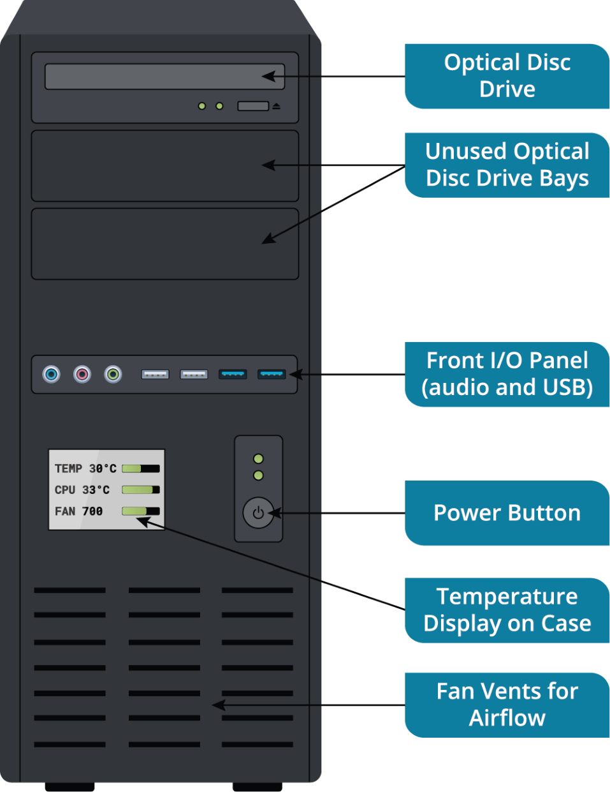

- **Rear panel** {#pc-rear-panel}
  - hu-title: Hátlap
  - en: The rear panel has the **PSU sockets** and the PSU's **integral fan exhaust**, which must never be obstructed or cooling suffers; there may be an extra **case fan**. Below the PSU is a cutout aligned with the motherboard's **I/O ports**.
  - hu: A hátlapon vannak a **tápegység csatlakozói** és a tápegység **beépített ventilátorának kifúvója** – ezt soha nem szabad eltakarni, különben romlik a hűtés; lehet egy további **házventilátor** is. A tápegység alatt van az alaplap **I/O portjaihoz** igazított kivágás.
  - concepts: PSU | power supply | tápegység ; fan exhaust | fan | ventilátor ; I/O ports | I/O
  - figure: 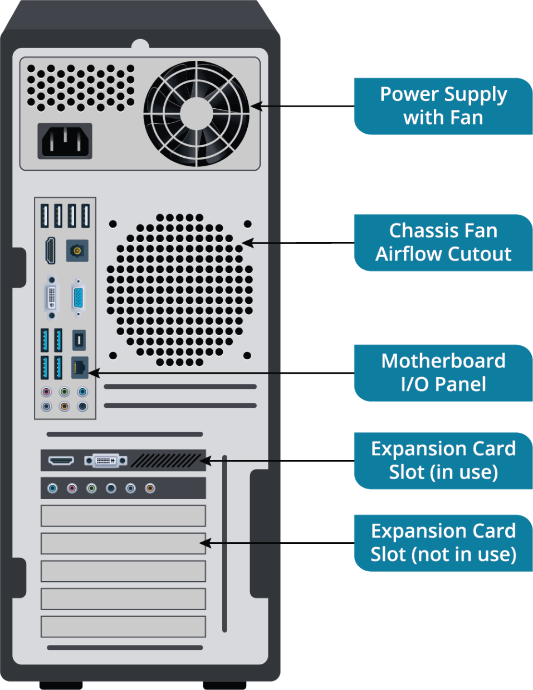

- **Blanking plates** {#pc-blanking-plate}
  - hu-title: Takarólemezek
  - en: The cutout slots at the bottom of the rear panel line up with the **adapter card slots**. Each must be covered by a card or by a metal **blanking plate**: an open slot disrupts the **airflow**, which leads to **overheating** and more **dust** inside the PC. So after removing a card, install a blanking plate.
  - hu: A hátlap alján lévő kivágások a **bővítőkártya-helyekhez** igazodnak. Mindegyiket kártyának vagy fém **takarólemeznek** (blanking plate) kell fednie: a nyitott rés megzavarja a **légáramlást**, ami **túlmelegedéshez** és több **porhoz** vezet. Kártya kiszerelése után tehát takarólemezt kell betenni.
  - concepts: blanking plate | takarólemez ; airflow | légáramlás ; overheating | túlmelegedés ; dust | por

## Peripheral Devices and Interfaces {#peripherals}
hu: Perifériák és csatlakozási felületek

- **I/O ports** {#io-port}
  - hu-title: I/O portok
  - en: An **input/output (I/O) port** lets a device connect to the PC through a **peripheral cable**. Some ports are dedicated to one device type (e.g. a graphics port for a monitor), others support many types. External ports sit at the rear or front of the case and are provided either by the **motherboard** or by an **expansion card**.
  - hu: Az **I/O (bemeneti/kimeneti) port** révén egy eszköz **periféria kábellel** csatlakozik a PC-hez. Egyes portok egy eszköztípusra szolgálnak (pl. grafikus port a monitornak), mások sokfélét támogatnak. A külső portok a ház hátoldalán vagy elején vannak, és az **alaplap** vagy egy **bővítőkártya** biztosítja őket.
  - concepts: I/O | input/output | bemeneti/kimeneti ; peripheral cable | periféria kábel ; motherboard | alaplap ; expansion card | bővítőkártya
  - figure: 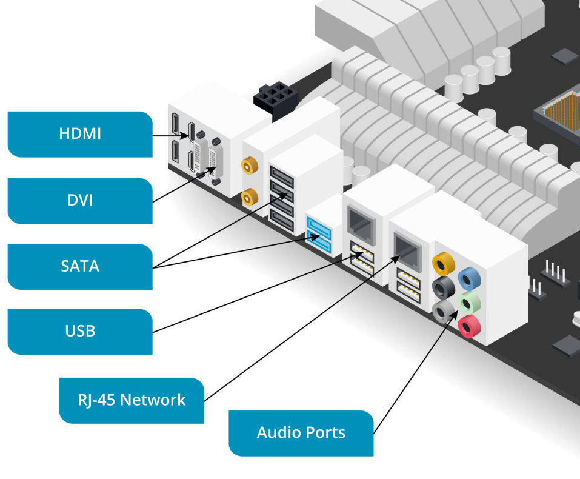

- **Port vs. bus vs. connector** {#port-bus-connector}
  - hu-title: Port, busz és csatlakozó
  - en: A **bus** transfers data to and from devices. A **port** is the external connection point for a particular bus interface. A **connector** is the end of the cable that plugs into a port of the same shape (**form factor**). One bus interface can use several connector form factors (e.g. USB Micro-B on the drive, USB Type A on the PC).
  - hu: A **busz** adatot visz az eszközökhöz és vissza. A **port** egy adott buszinterfész külső csatlakozási pontja. A **csatlakozó** (connector) a kábel vége, amely az azonos alakú (**formatényezőjű**) portba illeszkedik. Egy buszinterfész többféle csatlakozó-formát is használhat (pl. USB Micro-B a meghajtón, USB Type A a PC-n).
  - concepts: bus | busz ; port | connection point | csatlakozási pont ; connector | csatlakozó ; form factor | formatényező | alak
  - figure: 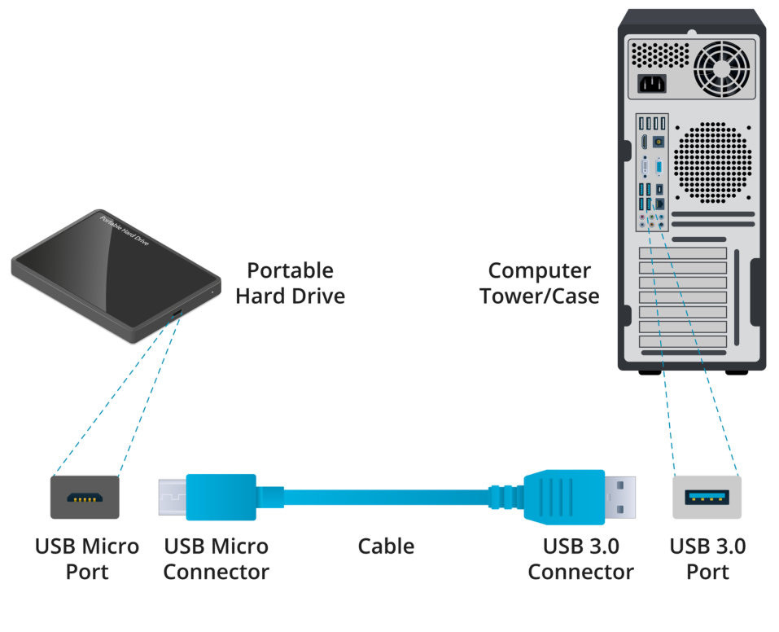

- **Keying and reversible connectors** {#keying}
  - hu-title: Kódolt (aszimmetrikus) és megfordítható csatlakozók
  - en: Most connectors and ports use **edge contacts** and are either **keyed** – an asymmetric design that prevents inserting them the wrong way around – or **reversible**, so they work either way up.
  - hu: A legtöbb csatlakozó és port **élérintkezős**, és vagy **kódolt** (keying) – aszimmetrikus kialakítás, amely megakadályozza a fordított bedugást –, vagy **megfordítható**, így bármelyik állásban működik.
  - concepts: keying | keyed | kódolt | aszimmetrikus ; reversible | megfordítható ; edge contacts | élérintkező

- **Bits and bytes** {#bits-bytes}
  - hu-title: Bit és bájt
  - en: A **bit (b)** is a single binary digit, 0 or 1. A **byte (B)** is **8 bits**. A lowercase **b** in a unit means bits, an uppercase **B** means bytes – so 100 Mbps and 100 MBps differ by a factor of 8.
  - hu: A **bit (b)** egyetlen bináris számjegy: 0 vagy 1. A **bájt (B)** **8 bit**. Mértékegységben a kis **b** bitet, a nagy **B** bájtot jelent – így a 100 Mbps és a 100 MBps között nyolcszoros a különbség.
  - concepts: 8 bits | 8 bit | eight bits ; lowercase | kisbetű | kis b ; uppercase | nagybetű | nagy B

- **Transfer rate units** {#transfer-units}
  - hu-title: Átviteli sebesség mértékegységei
  - en: Transfer rates use **decimal** multiples per second: **kilo** = 1000 (Kbps, KBps), **mega** = 1000×1000 (Mbps, MBps), **giga** = 1000×1000×1000 (Gbps, GBps).
  - hu: Az átviteli sebességek **decimális** (tízes alapú) többszörösöket használnak másodpercenként: **kilo** = 1000 (Kbps, KBps), **mega** = 1000×1000 (Mbps, MBps), **giga** = 1000×1000×1000 (Gbps, GBps).
  - concepts: 1000 | ezer ; decimal | decimális | tízes ; per second | másodperc

## Universal Serial Bus Cables {#usb}
hu: USB-kábelek

- **USB device classes** {#usb-classes}
  - hu-title: USB-eszközosztályok
  - en: **USB** is the standard way to connect most peripherals. USB device functions are grouped into **classes**, e.g. **human interface** (keyboards, mice), **mass storage** (disk drives), **printer** and **audio device**.
  - hu: Az **USB** a legtöbb periféria szabványos csatlakoztatási módja. Az USB-eszközök funkciói **osztályokba** sorolódnak, pl. **emberi interfész** (HID: billentyűzet, egér), **háttértár** (mass storage, lemezmeghajtók), **nyomtató** és **audioeszköz**.
  - concepts: classes | osztály ; human interface | HID | emberi interfész ; mass storage | háttértár ; printer | nyomtató

- **USB host controller** {#usb-host-controller}
  - hu-title: USB host controller (gazdavezérlő)
  - en: A USB bus is managed by a **host controller**; each controller has several ports on the same bus. In theory **127 devices** can connect to one controller, but because they share bandwidth, motherboards provide **multiple controllers with 3–4 ports each**.
  - hu: Az USB-buszt egy **host controller (gazdavezérlő)** kezeli; egy vezérlőhöz több port tartozik ugyanazon a buszon. Elméletben **127 eszköz** csatlakozhat egy vezérlőhöz, de mivel osztoznak a sávszélességen, az alaplapokon **több vezérlő van, egyenként 3–4 porttal**.
  - concepts: host controller | gazdavezérlő | vezérlő ; 127 ; shared bandwidth | bandwidth | sávszélesség ; multiple controllers | több vezérlő

- **USB 2.0 HighSpeed** {#usb-2-highspeed}
  - hu-title: USB 2.0 HighSpeed
  - en: USB 2.0 **HighSpeed** has a data rate of **480 Mbps**, **shared** between all devices on the same host controller. The bus is **half-duplex**: a device can send or receive, but not at the same time.
  - hu: Az USB 2.0 **HighSpeed** adatátviteli sebessége **480 Mbps**, amelyen az ugyanazon host controllerre kötött eszközök **osztoznak**. A busz **félduplex**: egy eszköz küldhet vagy fogadhat, de egyszerre nem.
  - concepts: 480 Mbps | 480 Mb/s ; shared | megosztott | osztoznak ; half-duplex | félduplex

- **USB 3.x: full-duplex and two sub-controllers** {#usb-3-full-duplex}
  - hu-title: USB 3.x: full duplex és két alvezérlő
  - en: USB 3.x transfer rates are **full-duplex** – a device can send and receive simultaneously. USB 3 controllers have **two sub-controllers**: one for **SuperSpeed** devices and one for **legacy** LowSpeed/FullSpeed/HighSpeed (USB 1.1 and 2.0) devices, so old devices **do not slow down** SuperSpeed ones.
  - hu: Az USB 3.x sebességek **full duplexek** – egy eszköz egyszerre küldhet és fogadhat. Az USB 3 vezérlőkben **két alvezérlő** van: egy a **SuperSpeed** eszközöknek, egy a **régi** LowSpeed/FullSpeed/HighSpeed (USB 1.1 és 2.0) eszközöknek, így a régi eszközök **nem lassítják** a SuperSpeed eszközöket.
  - concepts: full-duplex | full duplex | duplex ; two sub-controllers | sub-controller | két alvezérlő | alvezérlő ; legacy | régi ; not slow down | nem lassít

- **USB 3.2 Gen 1** {#usb-32-gen1}
  - hu-title: USB 3.2 Gen 1
  - en: **USB 3.2 Gen 1** = SuperSpeed USB **5 Gbps**. Connectors: USB-A, USB-C, USB Micro. Legacy name: **USB 3.0**.
  - hu: **USB 3.2 Gen 1** = SuperSpeed USB **5 Gbps**. Csatlakozók: USB-A, USB-C, USB Micro. Régi elnevezése: **USB 3.0**.
  - concepts: 5 Gbps | 5 Gb/s ; USB 3.0 ; SuperSpeed

- **USB 3.2 Gen 2x1** {#usb-32-gen2x1}
  - hu-title: USB 3.2 Gen 2x1
  - en: **USB 3.2 Gen 2x1** = SuperSpeed USB **10 Gbps**. Connectors: USB-A, USB-C, USB Micro. Legacy name: **USB 3.1 SuperSpeed+**.
  - hu: **USB 3.2 Gen 2x1** = SuperSpeed USB **10 Gbps**. Csatlakozók: USB-A, USB-C, USB Micro. Régi elnevezése: **USB 3.1 SuperSpeed+**.
  - concepts: 10 Gbps | 10 Gb/s ; USB 3.1 ; SuperSpeed+ | SuperSpeed plus

- **USB 3.2 Gen 2x2** {#usb-32-gen2x2}
  - hu-title: USB 3.2 Gen 2x2
  - en: **USB 3.2 Gen 2x2** = SuperSpeed USB **20 Gbps**, delivered as **2 × 10 Gbps** lanes. It works over **USB-C** connectors only.
  - hu: **USB 3.2 Gen 2x2** = SuperSpeed USB **20 Gbps**, **2 × 10 Gbps** sávon. Csak **USB-C** csatlakozóval működik.
  - concepts: 20 Gbps | 20 Gb/s ; 2 x 10 Gbps | 2 × 10 | two lanes | két sáv ; USB-C | only USB-C | csak USB-C

- **USB 2 Type A and Type B** {#usb2-type-a-b}
  - hu-title: USB 2 Type A és Type B
  - en: **Type A** connects to the **host** (and some peripherals); connector and port are **flat rectangles**, inserted with the USB symbol facing up. **Type B** is for large devices such as **printers**; it is **square with a beveled top**.
  - hu: A **Type A** a **hosthoz** (és néhány perifériához) csatlakozik; a csatlakozó és a port **lapos téglalap** alakú, az USB-jellel felfelé dugjuk be. A **Type B** nagyobb eszközökhöz, pl. **nyomtatókhoz** való; **négyzetes, levágott felső sarkokkal**.
  - concepts: flat rectangle | rectangle | téglalap ; host ; printer | nyomtató ; square | négyzet ; beveled | levágott
  - figure: 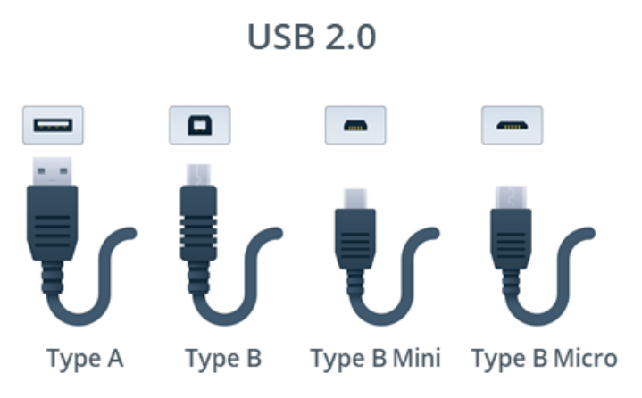

- **USB 2 Mini-B and Micro-B** {#usb2-mini-micro}
  - hu-title: USB 2 Mini-B és Micro-B
  - en: **Type B Mini** is a smaller peripheral connector seen on early **digital cameras**, no longer widely used. **Type B Micro** replaced it on small devices such as **smartphones and tablets**; it is noticeably **flatter** than Mini.
  - hu: A **Type B Mini** kisebb periféria-csatlakozó, főleg régi **digitális fényképezőgépeken** volt; ma már ritka. A **Type B Micro** váltotta fel a kis eszközökön, pl. **okostelefonokon és tableteken**; jóval **laposabb**, mint a Mini.
  - concepts: Mini | Mini-B ; digital camera | fényképező ; Micro | Micro-B ; smartphones | tablets | okostelefon ; flatter | laposabb

- **USB 3 connectors and compatibility** {#usb3-connectors}
  - hu-title: USB 3 csatlakozók és kompatibilitás
  - en: USB 3 has new Type A, Type B and Micro-B connectors with **extra pins**, often with a **blue** tab or housing. **USB 3 Type A is physically compatible** with USB 1.1/2.0, but **Type B and Micro-B are not**: a USB 2 Type A cable fits a USB 3 Type A port, but a USB 3 Type B cable will not fit a USB 2 Type B port.
  - hu: Az USB 3-ban új Type A, Type B és Micro-B csatlakozók vannak **plusz érintkezőkkel**, gyakran **kék** füllel vagy házzal. **Az USB 3 Type A fizikailag kompatibilis** az USB 1.1/2.0-val, **a Type B és a Micro-B viszont nem**: USB 2 Type A kábel jó az USB 3 Type A portba, de USB 3 Type B kábel nem megy bele USB 2 Type B portba.
  - concepts: blue | kék ; extra pins | additional pins | plusz érintkező ; Type A compatible | Type A kompatibilis ; Type B not compatible | Type B nem
  - figure: 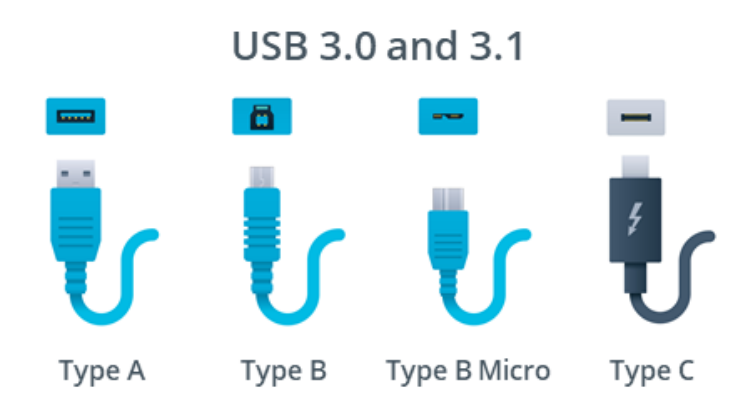

- **USB-C** {#usb-c}
  - hu-title: USB-C
  - en: **USB-C** was defined with **USB 3.1** as a single, consistent, compact connector. It is **reversible** (either way up) and **more robust** than Mini-B/Micro-B. Cables can be USB-C at both ends, or **converter cables** to USB Type A or Type B.
  - hu: Az **USB-C**-t az **USB 3.1** vezette be egységes, kompakt csatlakozóként. **Megfordítható** (bármelyik állásban bedugható), és **strapabíróbb**, mint a Mini-B/Micro-B. A kábel lehet mindkét végén USB-C, vagy **átalakító kábel** USB Type A vagy Type B felé.
  - concepts: reversible | megfordítható ; USB 3.1 ; robust | strapabíró | tartósabb ; converter | átalakító | adapter

- **USB cable length** {#usb-cable-length}
  - hu-title: USB-kábelhossz
  - en: Maximum cable length: **LowSpeed 3 m**; **FullSpeed and HighSpeed 5 m**. SuperSpeed cables have **no official maximum**, but up to about **3 m** is recommended. Vendors may sell longer cables.
  - hu: Maximális kábelhossz: **LowSpeed 3 m**; **FullSpeed és HighSpeed 5 m**. A SuperSpeed kábeleknek **nincs hivatalos maximuma**, de kb. **3 m** az ajánlott. A gyártók forgalmazhatnak hosszabb kábelt is.
  - concepts: 3 m | 3 méter | 3 meters ; 5 m | 5 méter | 5 meters ; no official maximum | nincs hivatalos

- **USB power and Power Delivery** {#usb-power}
  - hu-title: USB-tápellátás és Power Delivery
  - en: Besides data, USB supplies **power**; most Type A and Type C ports can charge a connected device. A basic USB port gives up to about **4.5 W**; a **Power Delivery (PD)** port can supply up to **100 W** with suitable connectors and cabling.
  - hu: Az USB az adat mellett **tápellátást** is ad; a legtöbb Type A és Type C port tölti a csatlakoztatott eszközt. Egy alap USB-port kb. **4,5 W**-ot ad; a **Power Delivery (PD)** port megfelelő csatlakozókkal és kábellel akár **100 W**-ot.
  - concepts: 4.5 W | 4,5 W | 4.5 watt ; Power Delivery | PD ; 100 W | 100 watt

## HDMI and DisplayPort Video Cables {#video}
hu: HDMI és DisplayPort videokábelek

- **What determines video bandwidth** {#video-bandwidth}
  - hu-title: Mi határozza meg a videó sávszélességét
  - en: Two factors: the **resolution** (e.g. HD 1920×1200, 4K 3840×2160) and how often the image is redrawn, in **Hz or fps**. Uncompressed **HD at 60 fps needs 4.5 Gbps**, **4K at 60 fps needs 8.91 Gbps** – which is why video uses dedicated interfaces.
  - hu: Két tényező: a **felbontás** (pl. HD 1920×1200, 4K 3840×2160) és a kép újrarajzolásának gyakorisága **Hz-ben vagy fps-ben**. Tömörítetlen **HD 60 fps-sel 4,5 Gbps-ot**, **4K 60 fps-sel 8,91 Gbps-ot** igényel – ezért kap a videó külön interfészt.
  - concepts: resolution | felbontás ; refresh | frame rate | fps | frissítés ; 4.5 Gbps | 4,5 Gbps ; 8.91 Gbps | 8,91 Gbps

- **Frame rate vs. refresh rate** {#fps-vs-hz}
  - hu-title: Képkockasebesség és frissítési frekvencia
  - en: **fps** (frame rate) describes the **video source**; **Hz** (refresh rate) describes the **display and interface**. To avoid **ghosting and tearing**, the refresh rate should **match** the frame rate or be **evenly divisible** by it – e.g. 60 fps on a 120 Hz display plays smoothly.
  - hu: Az **fps** (képkockasebesség) a **videóforrást** jellemzi, a **Hz** (frissítési frekvencia) a **kijelzőt és az interfészt**. A **szellemkép és a képszakadás** (ghosting, tearing) elkerüléséhez a frissítési frekvencia **egyezzen meg** a képkockasebességgel, vagy legyen annak **egész számú többszöröse** – pl. 60 fps 120 Hz-es kijelzőn simán fut.
  - concepts: fps | frame rate | képkocka ; Hz | hertz | refresh rate | frissítési ; divisible | többszörös | match | egyezzen ; tearing | ghosting | képszakadás | szellemkép

- **LCD/TFT and OLED displays** {#lcd-oled}
  - hu-title: LCD/TFT és OLED kijelzők
  - en: In an **LCD TFT** panel each pixel has **red, green and blue (RGB)** filtered cells, each controlled by a **transistor**; the panel is lit by an **LED backlight** (older ones: fluorescent tubes), hence "LED display". In **OLED** displays **each pixel is its own light source**, giving much better **contrast** and colour fidelity.
  - hu: Az **LCD TFT** panelen minden pixel **piros, zöld és kék (RGB)** szűrős cellákból áll, ezeket egy-egy **tranzisztor** vezérli; a panelt **LED-es háttérvilágítás** világítja meg (a régieket fénycső), innen a „LED-kijelző” név. Az **OLED** kijelzőn **minden pixel saját fényforrás**, így sokkal jobb a **kontraszt** és a színhűség.
  - concepts: TFT | transistor | tranzisztor ; RGB ; backlight | háttérvilágítás ; OLED ; own light source | saját fényforrás | contrast | kontraszt

- **HDMI** {#hdmi}
  - hu-title: HDMI
  - en: **HDMI** (High-Definition Multimedia Interface) is the **most widely used video interface**, on TVs, consoles, Blu-ray players and PC monitors. It carries **video and audio**, remote control and **HDCP** content protection; newer versions add **4K/8K** and variable refresh rate. Audio over HDMI needs an **audio chipset** on the video card.
  - hu: A **HDMI** (High-Definition Multimedia Interface) a **legelterjedtebb videointerfész**: tévéken, konzolokon, Blu-ray lejátszókon és PC-monitorokon. **Képet és hangot**, távvezérlést és **HDCP** tartalomvédelmet visz át; az újabb verziók **4K/8K**-t és változó frissítési frekvenciát is tudnak. A HDMI-s hanghoz a videokártyán **audiochip** kell.
  - concepts: video and audio | audio | hang ; HDCP | content protection | tartalomvédelem ; most widely used | legelterjedtebb ; 4K | 8K

- **HDMI connector types** {#hdmi-connectors}
  - hu-title: HDMI csatlakozótípusok
  - en: HDMI connectors: **full-size (Type A)**, **mini (Type C)** and **micro (Type D)**. All are **beveled** so they can only be inserted the correct way round.
  - hu: HDMI csatlakozók: **teljes méretű (Type A)**, **mini (Type C)** és **micro (Type D)**. Mindegyik **levágott sarkú**, így csak a helyes irányban dugható be.
  - concepts: Type A | full-size | teljes méretű ; mini | Type C ; micro | Type D ; beveled | levágott sarkú
  - figure: 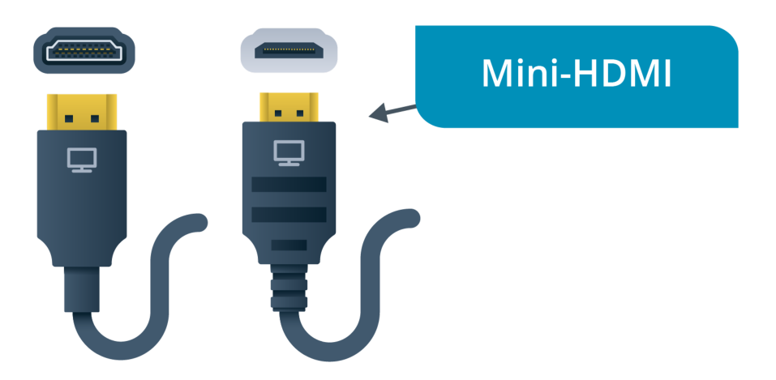

- **HDMI cable ratings** {#hdmi-cable-ratings}
  - hu-title: HDMI-kábelkategóriák
  - en: **Standard (Category 1)** and **High Speed (Category 2)**: High Speed supports longer cables and is required for v1.4 features such as **4K** and refresh rates **over 60 Hz**. HDMI 2.0 and 2.1 add **Premium High Speed (up to 18 Gbps)** and **Ultra High Speed (up to 48 Gbps)**.
  - hu: **Standard (Category 1)** és **High Speed (Category 2)**: a High Speed hosszabb kábelt enged, és szükséges a v1.4 funkciókhoz, pl. **4K** és **60 Hz feletti** frissítés. A HDMI 2.0 és 2.1 bevezette a **Premium High Speed (max. 18 Gbps)** és az **Ultra High Speed (max. 48 Gbps)** kategóriát.
  - concepts: Category 2 | High Speed ; 18 Gbps | Premium High Speed ; 48 Gbps | Ultra High Speed ; over 60 Hz | 60 Hz

- **DisplayPort** {#displayport}
  - hu-title: DisplayPort
  - en: **DisplayPort** is a **royalty-free** standard developed by **VESA** (HDMI requires a royalty). It supports similar features to HDMI – 4K, audio, content protection. Port/connector types: full-size **DP++** and **MiniDP (mDP)**, both **keyed** against incorrect orientation.
  - hu: A **DisplayPort** **jogdíjmentes** szabvány, a **VESA** fejlesztette (a HDMI jogdíjas). A HDMI-hez hasonló funkciókat tud – 4K, hang, tartalomvédelem. Port/csatlakozó típusok: teljes méretű **DP++** és **MiniDP (mDP)**, mindkettő **kódolt**, nem dugható be fordítva.
  - concepts: royalty-free | jogdíjmentes ; VESA ; DP++ ; MiniDP | mDP
  - figure: 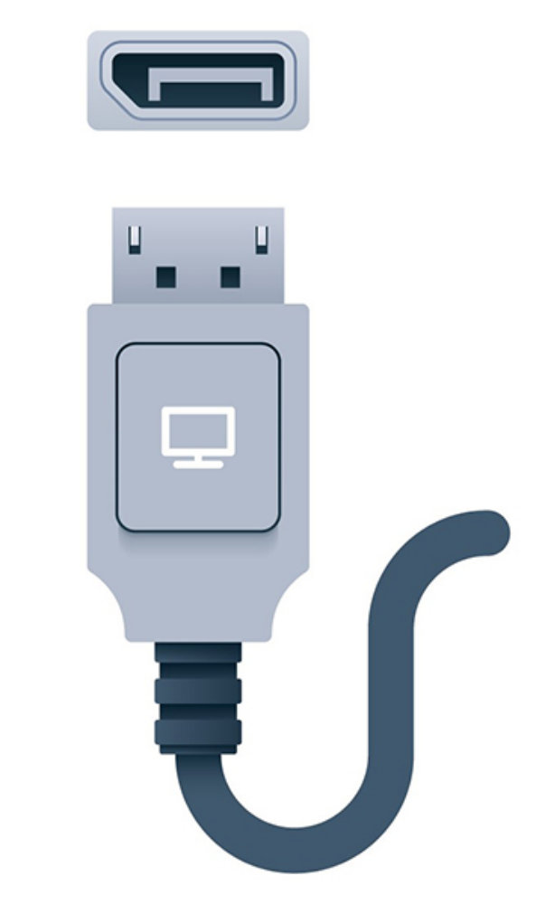

- **DisplayPort lanes** {#dp-lanes}
  - hu-title: DisplayPort sávok
  - en: DisplayPort bandwidth is allocated in up to **four bonded lanes**. Each lane was originally **2.7 Gbps**; with **version 2.0** a lane carries up to **20 Gbps**.
  - hu: A DisplayPort sávszélessége legfeljebb **négy összevont sávban** (lane) oszlik el. Egy sáv eredetileg **2,7 Gbps** volt; a **2.0-s verzióval** sávonként akár **20 Gbps**.
  - concepts: four lanes | 4 lanes | négy sáv | 4 sáv ; 2.7 Gbps | 2,7 Gbps ; 20 Gbps ; version 2.0 | 2.0

- **Daisy-chaining monitors** {#dp-daisy-chain}
  - hu-title: Monitorok láncba fűzése
  - en: A main advantage of **DisplayPort** over HDMI is **daisy-chaining**: several monitors connected one after another to a **single video port**. With HDMI each monitor needs **its own port** on the video card. Thunderbolt supports daisy-chaining too.
  - hu: A **DisplayPort** egyik fő előnye a HDMI-vel szemben a **láncba fűzés** (daisy chain): több monitor egymás után kötve **egyetlen videoporthoz**. HDMI-nél minden monitornak **külön port** kell a videokártyán. A Thunderbolt is támogatja a láncba fűzést.
  - concepts: daisy-chain | daisy chain | láncba fűzés | felfűzés ; single port | one port | egy port ; DisplayPort ; Thunderbolt

## Thunderbolt and Lightning Cables {#thunderbolt}
hu: Thunderbolt és Lightning kábelek

- **Thunderbolt 1 and 2** {#tb-1-2}
  - hu-title: Thunderbolt 1 és 2
  - en: **Thunderbolt** is both a **display interface** (like DisplayPort/HDMI) and a **general peripheral interface** (like USB). Versions 1 and 2 use the **MiniDP** physical interface and are **DisplayPort-compatible** (a DP monitor works via an adapter cable). Ports are marked with a **lightning bolt / flash icon**. Thunderbolt 2 supports **20 Gbps** and **daisy-chaining**.
  - hu: A **Thunderbolt** egyszerre **kijelző-interfész** (mint a DisplayPort/HDMI) és **általános periféria-interfész** (mint az USB). Az 1-es és 2-es verzió a **MiniDP** fizikai csatlakozót használja, és **DisplayPort-kompatibilis** (DP-s monitor adapterkábellel köthető). A portot **villám ikon** jelöli. A Thunderbolt 2 **20 Gbps**-ot és **láncba fűzést** támogat.
  - concepts: MiniDP ; DisplayPort compatible | DisplayPort | kompatibilis ; flash icon | lightning bolt | villám ; 20 Gbps

- **Thunderbolt 3 (USB-C)** {#tb-3}
  - hu-title: Thunderbolt 3 (USB-C)
  - en: **Thunderbolt 3** uses the same port, connector and cabling as **USB-C**. A USB device works in a Thunderbolt 3 port, but a **Thunderbolt device will not work in a USB port** that is not Thunderbolt-enabled. It supports up to **40 Gbps** over a short, high-quality cable (up to **0.5 m**). Not every USB-C port supports Thunderbolt – look for the **flash icon**. USB4 and Thunderbolt 4 are converged standards.
  - hu: A **Thunderbolt 3** ugyanazt a portot, csatlakozót és kábelt használja, mint az **USB-C**. USB-eszköz működik Thunderbolt 3 portban, de **Thunderbolt-eszköz nem működik olyan USB-portban**, amely nem Thunderbolt-képes. Rövid, jó minőségű kábelen (max. **0,5 m**) akár **40 Gbps**. Nem minden USB-C port tud Thunderboltot – keresd a **villám ikont**. Az USB4 és a Thunderbolt 4 egymáshoz közelített szabványok.
  - concepts: USB-C ; 40 Gbps ; 0.5 m | 0,5 m | 0.5 meter ; flash icon | villám ; not work in USB port | nem működik
  - figure: 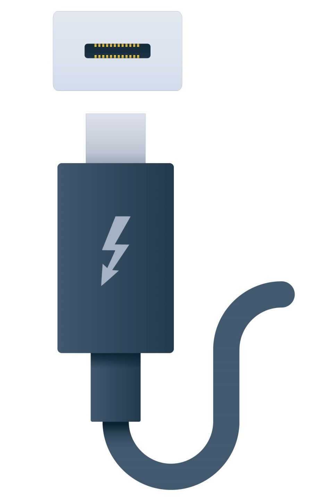

- **Apple Lightning** {#lightning}
  - hu-title: Apple Lightning
  - en: Apple's **iPhone and iPad** use the **proprietary**, **reversible** **Lightning** port and connector, found only on Apple mobile devices. It is **not compatible with USB-C**; to connect to a PC you need an **adapter cable** such as Lightning-to-USB A or Lightning-to-USB C.
  - hu: Az Apple **iPhone és iPad** a **zárt (gyártóspecifikus)**, **megfordítható** **Lightning** portot és csatlakozót használja, amely csak az Apple mobileszközein található meg. **Nem kompatibilis az USB-C-vel**; PC-hez **átalakító kábel** kell, pl. Lightning–USB A vagy Lightning–USB C.
  - concepts: proprietary | zárt | gyártóspecifikus ; reversible | megfordítható ; iPhone | iPad | Apple ; adapter cable | átalakító | Lightning-to-USB
  - figure: 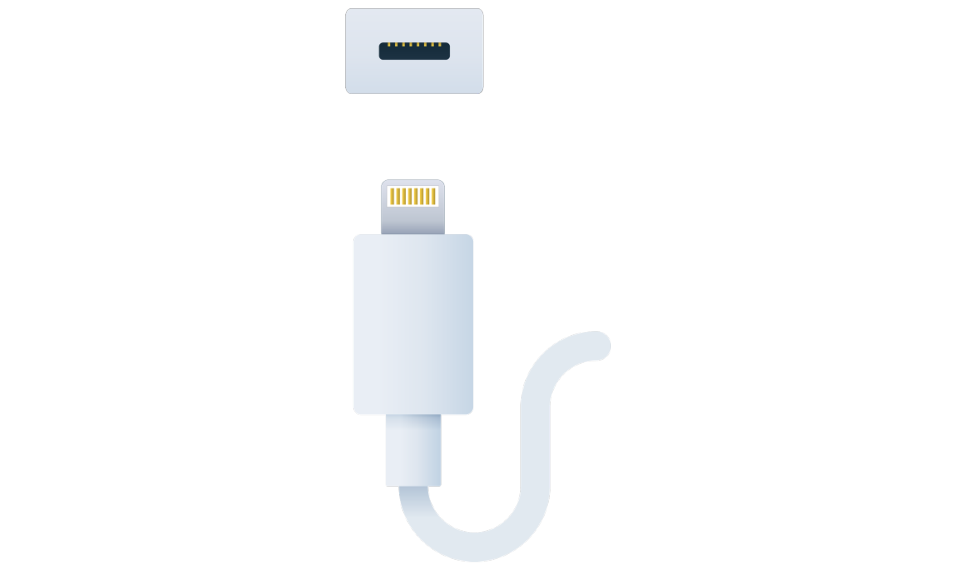

## SATA Hard Drive Cables {#sata}
hu: SATA-meghajtókábelek

- **SATA interface** {#sata-interface}
  - hu-title: SATA interfész
  - en: **SATA (Serial Advanced Technology Attachment)** is the standard way to connect **internal storage drives** in a desktop PC. Cables are up to **1 m (39 in.)** long with compact **7-pin** connectors, and each SATA port supports **a single device**.
  - hu: A **SATA (Serial Advanced Technology Attachment)** az asztali PC **belső meghajtóinak** szabványos csatlakoztatási módja. A kábel legfeljebb **1 m (39 hüvelyk)**, kompakt **7 tűs** csatlakozóval, és minden SATA-port **egyetlen eszközt** támogat.
  - concepts: internal storage | internal drives | belső meghajtó ; 1 m | 1 méter | 1 meter ; 7-pin | 7 pin | 7 tűs ; single device | one device | egy eszköz
  - figure: 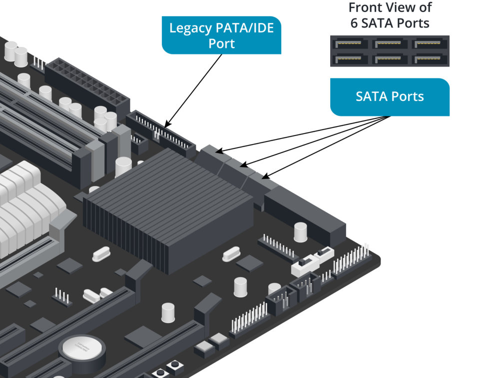

- **SATA power connector** {#sata-power}
  - hu-title: SATA tápcsatlakozó
  - en: The 7-pin SATA **data** connector carries **no power**. A separate **15-pin SATA power** connector links the drive to the PC's power supply (it includes an orange **3.3 V** wire).
  - hu: A 7 tűs SATA **adat**csatlakozó **nem visz tápellátást**. Külön **15 tűs SATA táp**csatlakozó köti a meghajtót a tápegységhez (ebben van a narancssárga **3,3 V**-os vezeték is).
  - concepts: 15-pin | 15 pin | 15 tűs ; no power | nincs táp | nem visz ; 3.3 V | 3,3 V | orange | narancs
  - figure: 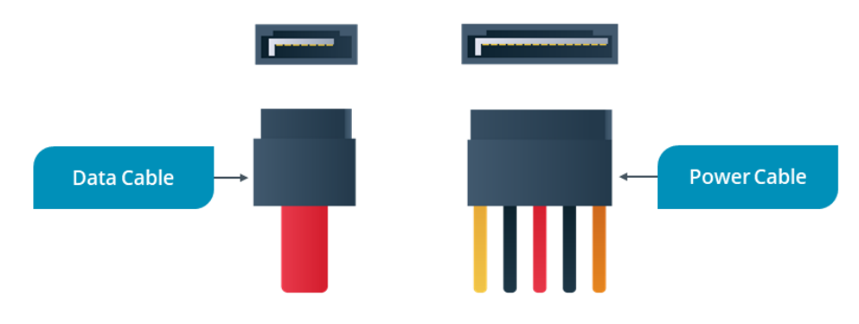

- **SATA revisions** {#sata-revisions}
  - hu-title: SATA-verziók
  - en: The first SATA standard supported up to **150 MBps**, followed by **SATA revision 2 (300 MBps)** and **SATA revision 3 (600 MBps)**.
  - hu: Az első SATA szabvány legfeljebb **150 MBps**-ot tudott, ezt követte a **SATA revision 2 (300 MBps)** és a **SATA revision 3 (600 MBps)**.
  - concepts: 150 MBps | 150 MB/s ; 300 MBps | 300 MB/s ; 600 MBps | 600 MB/s

- **Molex power connector** {#molex}
  - hu-title: Molex tápcsatlakozó
  - en: **Legacy** devices get power from the PSU through a **Molex** connector: **white or clear plastic, 4 pins**. Wire colours: **red = 5 VDC**, **yellow = 12 VDC**, **black = ground**. Some devices have both SATA and Molex power connectors; unused Molex plugs can simply be left unconnected.
  - hu: A **régebbi** eszközök **Molex** csatlakozón kapnak tápot a tápegységtől: **fehér vagy átlátszó műanyag, 4 tűs**. Vezetékszínek: **piros = 5 V DC**, **sárga = 12 V DC**, **fekete = föld**. Egyes eszközökön SATA és Molex tápcsatlakozó is van; a nem használt Molex dugók nyugodtan szabadon maradhatnak.
  - concepts: 4 pins | 4-pin | 4 tűs ; 5 V | 5 VDC | red | piros ; 12 V | 12 VDC | yellow | sárga ; ground | föld | black | fekete
  - figure: 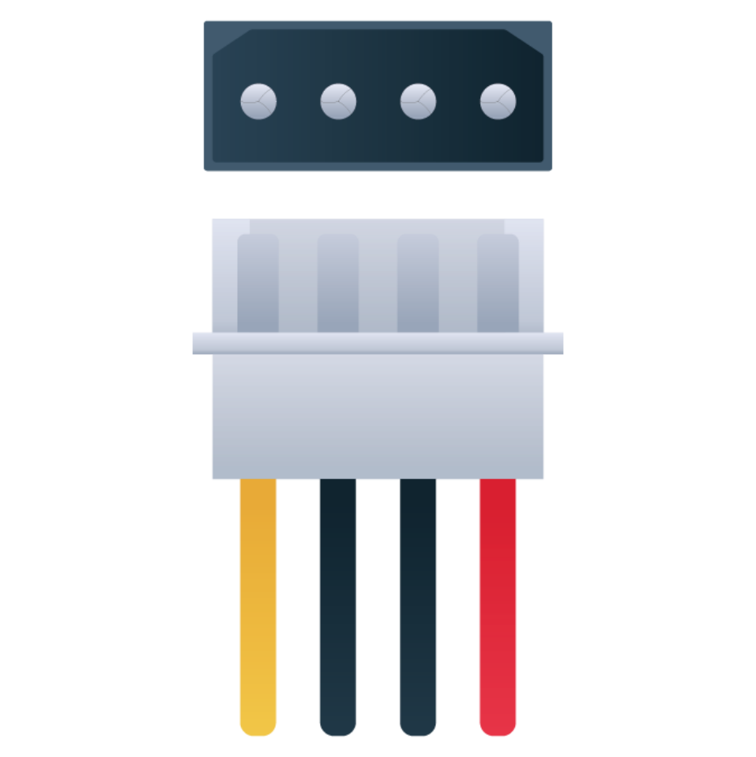

- **eSATA and eSATAp** {#esata}
  - hu-title: eSATA és eSATAp
  - en: **eSATA (external SATA)** attaches peripheral drives with a cable of up to **2 m (78 in.)**. You must use an **eSATA cable** – an internal SATA cable will not do. **eSATAp** is a nonstandard **powered** port compatible with both **USB and SATA**. In practice **USB dominates** the external drive market.
  - hu: Az **eSATA (külső SATA)** perifériás meghajtókat köt be legfeljebb **2 m (78 hüvelyk)** kábellel. **eSATA kábelt** kell használni – belső SATA kábel nem jó. Az **eSATAp** nem szabványos, **tápellátást is adó** port, amely **USB- és SATA-kompatibilis**. A gyakorlatban a külső meghajtóknál az **USB uralkodik**.
  - concepts: 2 m | 2 méter | 2 meters ; eSATA cable | eSATA kábel ; eSATAp | powered | táp ; USB and SATA | USB
