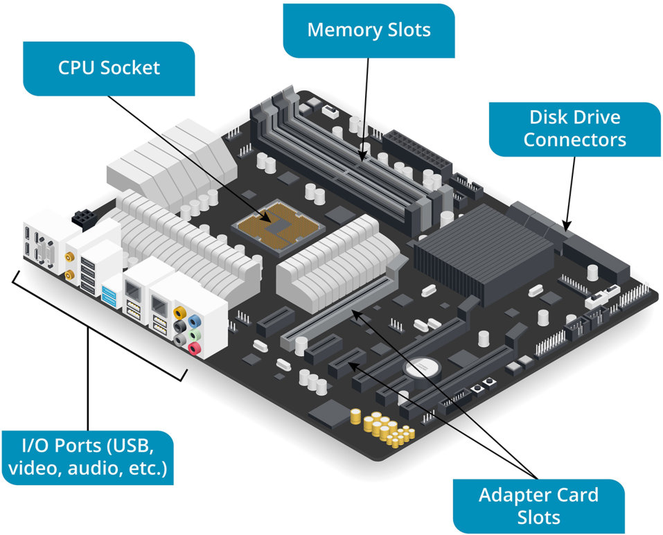
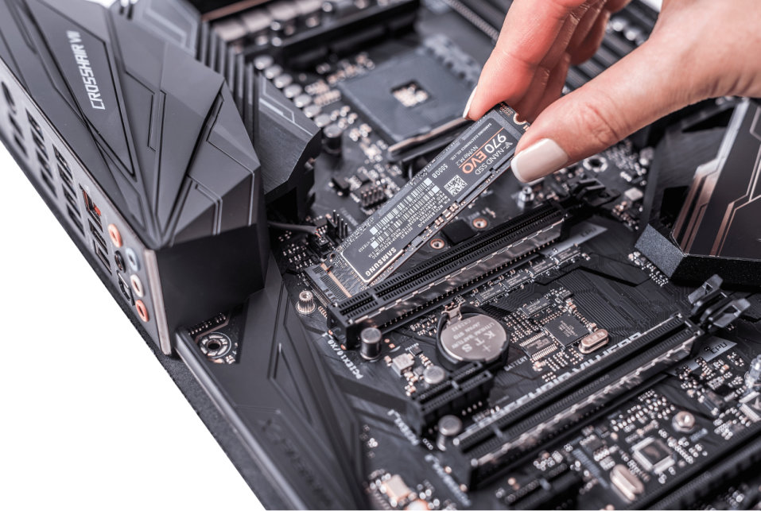
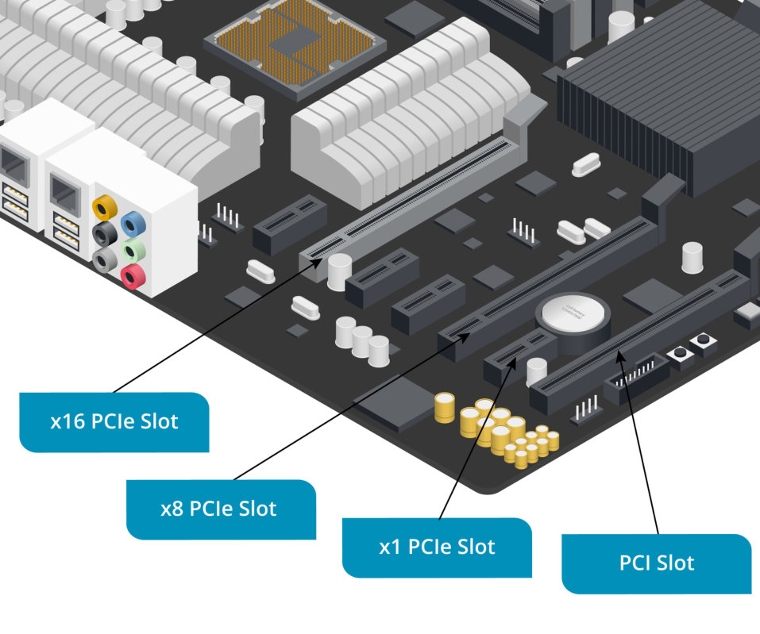
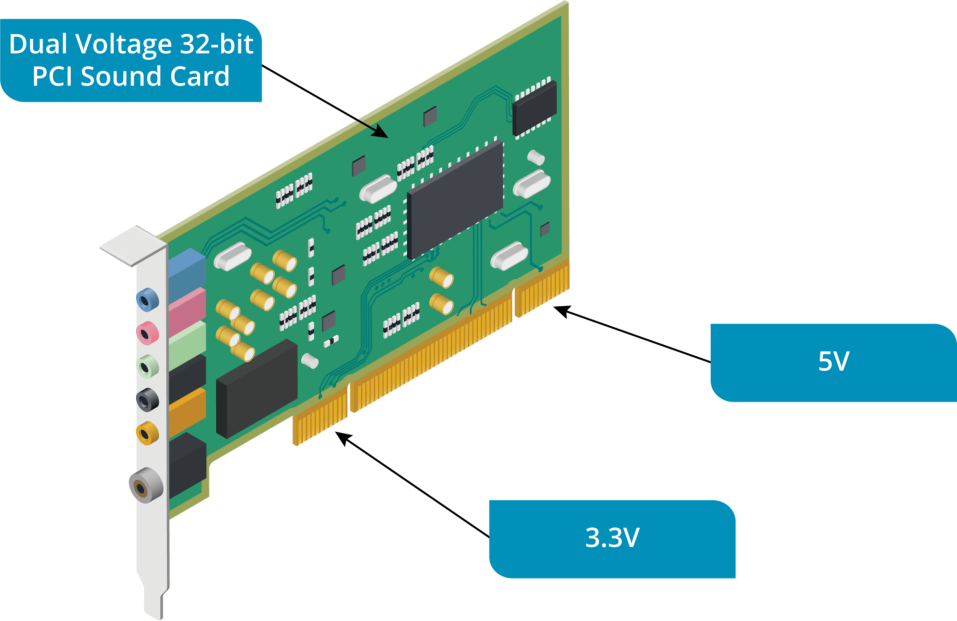
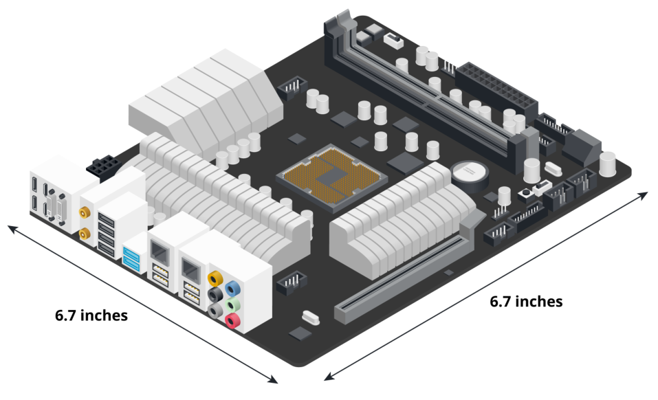
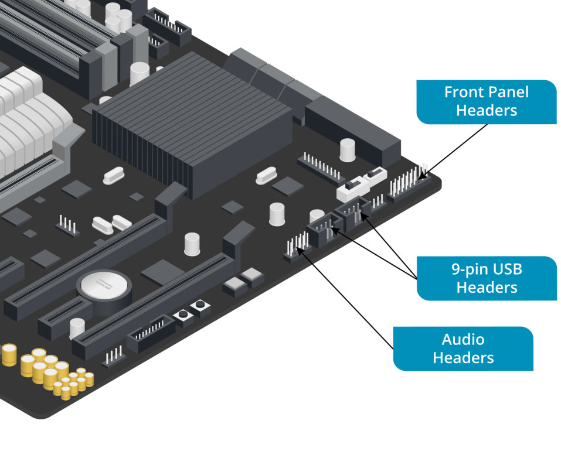
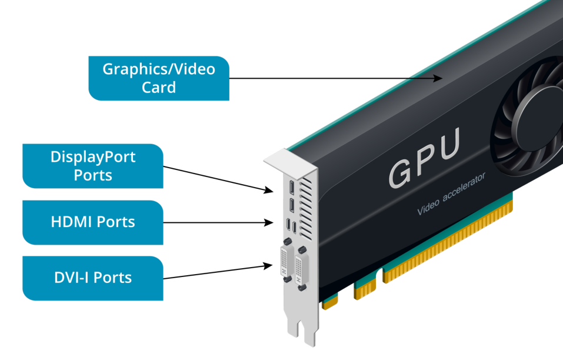
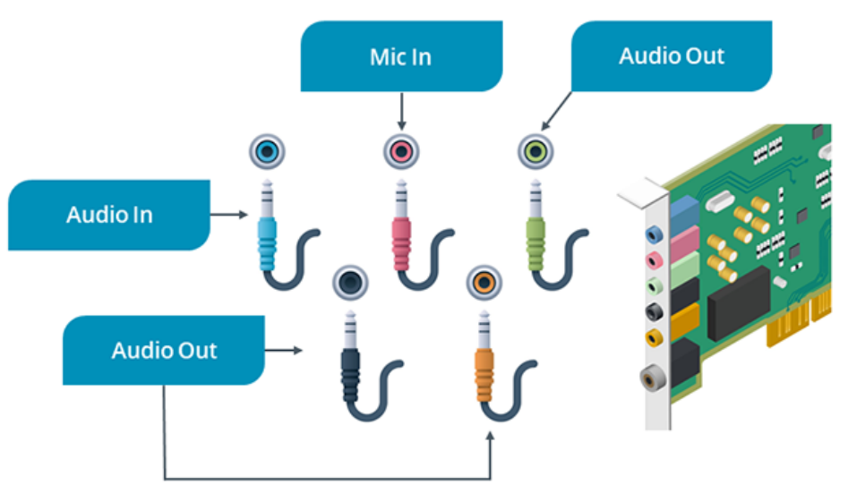
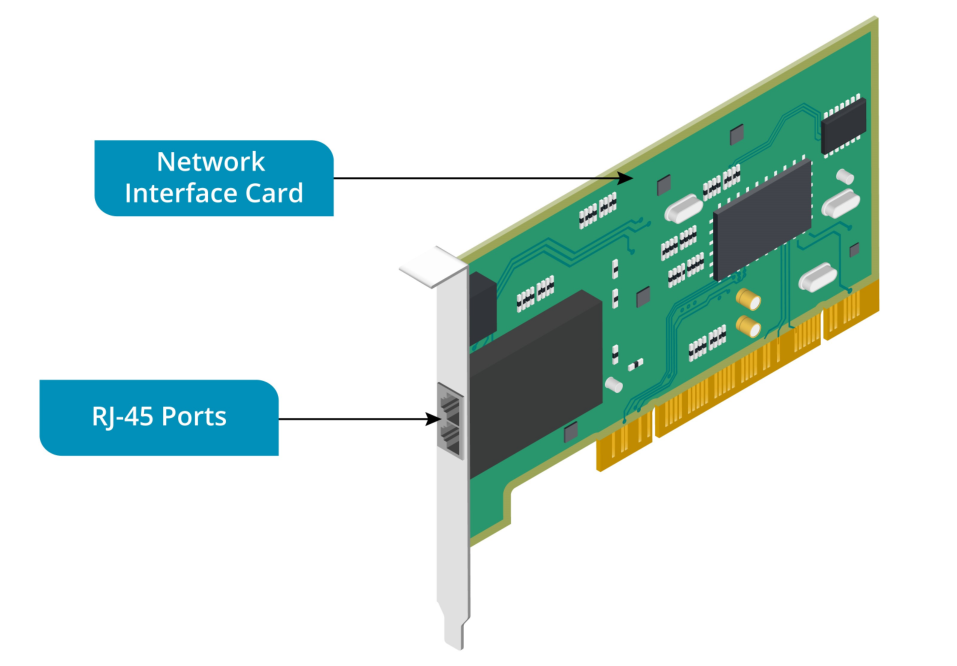

## mb-functions
- front-en: Which three core system functions do the devices on a motherboard implement?
- front-hu: Melyik három alapfunkciót valósítják meg az alaplapra szerelt eszközök?
- back-en: **Compute** (CPU), **storage** (memory and disks) and **networking**.
- back-hu: **Számítás** (CPU), **tárolás** (memória és lemezek) és **hálózat**.

## mb-functions (2)
- front-en: Name the five main connector groups of a motherboard.
- front-hu: Sorold fel az alaplap öt fő csatlakozócsoportját!
- back-en: **CPU socket**, **memory slots**, **disk drive connectors**, **adapter card slots** and the rear **I/O ports** (USB, video, audio…).
- back-hu: **Processzorfoglalat**, **memóriafoglalatok**, **meghajtócsatlakozók**, **bővítőhelyek** és a hátsó **I/O portok** (USB, videó, audio…).
- figure: 

## mb-memory
- front-en: What does it mean that system RAM is *volatile* (nonpersistent)?
- front-hu: Mit jelent, hogy a rendszermemória *illékony* (nem tartós)?
- back-en: It holds data **only while the PC is powered on**; mass storage is needed to keep data when the computer is off.
- back-hu: **Csak bekapcsolt állapotban** őrzi az adatokat; kikapcsolt gépen a háttértárak tárolják az adatot.

## mb-memory (2)
- front-en: In the storage hierarchy, which components are fast but volatile, and which are slower but permanent?
- front-hu: A tárolási hierarchiában mi gyors, de illékony, és mi lassabb, de tartós?
- back-en: Fast but volatile: **CPU, cache, RAM**. Slower but permanent: **mass storage and removable storage**.
- back-hu: Gyors, de illékony: **CPU, gyorsítótár, RAM**. Lassabb, de tartós: **háttértárak és cserélhető tárolók**.

## mb-clock
- front-en: What do clock multipliers do?
- front-hu: Mire valók az órajelszorzók?
- back-en: They apply a multiplication factor to the system clock's timing signal, so **different buses can run at different speeds**.
- back-hu: Szorzótényezővel alakítják a rendszeróra jelét, így **a különböző buszok eltérő sebességgel működhetnek**.

## safety-power
- front-en: After unplugging a PC and before opening it, what should you do, and why?
- front-hu: A gép kihúzása után, de kinyitás előtt mit kell tenni, és miért?
- back-en: **Hold the power button for a few seconds** to drain the charge from the internal components.
- back-hu: **Néhány másodpercig nyomva tartani a bekapcsológombot**, hogy a belső alkatrészek kisüljenek.

## safety-esd
- front-en: What is ESD, and how should you handle components to avoid it?
- front-hu: Mi az ESD, és hogyan kell megfogni az alkatrészeket, hogy elkerüld?
- back-en: **Electrostatic discharge**: static charge from your body or clothes released into a circuit. Hold parts **by the edges or plastic parts** and use an **anti-ESD wrist strap**.
- back-hu: **Elektrosztatikus kisülés**: a testeden/ruhádon lévő töltés kisül egy áramkörbe. Fogd az alkatrészt **a szélénél vagy műanyag részénél**, és használj **antisztatikus csuklópántot**.

## cpu-socket
- front-en: Why does a given motherboard support only a limited number of CPU models?
- front-hu: Miért csak korlátozott számú processzormodellt támogat egy alaplap?
- back-en: **Intel and AMD use different socket designs**, and CPU technology changes rapidly, so each board is made for a particular range of CPUs.
- back-hu: **Az Intel és az AMD eltérő foglalatot használ**, és a CPU-technológia gyorsan változik, ezért minden alaplap egy adott processzorkörhöz készül.

## cpu-chipset
- front-en: Can a motherboard's chipset be upgraded?
- front-hu: Cserélhető-e az alaplap lapkakészlete?
- back-en: **No**, it is **soldered** onto the board. Interfaces it does not support must be added as **adapter cards**.
- back-hu: **Nem**, az alaplapra van **forrasztva**. Az általa nem támogatott csatlakozókat **bővítőkártyával** lehet pótolni.

## cpu-chipset (2)
- front-en: Which three things does the chipset determine?
- front-hu: Melyik három dolgot határozza meg a lapkakészlet?
- back-en: The **choice of CPU**, the **type and maximum amount of RAM**, and the **integrated interfaces** (video, sound, networking).
- back-hu: A **választható processzort**, a **RAM típusát és maximális mennyiségét**, valamint a **beépített csatlakozókat** (videó, hang, hálózat).

## ram-dimm
- front-en: What type of motherboard slot is used to install system memory?
- front-hu: Milyen alaplapi foglalatba kerül a rendszermemória?
- back-en: A **DIMM** (dual inline memory module) slot: catches at both ends, close to the CPU socket, numbered and often color-coded.
- back-hu: **DIMM**- (dual inline memory module) foglalatba: két végén rögzítőfül, a processzor közelében, számozott és gyakran színkódolt.

## ram-ddr
- front-en: Can you fit a DDR4 DIMM into a DDR5 slot?
- front-hu: Betehető-e egy DDR4-es DIMM egy DDR5-ös foglalatba?
- back-en: **No.** Each DIMM form factor is specific to one DDR version; the label next to the slots shows the supported type.
- back-hu: **Nem.** Minden DIMM-kialakítás egy adott DDR-verzióhoz tartozik; a foglalatok melletti címke mutatja a támogatott típust.

## ram-ddr (2)
- front-en: What determines the maximum amount of RAM you can fit?
- front-hu: Mi határozza meg, legfeljebb mennyi RAM tehető a gépbe?
- back-en: The capabilities of the **memory controller** and the **number of physical slots**.
- back-hu: A **memóriavezérlő** képességei és a **fizikai foglalatok száma**.

## storage-sata
- front-en: How many storage devices can be attached to a single SATA port?
- front-hu: Hány tárolóeszköz köthető egyetlen SATA-portra?
- back-en: **One.**
- back-hu: **Egy.**

## storage-sata (2)
- front-en: Which two connections does an internal SATA drive need?
- front-hu: Milyen két csatlakozás kell egy belső SATA-meghajtónak?
- back-en: A **data cable** to the motherboard's SATA port and a **SATA power or Molex** connector from the PSU.
- back-hu: **Adatkábel** az alaplap SATA-portjához és **SATA- vagy Molex-tápcsatlakozó** a tápegységről.

## storage-m2
- front-en: Why does an M.2 SSD not need a power cable?
- front-hu: Miért nem kell tápkábel egy M.2 SSD-nek?
- back-en: M.2 **supplies power over the bus**.
- back-hu: Az M.2 **a buszon keresztül kapja a tápellátást**.

## storage-m2 (2)
- front-en: How is an M.2 card installed?
- front-hu: Hogyan kell beszerelni egy M.2 kártyát?
- back-en: Insert it into the horizontal port **at an angle**, push it down flat and secure it with a **screw**.
- back-hu: **Ferdén** bedugni a vízszintes portba, lenyomni, majd **csavarral** rögzíteni.
- figure: 

## storage-m2-sizes
- front-en: Which lengths do M.2 adapters come in?
- front-hu: Milyen hosszúságú M.2 kártyák léteznek?
- back-en: **42 mm, 60 mm, 80 mm and 110 mm**. Labels on the motherboard show which it supports.
- back-hu: **42, 60, 80 és 110 mm**. Az alaplap feliratai mutatják, melyiket támogatja.

## storage-esata
- front-en: What is the maximum eSATA cable length, and can you use an internal SATA cable instead?
- front-hu: Milyen hosszú lehet az eSATA kábel, és használható-e helyette belső SATA kábel?
- back-en: **2 m (78 in.)**. **No**, an eSATA port needs an **eSATA cable**.
- back-hu: **2 m (78 hüvelyk)**. **Nem**, az eSATA porthoz **eSATA kábel** kell.

## storage-esata-power
- front-en: What is the main drawback of eSATA compared to USB or Thunderbolt external drives?
- front-hu: Mi az eSATA fő hátránya az USB-s vagy Thunderboltos külső meghajtókkal szemben?
- back-en: **No power over the cable**, which limits it for **2.5-inch portable drives** (3.5-inch drives need their own supply anyway).
- back-hu: **A kábel nem visz tápellátást**, ez a **2,5 hüvelykes hordozható meghajtóknál** gond (a 3,5 hüvelykeseknek úgyis külön táp kell).

## storage-esata-power (2)
- front-en: What is eSATAp?
- front-hu: Mi az eSATAp?
- back-en: A **nonstandard powered** eSATA port used by some vendors, compatible with both **USB and SATA** (with an eSATAp cable).
- back-hu: Egyes gyártók **nem szabványos, tápellátást is adó** eSATA portja, amely **USB-vel és SATA-val** is kompatibilis (eSATAp kábellel).

## pcie
- front-en: What type of communication does PCIe use?
- front-hu: Milyen kommunikációt használ a PCIe?
- back-en: **Point-to-point serial**: each link is dedicated and made of one or more **lanes**.
- back-hu: **Pont-pont közötti soros** kommunikációt: minden link dedikált, és egy vagy több **sávból** áll.

## pcie (2)
- front-en: How can you tell a x16 PCIe slot from a x1 slot at a glance?
- front-hu: Miről ismered fel ránézésre a x16-os PCIe-bővítőhelyet egy x1-essel szemben?
- back-en: Slots with more lanes are **physically longer**; x16 is the longest.
- back-hu: A több sávos bővítőhelyek **fizikailag hosszabbak**; az x16-os a leghosszabb.
- figure: 

## pcie-versions
- front-en: What is the bandwidth of a PCIe v2.0 x16 graphics adapter?
- front-hu: Mekkora egy PCIe 2.0 x16-os videókártya sávszélessége?
- back-en: **8 GB/s** (0.5 GB/s per lane × 16).
- back-hu: **8 GB/s** (sávonként 0,5 GB/s × 16).

## pcie-versions (2)
- front-en: What is the difference between GT/s and GB/s for PCIe?
- front-hu: Mi a különbség a GT/s és a GB/s között a PCIe-nél?
- back-en: **GT/s** is the **raw** transfer rate per lane; **GB/s** is the throughput **after encoding overhead**.
- back-hu: A **GT/s** sávonkénti **nyers** átviteli sebesség; a **GB/s** a **kódolási veszteség utáni** tényleges átvitel.

## pcie-versions (3)
- front-en: What are the raw lane rates of PCIe 2, 3, 4 and 5?
- front-hu: Mekkora a PCIe 2, 3, 4 és 5 sávonkénti nyers sebessége?
- back-en: **5, 8, 16 and 32 GT/s**. Throughput roughly doubles each version (x16: 8 → ~16 → ~32 → ~63 GB/s).
- back-hu: **5, 8, 16 és 32 GT/s**. Az átvitel verziónként nagyjából duplázódik (x16: 8 → ~16 → ~32 → ~63 GB/s).

## pcie-plugging
- front-en: You have a x8 PCIe card. Can you fit it in a x16 slot?
- front-hu: Van egy x8-as PCIe-kártyád. Beteheted egy x16-os helyre?
- back-en: **Yes**, this is **up-plugging**: a card fits any slot with an equal or greater number of lanes. It should work at x8 (occasionally only x1).
- back-hu: **Igen**, ez az **up-plugging**: a kártya minden ugyanannyi vagy több sávos helyre befér. x8-ként kell működnie (néha csak x1-ként).

## pcie-plugging (2)
- front-en: What does a slot labelled "x16 @ x8" (or "x16/x8") mean?
- front-hu: Mit jelent a „x16 @ x8” (vagy „x16/x8”) feliratú bővítőhely?
- back-en: The slot is **physically x16** but supports only **x8 operation**.
- back-hu: A hely **fizikailag x16-os**, de csak **x8-as működést** támogat.

## pcie-compat
- front-en: You install a PCIe 4 card in a PCIe 3 motherboard. Does it work, and at what speed?
- front-hu: Egy PCIe 4-es kártyát PCIe 3-as alaplapba teszel. Működik, és milyen sebességgel?
- back-en: **Yes**, all PCIe versions are backwards-compatible; the bus runs at the speed of the **lowest version** (here PCIe 3).
- back-hu: **Igen**, minden PCIe-verzió visszafelé kompatibilis; a busz a **legalacsonyabb verzió** sebességével megy (itt PCIe 3).

## pcie-power
- front-en: How much power can a PCIe graphics slot, another PCIe slot, and a PCIe power connector supply?
- front-hu: Mennyi teljesítményt adhat a PCIe grafikus bővítőhely, egy másik PCIe-hely és egy PCIe-tápcsatlakozó?
- back-en: Graphics slot **75 W**, other slots **25 W**, PCIe power connector an extra **75 W**.
- back-hu: Grafikus hely **75 W**, többi hely **25 W**, PCIe-tápcsatlakozó további **75 W**.

## pci
- front-en: Can a legacy PCI card be installed in a PCIe slot?
- front-hu: Betehető-e egy régi PCI-kártya PCIe-bővítőhelybe?
- back-en: **No.** PCIe is software-compatible with PCI, so boards may have **PCI slots**, but PCI cards do not fit PCIe slots.
- back-hu: **Nem.** A PCIe szoftveresen kompatibilis a PCI-jal, ezért az alaplapon lehetnek **PCI-helyek**, de PCI-kártya nem fér PCIe-helyre.

## pci (2)
- front-en: What is the transfer rate of standard 32-bit, 33.3 MHz PCI, and how is it calculated?
- front-hu: Mekkora a szabványos 32 bites, 33,3 MHz-es PCI átviteli sebessége, és hogyan jön ki?
- back-en: **133 MBps**: 32 bits ÷ 8 = 4 bytes × 33.3 MHz.
- back-hu: **133 MBps**: 32 bit ÷ 8 = 4 bájt × 33,3 MHz.

## pci-keying
- front-en: Why can't a 3.3V PCI card be inserted into a 5V PCI slot?
- front-hu: Miért nem dugható be egy 3,3 V-os PCI-kártya egy 5 V-os PCI-foglalatba?
- back-en: The 5V, 3.3V and dual-voltage card types use **different keying** (notches), which physically prevents it.
- back-hu: Az 5 V-os, 3,3 V-os és kettős feszültségű kártyák **eltérő kódolásúak** (bevágásúak), ez fizikailag megakadályozza.
- figure: 

## ff-definition
- front-en: What does a motherboard form factor describe?
- front-hu: Mit ír le az alaplap formátuma (form factor)?
- back-en: Its **shape and layout**, the type of **case and power supply** it works with, and the **number of adapter cards** it can take.
- back-hu: Az **alakját és elrendezését**, hogy milyen **házzal és tápegységgel** használható, és **hány bővítőkártya** fér bele.

## ff-atx
- front-en: What are the dimensions and maximum number of expansion slots of a full-size ATX board?
- front-hu: Mekkora a teljes méretű ATX alaplap, és legfeljebb hány bővítőhelye lehet?
- back-en: **12 × 9.6 in (305 × 244 mm)**, up to **7** expansion slots.
- back-hu: **12 × 9,6 hüvelyk (305 × 244 mm)**, legfeljebb **7** bővítőhely.

## ff-matx
- front-en: What are the size and maximum number of expansion slots of a Micro-ATX board?
- front-hu: Mekkora a Micro-ATX alaplap, és legfeljebb hány bővítőhelye lehet?
- back-en: **9.6 × 9.6 in (244 × 244 mm)** square, at most **4** expansion slots. Usually mountable in an ATX case.
- back-hu: **9,6 × 9,6 hüvelyk (244 × 244 mm)** négyzet, legfeljebb **4** bővítőhely. Általában ATX házba is beszerelhető.

## ff-itx
- front-en: What are the size and number of expansion slots of a Mini-ITX board?
- front-hu: Mekkora a Mini-ITX alaplap, és hány bővítőhelye van?
- back-en: **6.7 × 6.7 in (170 × 170 mm)**, **one** expansion slot.
- back-hu: **6,7 × 6,7 hüvelyk (170 × 170 mm)**, **egy** bővítőhely.
- figure: 

## ff-itx (2)
- front-en: Where are nano-, pico- and mobile-ITX boards used?
- front-hu: Hol használják a nano-, pico- és mobile-ITX alaplapokat?
- back-en: In **embedded systems and portables**, not in PCs.
- back-hu: **Beágyazott rendszerekben és hordozható eszközökben**, nem PC-kben.

## ff-standoffs
- front-en: What is the purpose of motherboard standoffs?
- front-hu: Mire valók az alaplapi távtartók?
- back-en: They hold the board firmly to the case and ensure **no other part of the board touches the case**.
- back-hu: Szilárdan rögzítik az alaplapot a házhoz, és biztosítják, hogy **az alaplap más része ne érjen hozzá a házhoz**.

## ff-standoffs (2)
- front-en: Where should standoffs be placed, and where never?
- front-hu: Hova kell távtartót tenni, és hova soha?
- back-en: So that the **corners, long edges and centre** are supported, but **never where the board has no matching hole**.
- back-hu: Úgy, hogy a **sarkok, a hosszú élek és a közép** alá legyen támasztva, de **soha oda, ahol az alaplapon nincs furat**.

## ff-install
- front-en: What is a jumper on a motherboard, and when should you check it?
- front-hu: Mi a jumper az alaplapon, és mikor kell ellenőrizni?
- back-en: A clip placed over **header pins** to set an option (e.g. enable recovery mode). Check the **documentation** for jumper settings **before installing** the board.
- back-hu: A **tüskesor lábaira** helyezett áthidaló, amely egy beállítást kapcsol (pl. helyreállítási mód). A board **beszerelése előtt** nézd meg a **dokumentációban** a jumperbeállításokat.

## ff-install (2)
- front-en: What is the risk of overtightening motherboard screws?
- front-hu: Mi a veszélye, ha túlhúzod az alaplap csavarjait?
- back-en: You can **crack the board**. It should be firm and stable, but not overtightened.
- back-hu: **Megrepedhet az alaplap**. Legyen szilárd és stabil, de ne húzd túl.

## hdr-power-button
- front-en: What happens when you press a soft power button on a running PC, and when you hold it?
- front-hu: Mi történik, ha egy működő gépen megnyomod a soft power gombot, és mi, ha nyomva tartod?
- back-en: Pressing sends a signal the **OS interprets as a shutdown command**; **holding it a few seconds** cuts the power.
- back-hu: Megnyomva jelet küld, amelyet az **operációs rendszer leállításként értelmez**; **néhány másodpercig nyomva tartva** megszakítja a tápellátást.

## hdr-front-panel
- front-en: What should you do before disconnecting front-panel header cables?
- front-hu: Mit tegyél, mielőtt lehúzod az előlapi header-kábeleket?
- back-en: **Make a diagram** of the position and orientation of each connector; labels on wires and headers are often hard to follow.
- back-hu: **Rajzold le** az egyes csatlakozók helyét és irányát; a vezetékek és headerek feliratai gyakran nehezen követhetők.

## hdr-usb
- front-en: How many pins does an internal USB 2 header have, and how many ports can it serve?
- front-hu: Hány tűs a belső USB 2 header, és hány portot szolgál ki?
- back-en: **9 pins**, up to **two 4-pin port connections** (the 9th pin orients the cable).
- back-hu: **9 tűs**, legfeljebb **két 4 tűs portcsatlakozást** (a 9. tű a kábel irányát biztosítja).
- figure: 

## hdr-usb (2)
- front-en: What format does an internal USB 3 header use?
- front-hu: Milyen kialakítású a belső USB 3 header?
- back-en: **2 × 10** pins; it can be cabled to two ports.
- back-hu: **2 × 10** tűs; két portra köthető.

## pwr-p1
- front-en: Describe the main P1 motherboard power connector.
- front-hu: Írd le a fő P1 alaplapi tápcsatlakozót!
- back-en: A **2 × 12-pin (24-pin)** block with **square pin receptacles**.
- back-hu: **2 × 12 tűs (24 tűs)** blokk **négyzetes tűfoglalatokkal**.

## pwr-fan
- front-en: How does a 4-pin fan connector control fan speed?
- front-hu: Hogyan szabályozza a fordulatszámot a 4 tűs ventilátorcsatlakozó?
- back-en: With a **pulse width modulation (PWM)** signal carried on the **blue wire**.
- back-hu: **Impulzusszélesség-modulációs (PWM)** jellel a **kék vezetéken**.

## pwr-fan (2)
- front-en: How is the speed of a 3-pin fan controlled?
- front-hu: Hogyan szabályozzák a 3 tűs ventilátor fordulatszámát?
- back-en: By **varying the voltage**.
- back-hu: A **feszültség változtatásával**.

## pwr-fan-mix
- front-en: What happens if you connect a 4-pin fan to a 3-pin header?
- front-hu: Mi történik, ha 4 tűs ventilátort 3 tűs headerre kötsz?
- back-en: It usually **works**, but **cannot use PWM** speed control. (A 3-pin fan on a 4-pin header also works, but the speed may not be adjustable.)
- back-hu: Általában **működik**, de **nem tud PWM-mel szabályozni**. (3 tűs ventilátor 4 tűs headeren is működik, de a fordulatszám esetleg nem állítható.)

## video-card
- front-en: When is onboard graphics not enough, and what do you install instead?
- front-hu: Mikor nem elég az integrált grafika, és mit szerelsz helyette?
- back-en: For **3-D gaming, CAD or digital artwork**; install an **add-on graphics card in a PCIe slot**.
- back-hu: **3D-s játékhoz, CAD-hez vagy digitális grafikához**; ilyenkor **PCIe-bővítőhelyre szerelt videókártya** kell.

## video-gpu
- front-en: What is the basic performance test for a GPU?
- front-hu: Mi a GPU teljesítményének alapvető mércéje?
- back-en: The **frame rate** it can produce for a particular game or application.
- back-hu: Az adott játékban vagy alkalmazásban elért **képkockasebesség (frame rate)**.

## video-memory
- front-en: What is "shared memory" on a graphics adapter?
- front-hu: Mi a „megosztott memória” egy grafikus adapternél?
- back-en: The adapter uses **system RAM** instead of (or in addition to) its own dedicated **GDDR** memory; typical of low-end cards.
- back-hu: Az adapter a **rendszer RAM-ját** használja saját **GDDR** memória helyett (vagy mellett); az alsó kategóriás kártyákra jellemző.

## video-memory (2)
- front-en: How much graphics memory do high-end and mid-range dedicated cards have?
- front-hu: Mennyi grafikus memóriája van a felső és a középkategóriás kártyáknak?
- back-en: High-end: up to **12 GB GDDR**; mid-range: around **4–6 GB**.
- back-hu: Felső kategória: akár **12 GB GDDR**; középkategória: kb. **4–6 GB**.

## video-interface
- front-en: Which slot do most modern graphics cards use, and what holds the card in place?
- front-hu: Melyik bővítőhelyet használja a legtöbb mai videókártya, és mi tartja a helyén?
- back-en: **PCIe x16**, with a **retaining latch** at the end of the slot.
- back-hu: **PCIe x16**-ot, a hely végén lévő **rögzítőretesszel**.
- figure: 

## video-capture
- front-en: What is the difference between a graphics card and a capture card?
- front-hu: Mi a különbség a videókártya és a capture kártya között?
- back-en: A graphics card **outputs** video to a display; a capture card **records video input** (e.g. game footage over HDMI) and saves it as a movie or streaming file.
- back-hu: A videókártya **kiadja** a képet a kijelzőre; a capture kártya **videobemenetet rögzít** (pl. játékfelvételt HDMI-n), és film- vagy streamingfájlként menti.

## video-capture (2)
- front-en: In which two forms can a capture card be fitted?
- front-hu: Milyen két formában szerelhető be egy capture kártya?
- back-en: As an **internal PCIe card** or as an **external unit on USB/Thunderbolt**.
- back-hu: **Belső PCIe-kártyaként** vagy **USB/Thunderbolt csatlakozású külső egységként**.

## sound-jacks
- front-en: What size are most audio jacks, and what are they also called?
- front-hu: Mekkorák a legtöbb audio jackek, és hogy hívják még őket?
- back-en: **3.5 mm (1/8 inch)** mono or stereo jacks, also called **phone plugs** or **mini TRS** (tip, ring, sleeve).
- back-hu: **3,5 mm-es (1/8 hüvelykes)** mono vagy sztereó jackek, más néven **phone plug** vagy **mini TRS** (tip, ring, sleeve).

## sound-colors
- front-en: What do the pink, light blue and green jacks on a sound card do?
- front-hu: Mire valók a hangkártya rózsaszín, világoskék és zöld jackjei?
- back-en: **Pink** = microphone in, **light blue** = audio (line) in, **green** = main audio out.
- back-hu: **Rózsaszín** = mikrofonbemenet, **világoskék** = audio- (vonal-) bemenet, **zöld** = fő audiokimenet.
- figure: 

## sound-surround
- front-en: What is surround sound?
- front-hu: Mi a térhatású (surround) hang?
- back-en: Playback through **multiple speakers positioned around the listener** for a "cinematic" experience; needs a sound card with multiple output channels.
- back-hu: Lejátszás **a hallgató körül elhelyezett több hangszóróval** „mozis” élményért; több kimeneti csatornás hangkártya kell hozzá.

## sound-types
- front-en: Why are most professional audio interfaces external (USB/Thunderbolt) units?
- front-hu: Miért külső (USB/Thunderbolt) egység a legtöbb professzionális audio interfész?
- back-en: Audio hardware inside the PC can pick up **noise from other internal components** when recording.
- back-hu: A gépen belüli hanghardver felvételkor **zajt szedhet össze a többi belső alkatrésztől**.

## sound-types (2)
- front-en: What are wavetables on a pro-level sound card?
- front-hu: Mik a wavetable-ök egy profi hangkártyán?
- back-en: **Sound samples stored in flash memory** on the card.
- back-hu: A kártya **flash memóriájában tárolt hangminták**.

## nic-card
- front-en: Give two reasons to install an add-on NIC when the motherboard already has Ethernet.
- front-hu: Mondj két okot, amiért bővítő hálózati kártyát szerelnél, ha az alaplapon már van Ethernet!
- back-en: To use a **different network or cabling/connector type** (e.g. **fiber optic** instead of copper), or to get **multiple ports** that can be **bonded** into one higher-bandwidth link.
- back-hu: Más **hálózat- vagy kábel-/csatlakozótípushoz** (pl. réz helyett **optikai szál**), vagy **több porthoz**, amelyek **összevonhatók (bonding)** egy nagyobb sávszélességű kapcsolattá.
- figure: 

## nic-wireless
- front-en: Which standards are Wi-Fi adapters developed to, and what other wireless adapter cards exist?
- front-hu: Milyen szabványok szerint készülnek a Wi-Fi-adapterek, és milyen más vezeték nélküli kártyák léteznek?
- back-en: **IEEE 802.11** standards; there are also cards for **cellular data networks**.
- back-hu: **IEEE 802.11** szabványok szerint; vannak **mobil adathálózati** kártyák is.
