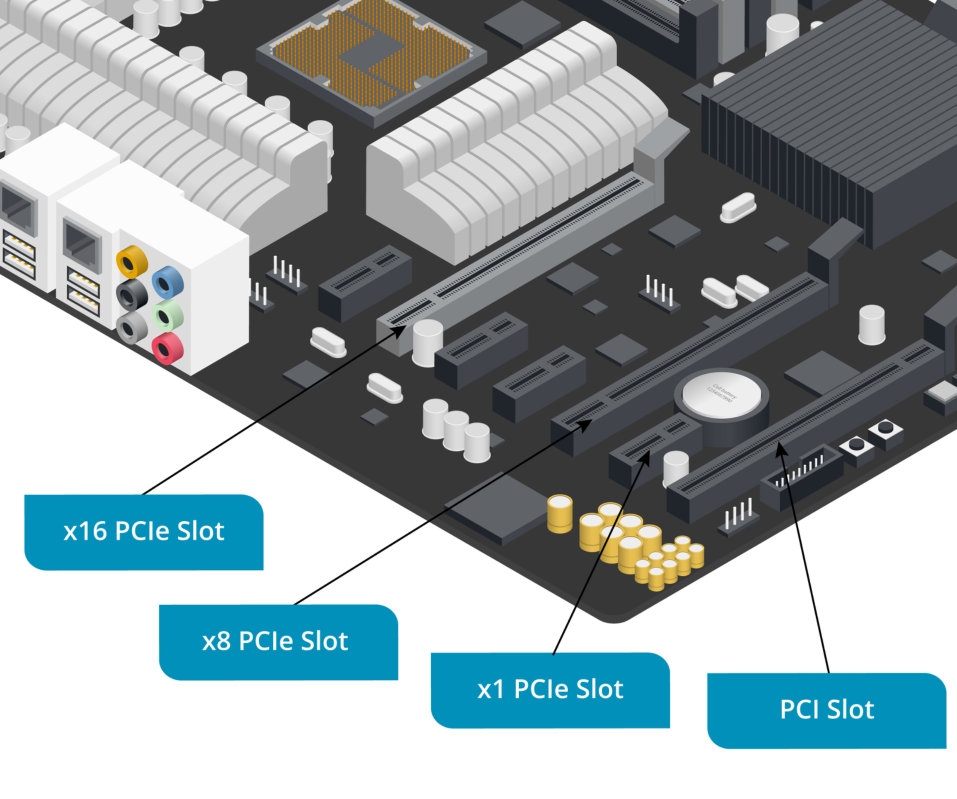
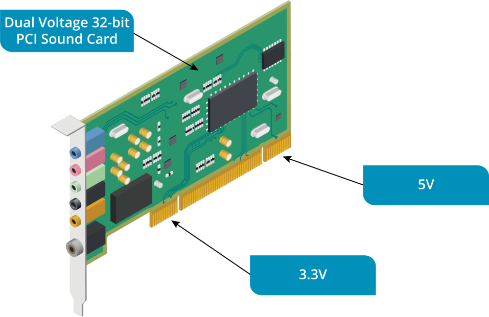
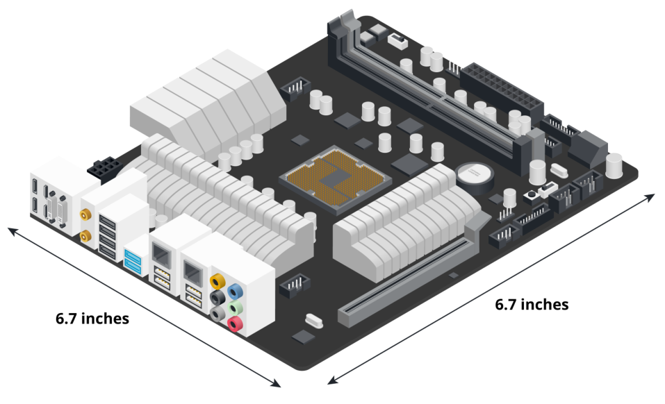
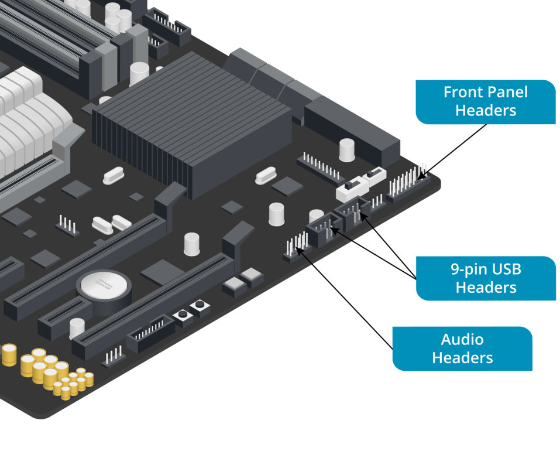
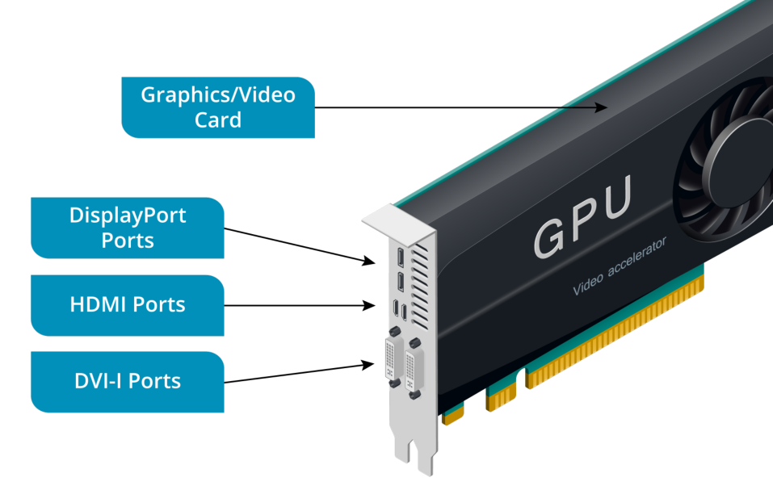
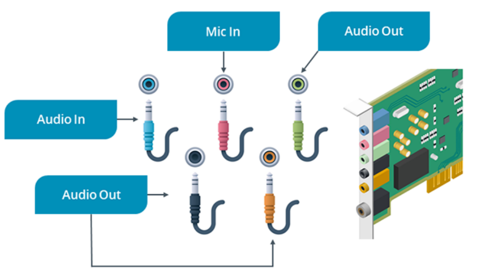
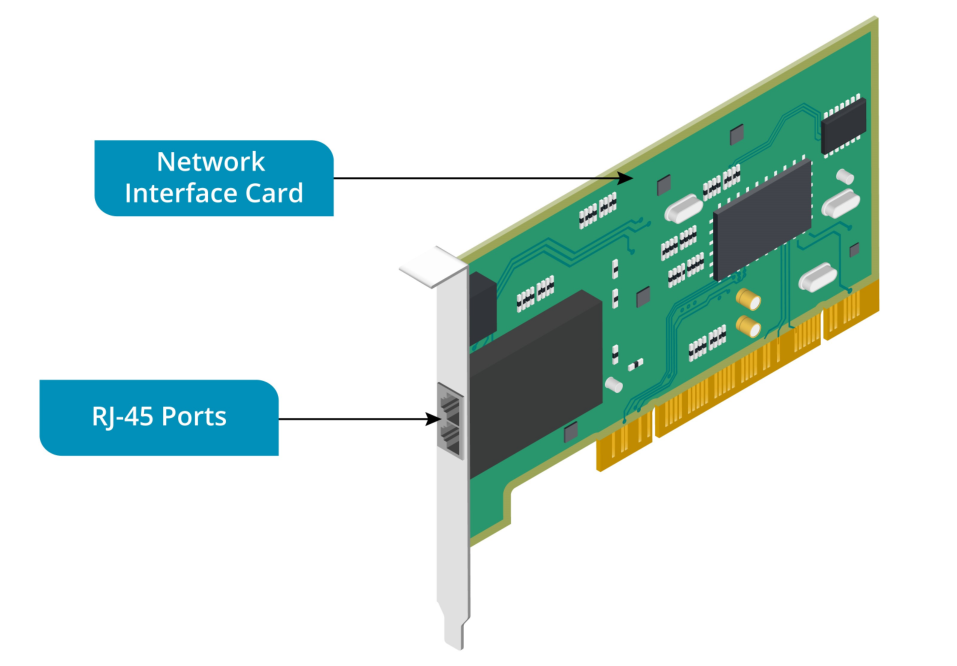

## mb-functions
- q-en: Which component implements the **compute** (processing) function of a PC?
- q-hu: Melyik alkatrész valósítja meg a PC **számítási** (feldolgozási) funkcióját?
- [ ] System RAM | Rendszermemória
- [x] CPU | CPU (processzor)
- [ ] SATA hard disk | SATA-merevlemez
- [ ] Network adapter | Hálózati adapter
- why-en: Software runs as instructions executed by the CPU. RAM and disks provide storage, and the network adapter provides networking.
- why-hu: A szoftver a CPU által végrehajtott utasításokként fut. A RAM és a lemezek a tárolást, a hálózati adapter a hálózatot szolgálja.

## mb-memory
- q-en: Which type of storage is the slowest but keeps its data when the PC is switched off?
- q-hu: Melyik tárolótípus a leglassabb, de kikapcsolt gépen is megőrzi az adatokat?
- [ ] CPU cache | CPU-gyorsítótár
- [ ] System RAM | Rendszermemória
- [x] Mass storage (HDD/SSD) | Háttértár (HDD/SSD)
- [ ] Graphics memory (GDDR) | Grafikus memória (GDDR)
- why-en: CPU cache and RAM (including GDDR graphics memory) are fast but volatile. Mass storage is slower but permanent.
- why-hu: A CPU-gyorsítótár és a RAM (a GDDR grafikus memória is) gyors, de illékony. A háttértár lassabb, de tartós.

## mb-clock
- q-en: What allows different types of bus on the motherboard to run at different speeds?
- q-hu: Mi teszi lehetővé, hogy az alaplap különböző buszai eltérő sebességgel működjenek?
- [x] Clock multipliers | Órajelszorzók
- [ ] PCIe lanes | PCIe-sávok
- [ ] The CMOS battery | A CMOS-elem
- [ ] Jumper settings | Jumperbeállítások
- why-en: Clock multipliers apply a multiplication factor to the system clock's timing signal, producing different timing signals for different buses.
- why-hu: Az órajelszorzók szorzótényezővel alakítják a rendszeróra jelét, így a különböző buszok más-más órajelet kapnak.

## safety-power
- q-en: You have unplugged a PC's power cord. What should you do next, before working inside the case?
- q-hu: Kihúztad a gép tápkábelét. Mit tegyél ezután, mielőtt a házban dolgozol?
- [ ] Open the PSU to check for stored charge | Kinyitni a tápegységet, hogy van-e benne töltés
- [ ] Remove the CMOS battery | Kivenni a CMOS-elemet
- [ ] Touch the motherboard to discharge static | Megérinteni az alaplapot a statikus töltés levezetéséhez
- [x] Hold the power button for a few seconds | Néhány másodpercig nyomva tartani a bekapcsológombot
- why-en: Holding the power button drains the charge from the internal components. The PSU is not field repairable and must never be opened. Touching the board is exactly what causes ESD.
- why-hu: A bekapcsológomb nyomva tartása kisüti a belső alkatrészeket. A tápegység a helyszínen nem javítható, soha ne nyisd ki. Az alaplap megérintése épp ESD-t okozhat.

## safety-esd
- q-en: How should you handle an adapter card to minimize the risk of ESD damage?
- q-hu: Hogyan fogd meg a bővítőkártyát, hogy minimális legyen az ESD-károsodás kockázata?
- [ ] By the gold edge-connector contacts | Az aranyozott csatlakozóérintkezőknél
- [ ] By the chips on the board | A lapkáknál
- [x] By its edges or plastic parts, wearing an anti-ESD wrist strap | A szélénél vagy a műanyag részeinél, antisztatikus csuklópánttal
- [ ] Any way, as long as the PC is unplugged | Akárhogy, ha a gép ki van húzva
- why-en: Static charge from your body is released when you touch a circuit, so hold components by their edges or plastic parts and wear a wrist strap. Unplugging the PC does not protect against ESD.
- why-hu: A testedben lévő töltés áramkör érintésekor sül ki, ezért a szélüknél vagy műanyag részüknél fogd az alkatrészeket, és viselj csuklópántot. A gép kihúzása nem véd az ESD ellen.

## cpu-socket
- q-en: Which statement about CPU sockets is true?
- q-hu: Melyik állítás igaz a processzorfoglalatokra?
- [ ] Intel and AMD CPUs share one universal socket | Az Intel és az AMD processzorai közös, univerzális foglalatot használnak
- [ ] A motherboard supports every CPU made by its socket's vendor | Egy alaplap a foglalat gyártójának minden processzorát támogatja
- [ ] The socket can be upgraded by replacing the chipset | A foglalat a lapkakészlet cseréjével frissíthető
- [x] Intel and AMD use different socket designs, and a board supports only a limited range of CPUs | Az Intel és az AMD eltérő foglalatot használ, és egy alaplap csak korlátozott processzorkört támogat
- why-en: The two vendors use different socket designs, and because CPU technology changes rapidly, each board supports only a limited number of models. The chipset is soldered and cannot be replaced.
- why-hu: A két gyártó eltérő foglalatot használ, és a gyors fejlődés miatt minden alaplap csak korlátozott számú modellt támogat. A lapkakészlet be van forrasztva, nem cserélhető.

## cpu-chipset
- q-en: The motherboard's chipset does not support an interface you need. What is the usual solution?
- q-hu: Az alaplap lapkakészlete nem támogat egy szükséges csatlakozót. Mi a szokásos megoldás?
- [ ] Upgrade the chipset | A lapkakészlet cseréje
- [x] Install an adapter card that provides the interface | Az adott csatlakozót biztosító bővítőkártya beszerelése
- [ ] Replace the CPU with a faster model | A processzor cseréje gyorsabbra
- [ ] Add more system RAM | Több rendszermemória beszerelése
- why-en: The chipset is soldered onto the board and cannot be upgraded; interfaces it does not support are added as adapter cards.
- why-hu: A lapkakészlet az alaplapra van forrasztva, nem cserélhető; az általa nem támogatott csatlakozókat bővítőkártyával lehet pótolni.

## ram-dimm
- q-en: What type of motherboard slot is used to install system memory?
- q-hu: Milyen alaplapi foglalatba kerül a rendszermemória?
- [ ] PCIe x1
- [ ] M.2
- [x] DIMM
- [ ] SATA
- why-en: System RAM is packaged as dual inline memory modules (DIMMs) that fit DIMM slots near the CPU socket. M.2 is mainly used for SSDs, and SATA for drives.
- why-hu: A rendszermemória DIMM (dual inline memory module) modulokban kerül a processzor melletti DIMM-foglalatokba. Az M.2 főleg SSD-khez, a SATA meghajtókhoz való.

## ram-ddr
- q-en: Together with the number of physical slots, what determines how much RAM can be fitted?
- q-hu: A fizikai foglalatok száma mellett mi határozza meg, mennyi RAM tehető a gépbe?
- [x] The memory controller | A memóriavezérlő
- [ ] The PSU wattage | A tápegység teljesítménye
- [ ] The system clock | A rendszeróra
- [ ] The color coding of the DIMM slots | A DIMM-foglalatok színkódja
- why-en: The capabilities of the memory controller and the number of slots set the maximum amount of memory. Color coding only helps you populate the slots correctly.
- why-hu: A memóriavezérlő képességei és a foglalatok száma szabja meg a maximális memóriát. A színkód csak a foglalatok helyes feltöltését segíti.

## storage-sata
- q-en: How many storage devices can be attached to a single SATA port?
- q-hu: Hány tárolóeszköz köthető egyetlen SATA-portra?
- [ ] Two (master and slave) | Kettő (master és slave)
- [x] One | Egy
- [ ] Four | Négy
- [ ] Up to 127 | Legfeljebb 127
- why-en: Each SATA port connects exactly one drive. Master/slave pairs belong to the older parallel ATA, and 127 devices is a USB limit.
- why-hu: Egy SATA-portra pontosan egy meghajtó köthető. A master/slave pár a régi párhuzamos ATA-ra jellemző, a 127 eszköz pedig USB-korlát.

## storage-m2
- q-en: Why does an M.2 SSD not need a separate power cable?
- q-hu: Miért nem kell külön tápkábel egy M.2 SSD-nek?
- [ ] It uses a SATA power splitter under the board | Az alaplap alatti SATA-tápelosztóról kap tápot
- [ ] It runs from the CMOS battery | A CMOS-elemről működik
- [ ] It draws power from the PCIe power connector | A PCIe-tápcsatlakozóról kap tápot
- [x] M.2 supplies power over the bus | Az M.2 a buszon keresztül ad tápellátást
- why-en: The M.2 interface supplies power over the bus itself. SATA drives, by contrast, need a SATA power or Molex connector.
- why-hu: Az M.2 csatlakozó magán a buszon keresztül ad tápot. A SATA-meghajtóknak ezzel szemben SATA- vagy Molex-tápcsatlakozó kell.

## storage-m2-sizes
- q-en: You want to buy an 80 mm M.2 SSD. What should you check first?
- q-hu: Egy 80 mm-es M.2 SSD-t szeretnél venni. Mit ellenőrizz először?
- [x] That the motherboard's labels show support for 80 mm M.2 adapters | Hogy az alaplap feliratai szerint támogatott-e a 80 mm-es M.2 kártya
- [ ] That the PSU has a spare Molex connector | Hogy van-e szabad Molex-csatlakozó a tápegységen
- [ ] That the case has a free 3.5-inch drive bay | Hogy van-e szabad 3,5 hüvelykes meghajtórekesz a házban
- [ ] That a PCIe power connector is available | Hogy van-e szabad PCIe-tápcsatlakozó
- why-en: M.2 adapters come in 42, 60, 80 and 110 mm lengths, and labels on the board show which sizes fit. M.2 needs no power cable or drive bay.
- why-hu: Az M.2 kártyák 42, 60, 80 és 110 mm hosszúak lehetnek, és az alaplap feliratai mutatják, melyik fér el. Az M.2-nek nem kell tápkábel vagy meghajtórekesz.

## storage-esata
- q-en: What is the maximum cable length for eSATA?
- q-hu: Legfeljebb milyen hosszú lehet az eSATA kábel?
- [ ] 1 m (39 in.) | 1 m (39 hüvelyk)
- [x] 2 m (78 in.) | 2 m (78 hüvelyk)
- [ ] 5 m (16 ft) | 5 m (16 láb)
- [ ] 10 m (33 ft) | 10 m (33 láb)
- why-en: eSATA supports cables up to 2 m (78 in.). You must use an eSATA cable; an internal SATA cable will not work with an eSATA port.
- why-hu: Az eSATA legfeljebb 2 m (78 hüvelyk) hosszú kábelt támogat. eSATA kábelt kell használni; belső SATA kábel nem jó az eSATA porthoz.

## storage-esata-power
- q-en: Why is eSATA less suitable than USB for 2.5-inch portable drives?
- q-hu: Miért kevésbé alkalmas az eSATA az USB-nél a 2,5 hüvelykes hordozható meghajtókhoz?
- [x] eSATA does not supply power over the cable | Az eSATA kábel nem visz tápellátást
- [ ] eSATA is slower than USB 2.0 | Az eSATA lassabb az USB 2.0-nál
- [ ] eSATA cables are limited to 50 cm | Az eSATA kábel legfeljebb 50 cm lehet
- [ ] 2.5-inch drives use a different eSATA connector | A 2,5 hüvelykes meghajtók más eSATA csatlakozót használnak
- why-en: eSATA carries no power, so a portable drive would need a separate supply (3.5-inch drives need one anyway). The nonstandard eSATAp port adds power.
- why-hu: Az eSATA nem visz tápot, így a hordozható meghajtónak külön táp kellene (a 3,5 hüvelykeseknek úgyis kell). A nem szabványos eSATAp port ad tápot is.

## pcie
- q-en: Which describes PCI Express communications?
- q-hu: Melyik írja le a PCI Express kommunikációját?
- [ ] A shared parallel bus | Megosztott párhuzamos busz
- [x] Point-to-point serial links made of one or more lanes | Pont-pont közötti soros linkek, egy vagy több sávval
- [ ] Parallel, 32-bit at 33.3 MHz | Párhuzamos, 32 bites, 33,3 MHz-es
- [ ] A daisy-chained serial bus | Felfűzött (daisy-chain) soros busz
- why-en: PCIe gives each component a dedicated point-to-point serial link that uses one or more lanes. 32-bit/33.3 MHz parallel describes the legacy PCI bus.
- why-hu: A PCIe minden alkatrésznek dedikált, pont-pont közötti soros linket ad egy vagy több sávval. A 32 bites, 33,3 MHz-es párhuzamos működés a régi PCI buszra jellemző.
- figure: 

## pcie-versions
- q-en: What is the bandwidth of a PCIe v2.0 x16 graphics adapter?
- q-hu: Mekkora egy PCIe 2.0 x16-os videókártya sávszélessége?
- [ ] 0.5 GB/s | 0,5 GB/s
- [ ] 5 GB/s
- [x] 8 GB/s
- [ ] 16 GB/s
- why-en: PCIe 2 delivers 0.5 GB/s per lane, so x16 gives 8 GB/s. 5 is the raw rate in GT/s, and about 16 GB/s is PCIe 3 x16.
- why-hu: A PCIe 2 sávonként 0,5 GB/s-ot ad, így az x16 8 GB/s. Az 5 a nyers sebesség GT/s-ban, a kb. 16 GB/s pedig a PCIe 3 x16.

## pcie-plugging
- q-en: You have a x8 PCIe storage adapter card. Which slots can it be fitted in?
- q-hu: Van egy x8-as PCIe-tárolóadapter-kártyád. Milyen bővítőhelyekre teheted?
- [ ] Only a x8 slot | Csak x8-as helyre
- [x] A x8 or a x16 slot | x8-as vagy x16-os helyre
- [ ] A x1 or a x4 slot | x1-es vagy x4-es helyre
- [ ] Any PCI or PCIe slot | Bármely PCI- vagy PCIe-helyre
- why-en: Up-plugging: a card fits any slot with an equal or greater number of lanes, so a x8 card fits x8 or x16. PCI slots are not compatible with PCIe cards.
- why-hu: Up-plugging: a kártya minden ugyanannyi vagy több sávos helyre befér, így az x8-as kártya x8-as vagy x16-os helyre tehető. A PCI-helyek nem fogadnak PCIe-kártyát.

## pcie-compat
- q-en: A PCIe version 3 adapter is installed in a PCIe version 2 motherboard. What happens?
- q-hu: Egy PCIe 3-as adaptert PCIe 2-es alaplapba szerelnek. Mi történik?
- [ ] It does not fit | Nem fér bele
- [ ] It works at PCIe 3 speed | PCIe 3 sebességgel működik
- [x] It works, at PCIe 2 speed | Működik, PCIe 2 sebességgel
- [ ] It works only in a x1 slot | Csak x1-es helyen működik
- why-en: All PCIe versions are backwards-compatible, and the bus works at the speed of the lowest-version component.
- why-hu: Minden PCIe-verzió visszafelé kompatibilis, és a busz a legalacsonyabb verziójú alkatrész sebességével működik.

## pcie-power
- q-en: A graphics card needs about 150 W. How can PCIe supply it?
- q-hu: Egy videókártyának kb. 150 W kell. Hogyan biztosíthatja ezt a PCIe?
- [x] 75 W from the graphics slot plus 75 W from a PCIe power connector | 75 W a grafikus bővítőhelyről és 75 W egy PCIe-tápcsatlakozóról
- [ ] 150 W from the x16 slot alone | 150 W egyedül az x16-os helyről
- [ ] Two x1 slots at 75 W each | Két x1-es hely, egyenként 75 W
- [ ] The 4-pin fan header | A 4 tűs ventilátorheaderről
- why-en: A dedicated graphics slot supplies up to 75 W (other slots 25 W), and each PCIe power connector adds 75 W.
- why-hu: A dedikált grafikus hely legfeljebb 75 W-ot ad (a többi hely 25 W-ot), és egy PCIe-tápcsatlakozó további 75 W-ot.

## pci
- q-en: Which statement about the legacy PCI bus is correct?
- q-hu: Melyik állítás igaz a régi PCI buszra?
- [ ] PCI cards fit in PCIe x1 slots | A PCI-kártyák beférnek a PCIe x1-es helyekre
- [ ] PCI uses point-to-point serial links | A PCI pont-pont közötti soros linkeket használ
- [ ] PCI is faster than PCIe x1 | A PCI gyorsabb a PCIe x1-nél
- [x] Most PCI is 32-bit parallel at 33.3 MHz, giving up to 133 MBps | A legtöbb PCI 32 bites, párhuzamos, 33,3 MHz-es, legfeljebb 133 MBps-mal
- why-en: PCI is a parallel bus: 4 bytes × 33.3 MHz = 133 MBps, far below even PCIe 2 x1 (0.5 GB/s). Boards can have PCI slots, but PCI cards don't fit PCIe slots.
- why-hu: A PCI párhuzamos busz: 4 bájt × 33,3 MHz = 133 MBps, ami jóval kevesebb a PCIe 2 x1 0,5 GB/s-ánál is. Az alaplapon lehet PCI-hely, de PCI-kártya nem fér PCIe-helyre.

## pci-keying
- q-en: Why do 5V, 3.3V and dual-voltage PCI cards have different keying?
- q-hu: Miért eltérő a kódolása (bevágása) az 5 V-os, a 3,3 V-os és a kettős feszültségű PCI-kártyáknak?
- [x] To prevent an incompatible card from being inserted into a slot | Hogy ne lehessen nem megfelelő kártyát a foglalatba dugni
- [ ] To tell the OS which PCI version the card uses | Hogy az operációs rendszer tudja, melyik PCI-verziót használja a kártya
- [ ] To improve airflow around the card | Hogy javuljon a légáramlás a kártya körül
- [ ] To let 3.3V cards run in 5V slots | Hogy a 3,3 V-os kártyák 5 V-os helyen is működjenek
- why-en: The notches physically stop, for example, a 3.3V card from going into a 5V slot. Dual-voltage cards have both notches and fit both.
- why-hu: A bevágások fizikailag megakadályozzák például, hogy 3,3 V-os kártya 5 V-os helyre kerüljön. A kettős feszültségű kártyákon mindkét bevágás megvan, ezért mindkettőbe beférnek.
- figure: 

## ff-definition
- q-en: Besides its shape and layout, what does a motherboard's form factor determine?
- q-hu: Az alakján és elrendezésén kívül mit határoz meg az alaplap formátuma?
- [ ] The CPU socket type | A processzorfoglalat típusát
- [x] The type of case and power supply, and the number of adapter cards | A ház és a tápegység típusát, valamint a bővítőkártyák számát
- [ ] The DDR generation of the RAM | A RAM DDR-generációját
- [ ] The supported PCIe version | A támogatott PCIe-verziót
- why-en: The form factor sets the shape, layout, compatible case and PSU, and the number of adapter cards. The socket, RAM type and PCIe version depend on the chipset and the board design.
- why-hu: A formátum határozza meg az alakot, az elrendezést, a kompatibilis házat és tápegységet, valamint a bővítőkártyák számát. A foglalat, a RAM-típus és a PCIe-verzió a lapkakészlettől és az alaplap kialakításától függ.

## ff-atx
- q-en: What are the dimensions of a full-size ATX motherboard?
- q-hu: Mekkora egy teljes méretű ATX alaplap?
- [x] 12 × 9.6 in (305 × 244 mm) | 12 × 9,6 hüvelyk (305 × 244 mm)
- [ ] 9.6 × 9.6 in (244 × 244 mm) | 9,6 × 9,6 hüvelyk (244 × 244 mm)
- [ ] 6.7 × 6.7 in (170 × 170 mm) | 6,7 × 6,7 hüvelyk (170 × 170 mm)
- [ ] 13 × 12 in (330 × 305 mm) | 13 × 12 hüvelyk (330 × 305 mm)
- why-en: Full-size ATX is 12 × 9.6 in with up to seven expansion slots. 9.6 in square is Micro-ATX, and 6.7 in square is Mini-ITX.
- why-hu: A teljes méretű ATX 12 × 9,6 hüvelyk, legfeljebb hét bővítőhellyel. A 9,6 hüvelykes négyzet a Micro-ATX, a 6,7 hüvelykes a Mini-ITX.

## ff-matx
- q-en: What is the maximum number of expansion slots on a Micro-ATX board?
- q-hu: Legfeljebb hány bővítőhelye lehet egy Micro-ATX alaplapnak?
- [ ] 1
- [ ] 2
- [x] 4
- [ ] 7
- why-en: mATX boards (244 × 244 mm) have at most four slots. ATX allows seven and Mini-ITX one.
- why-hu: Az mATX alaplapokon (244 × 244 mm) legfeljebb négy bővítőhely van. Az ATX-en hét, a Mini-ITX-en egy.

## ff-itx
- q-en: You are labeling spare parts for inventory. A square motherboard measures 6.7 × 6.7 inches and has a single expansion slot. What type is it?
- q-hu: Alkatrészeket címkézel a raktárhoz. Egy négyzet alakú alaplap 6,7 × 6,7 hüvelykes, és egyetlen bővítőhelye van. Milyen típusú?
- [ ] ATX
- [ ] Micro-ATX
- [ ] Nano-ITX
- [x] Mini-ITX
- why-en: Mini-ITX is 6.7 in (170 mm) square with one expansion slot. Nano-ITX is smaller and used in embedded systems; mATX is 9.6 in square.
- why-hu: A Mini-ITX 6,7 hüvelykes (170 mm-es) négyzet egy bővítőhellyel. A Nano-ITX kisebb, beágyazott rendszerekben használják; az mATX 9,6 hüvelykes négyzet.
- figure: 

## ff-standoffs
- q-en: When installing a motherboard, where must you NOT place a standoff?
- q-hu: Az alaplap beszerelésekor hová NEM szabad távtartót tenni?
- [ ] Under the corners of the board | Az alaplap sarkai alá
- [ ] Under the centre of the board | Az alaplap közepe alá
- [x] Where there is no corresponding hole in the motherboard | Ahol az alaplapon nincs hozzá tartozó furat
- [ ] Along the long edges | A hosszú élek mentén
- why-en: Standoffs must support the corners, long edges and centre, but a standoff without a matching hole would touch the underside of the board, which standoffs are meant to prevent.
- why-hu: A távtartóknak a sarkokat, a hosszú éleket és a közepet kell alátámasztaniuk, de a furat nélküli helyen lévő távtartó hozzáérne az alaplap aljához, épp ezt kell elkerülni.

## ff-install
- q-en: Before placing the motherboard in the case, what do you fit into the oblong cutout at the rear of the case?
- q-hu: Mielőtt az alaplapot a házba helyezed, mit pattintasz a ház hátoldalán lévő hosszúkás kivágásba?
- [x] The I/O blanking plate, with caps removed for the board's ports | Az I/O takarólemezt, a portoknak megfelelően eltávolított fedőkkel
- [ ] An adapter card blanking plate | Egy bővítőhely-takarólemezt
- [ ] The case fan | A házventilátort
- [ ] The PSU mounting bracket | A tápegység rögzítőkeretét
- why-en: The I/O blanking plate is prepared so that the USB, audio and video ports are uncovered, then snapped into the I/O cutout. Adapter card blanking plates cover the expansion slot openings.
- why-hu: Az I/O takarólemezt úgy készíted elő, hogy az USB-, audio- és videoportok szabadon maradjanak, majd bepattintod az I/O kivágásba. A bővítőhely-takarólemezek a kártyahelyek nyílásait fedik.

## hdr-power-button
- q-en: A user briefly presses the case power button on a running PC, and the OS starts shutting down instead of the PC switching off. Why?
- q-hu: A felhasználó röviden megnyomja egy működő gép bekapcsológombját, és a gép nem kapcsol ki azonnal, hanem az operációs rendszer leáll. Miért?
- [ ] The PSU detected a fault | A tápegység hibát észlelt
- [x] The button is soft power: it sends a signal the OS interprets as a shutdown command | A gomb soft power: olyan jelet küld, amelyet az operációs rendszer leállításként értelmez
- [ ] The front panel header is connected the wrong way round | Az előlapi header fordítva van bekötve
- [ ] The button cuts the power directly, and the OS reacts first | A gomb közvetlenül megszakítja a tápot, és az OS ezt előbb érzékeli
- why-en: Soft power sends a shutdown request to the OS. Only holding the button for a few seconds cuts the power.
- why-hu: A soft power leállítási kérést küld az operációs rendszernek. Csak a gomb néhány másodperces nyomva tartása szakítja meg a tápot.

## hdr-front-panel
- q-en: What is the best practice before disconnecting the front panel header cables?
- q-hu: Mi a legjobb gyakorlat az előlapi header-kábelek lehúzása előtt?
- [ ] Remove the CMOS battery | Kivenni a CMOS-elemet
- [ ] Unplug them all and rely on the wire colors later | Lehúzni mindet, és később a vezetékek színére hagyatkozni
- [ ] Remove the front cover first | Először levenni az előlapot
- [x] Make a diagram of each connector's position and orientation | Lerajzolni az egyes csatlakozók helyét és irányát
- why-en: Labels on wires and headers are not always easy to follow, so a diagram, or else the motherboard documentation, is the reliable way to reconnect them.
- why-hu: A vezetékek és headerek feliratai nem mindig követhetők könnyen, ezért a rajz – vagy ennek hiányában az alaplap dokumentációja – a megbízható módja a visszakötésnek.

## hdr-usb
- q-en: How many USB 2 port connections can a single 9-pin internal USB header accept?
- q-hu: Hány USB 2 portcsatlakozást fogad egyetlen 9 tűs belső USB-header?
- [ ] One | Egy
- [x] Two | Kettő
- [ ] Four | Négy
- [ ] Nine | Kilenc
- why-en: A 9-pin header takes up to two 4-pin port connections; the 9th pin orients the cable. USB 3 uses a 2 × 10 header, also for two ports.
- why-hu: A 9 tűs header legfeljebb két 4 tűs portcsatlakozást fogad; a 9. tű a kábel irányát biztosítja. Az USB 3 2 × 10-es headert használ, szintén két porthoz.
- figure: 

## pwr-p1
- q-en: Which describes the main P1 motherboard power connector?
- q-hu: Melyik írja le a fő P1 alaplapi tápcsatlakozót?
- [ ] A 4-pin Molex KK connector | 4 tűs Molex KK csatlakozó
- [ ] A 2 × 10-pin block | 2 × 10 tűs blokk
- [x] A 2 × 12-pin (24-pin) block with square pin receptacles | 2 × 12 tűs (24 tűs) blokk négyzetes tűfoglalatokkal
- [ ] A 6-pin PCIe power connector | 6 tűs PCIe-tápcsatlakozó
- why-en: P1 is the distinctive 2 × 12-pin block. Molex KK is the fan connector format, and 2 × 10 is the USB 3 header.
- why-hu: A P1 a jellegzetes 2 × 12 tűs blokk. A Molex KK a ventilátorcsatlakozók formátuma, a 2 × 10-es pedig az USB 3 header.

## pwr-fan
- q-en: On a 4-pin fan connector, which wire carries the PWM speed control signal?
- q-hu: A 4 tűs ventilátorcsatlakozón melyik vezeték viszi a PWM fordulatszám-szabályozó jelet?
- [ ] Red | Piros
- [ ] Black | Fekete
- [ ] Yellow | Sárga
- [x] Blue | Kék
- why-en: The 4th (blue) wire carries the pulse width modulation signal for precise speed control; 3-pin fans are controlled by varying the voltage.
- why-hu: A 4. (kék) vezeték viszi a pontos fordulatszám-szabályozáshoz szükséges impulzusszélesség-modulációs jelet; a 3 tűs ventilátorokat a feszültség változtatásával szabályozzák.

## pwr-fan-mix
- q-en: You connect a 3-pin case fan to a 4-pin motherboard fan header. What is the most likely result?
- q-hu: Egy 3 tűs házventilátort 4 tűs alaplapi headerre kötsz. Mi a legvalószínűbb eredmény?
- [x] The fan works, but the system may not be able to vary its speed | A ventilátor működik, de a rendszer esetleg nem tudja szabályozni a fordulatszámát
- [ ] The connector does not fit the header | A csatlakozó nem illik a headerre
- [ ] The fan works with full PWM speed control | A ventilátor teljes PWM-szabályozással működik
- [ ] The header is damaged by overvoltage | A header túlfeszültség miatt károsodik
- why-en: Mixed 3-pin and 4-pin fans and headers usually work, but a 3-pin fan has no PWM wire, so speed control may need special configuration or be unavailable.
- why-hu: A 3 és 4 tűs ventilátorok és headerek vegyesen is általában működnek, de a 3 tűs ventilátornak nincs PWM-vezetéke, így a szabályozás külön beállítást igényelhet, vagy nem érhető el.

## video-card
- q-en: A user wants a PC for CAD and 3-D gaming. The motherboard only has onboard graphics. What do you recommend?
- q-hu: A felhasználó CAD-hez és 3D-s játékhoz szeretne gépet. Az alaplapon csak integrált grafika van. Mit javasolsz?
- [ ] Add more system RAM for shared graphics memory | Több rendszermemóriát a megosztott grafikus memóriához
- [x] Install a dedicated graphics card in a PCIe x16 slot | Egy önálló videókártyát egy PCIe x16-os helyre
- [ ] Install a capture card | Egy capture kártyát
- [ ] Use a USB video adapter | Egy USB-s videóadaptert
- why-en: Onboard graphics is low-end; 3-D gaming, CAD and digital artwork need a more powerful add-on card in a PCIe slot. A capture card records video, it doesn't render it.
- why-hu: Az integrált grafika alsó kategóriás; 3D-s játékhoz, CAD-hez és digitális grafikához erősebb, PCIe-helyre szerelt kártya kell. A capture kártya rögzíti a videót, nem állítja elő.

## video-gpu
- q-en: What is the basic test of a GPU's performance?
- q-hu: Mi a GPU teljesítményének alapvető mércéje?
- [ ] Its clock speed in MHz | Az órajele MHz-ben
- [ ] The number of video ports | A videoportok száma
- [ ] The size of its heat sink | A hűtőbordája mérete
- [x] The frame rate it produces in a particular game or application | Az adott játékban vagy alkalmazásban elért képkockasebesség
- why-en: The basic test is the frame rate for a particular game or application; texture and lighting effect support are further characteristics.
- why-hu: Az alapvető mérce az adott játékban vagy alkalmazásban elért képkockasebesség; további jellemző a textúra- és fényeffektusok támogatása.

## video-memory
- q-en: A low-end graphics adapter has no dedicated memory. What does it use?
- q-hu: Egy alsó kategóriás grafikus adapternek nincs saját memóriája. Mit használ?
- [x] Shared memory: part of the system RAM | Megosztott memóriát: a rendszer RAM-jának egy részét
- [ ] GDDR chips on the motherboard | Az alaplapon lévő GDDR lapkákat
- [ ] The CPU cache | A CPU-gyorsítótárat
- [ ] Flash memory on the card | A kártyán lévő flash memóriát
- why-en: Low-end adapters use shared memory (system RAM); dedicated cards have their own GDDR, up to 12 GB at the high end.
- why-hu: Az alsó kategóriás adapterek megosztott memóriát (a rendszer RAM-ját) használnak; az önálló kártyáknak saját GDDR memóriájuk van, a felső kategóriában akár 12 GB.

## video-interface
- q-en: What typically holds a graphics card securely in its PCIe x16 slot?
- q-hu: Mi tartja általában biztosan a helyén a videókártyát a PCIe x16-os bővítőhelyen?
- [ ] Standoffs | Távtartók
- [x] A retaining latch at the end of the slot | A bővítőhely végén lévő rögzítőretesz
- [ ] A jumper | Egy jumper
- [ ] The keying notches alone | Egyedül a kódoló bevágások
- why-en: The x16 slot usually has a retaining latch at its end. Standoffs hold the motherboard to the case, not cards.
- why-hu: Az x16-os bővítőhely végén általában rögzítőretesz van. A távtartók az alaplapot rögzítik a házhoz, nem a kártyákat.
- figure: 

## video-capture
- q-en: A streamer wants to record gameplay from a game console's HDMI output on a PC. Which card is needed?
- q-hu: Egy streamer egy játékkonzol HDMI-kimenetét szeretné PC-n rögzíteni. Milyen kártya kell ehhez?
- [ ] Graphics card | Videókártya
- [ ] Sound card | Hangkártya
- [x] Capture card | Capture kártya
- [ ] Network interface card | Hálózati kártya
- why-en: A capture card records video input (e.g. HDMI from a console or camera) and saves it as a movie or streaming file; a graphics card only outputs video.
- why-hu: A capture kártya videobemenetet rögzít (pl. konzol vagy kamera HDMI-jelét), és film- vagy streamingfájlként menti; a videókártya csak kiadja a képet.

## sound-jacks
- q-en: What are most audio jacks on a sound card?
- q-hu: Milyenek a hangkártyák audio jackjei többnyire?
- [x] 3.5 mm (1/8 in) TRS jacks | 3,5 mm-es (1/8 hüvelykes) TRS jackek
- [ ] 6.35 mm (1/4 in) jacks | 6,35 mm-es (1/4 hüvelykes) jackek
- [ ] RCA connectors | RCA csatlakozók
- [ ] RJ11 connectors | RJ11 csatlakozók
- why-en: Most audio jacks are 3.5 mm mono or stereo jacks, also called phone plugs or mini TRS (tip, ring, sleeve) connectors.
- why-hu: A legtöbb audio jack 3,5 mm-es mono vagy sztereó jack, más néven phone plug vagy mini TRS (tip, ring, sleeve) csatlakozó.

## sound-colors
- q-en: Which color is normally used for the microphone input on a sound card?
- q-hu: Milyen színű általában a hangkártya mikrofonbemenete?
- [ ] Green | Zöld
- [ ] Light blue | Világoskék
- [x] Pink | Rózsaszín
- [ ] Orange | Narancssárga
- why-en: Pink is mic in, light blue is audio (line) in, green is the main audio out; black and orange are extra outputs for surround speakers.
- why-hu: A rózsaszín a mikrofonbemenet, a világoskék az audio- (vonal-) bemenet, a zöld a fő kimenet; a fekete és a narancssárga további kimenetek a térhatású hangszóróknak.
- figure: 

## sound-surround
- q-en: What does surround sound playback require?
- q-hu: Mi kell a térhatású (surround) lejátszáshoz?
- [ ] A single pair of stereo speakers | Egyetlen sztereó hangszórópár
- [ ] A microphone input | Mikrofonbemenet
- [ ] An HDMI capture card | HDMI-s capture kártya
- [x] A sound card with multiple output channels and speakers positioned around the listener | Több kimeneti csatornás hangkártya és a hallgató körül elhelyezett hangszórók
- why-en: Surround sound uses multiple output channels driving speakers placed around the listener; a single stereo pair gives only stereo.
- why-hu: A térhatású hang több kimeneti csatornát és a hallgató köré helyezett hangszórókat használ; egy sztereó pár csak sztereó hangot ad.

## sound-types
- q-en: Why are most professional audio interfaces external units connected via USB or Thunderbolt?
- q-hu: Miért külső, USB-n vagy Thunderbolton csatlakozó egység a legtöbb professzionális audio interfész?
- [ ] PCIe slots cannot carry audio data | A PCIe-bővítőhely nem tud hangadatot vinni
- [x] Audio hardware inside the PC can pick up noise from other components when recording | A gépen belüli hanghardver felvételkor zajt szedhet össze a többi alkatrésztől
- [ ] USB has more bandwidth than PCIe | Az USB-nek nagyobb a sávszélessége, mint a PCIe-nek
- [ ] External units do not need drivers | A külső egységeknek nem kell illesztőprogram
- why-en: Internal components create electrical noise that built-in audio can pick up when recording, so pro interfaces sit outside the case. PCIe sound cards do exist and work.
- why-hu: A belső alkatrészek elektromos zaja bekerülhet a beépített hanghardver felvételébe, ezért a profi interfészek a házon kívül vannak. PCIe-s hangkártyák is léteznek és működnek.

## nic-card
- q-en: What is the purpose of bonding multiple ports on a dedicated NIC?
- q-hu: Mi a célja a több port összevonásának (bonding) egy külön hálózati kártyán?
- [x] To combine them into a single higher-bandwidth link | Egyetlen, nagyobb sávszélességű kapcsolattá egyesíteni őket
- [ ] To connect copper and fiber networks to each other | Réz- és optikai hálózat összekötése
- [ ] To add Wi-Fi to a wired adapter | Wi-Fi hozzáadása egy vezetékes adapterhez
- [ ] To let several PCs share one port | Hogy több gép osztozzon egy porton
- why-en: Multiple ports on a NIC can be bonded into one higher-bandwidth link. An add-on NIC is also used to switch to a different network or cabling type, such as fiber.
- why-hu: A hálózati kártya több portja egyetlen, nagyobb sávszélességű kapcsolattá vonható össze. Bővítő hálózati kártyát más hálózat- vagy kábeltípushoz (pl. optikai szálhoz) is használnak.
- figure: 

## nic-wireless
- q-en: Wi-Fi adapters are developed to which family of standards?
- q-hu: Milyen szabványcsalád szerint készülnek a Wi-Fi-adapterek?
- [ ] IEEE 802.3
- [x] IEEE 802.11
- [ ] IEEE 1394
- [ ] IEEE 802.15
- why-en: Wi-Fi is IEEE 802.11. 802.3 is wired Ethernet, 1394 is FireWire and 802.15 covers personal area networks such as Bluetooth.
- why-hu: A Wi-Fi az IEEE 802.11. A 802.3 a vezetékes Ethernet, az 1394 a FireWire, a 802.15 pedig a személyes hálózatok (pl. Bluetooth) szabványa.
