# Install and Configure Motherboards

## Motherboard Functions {#mb}
hu: Az alaplap feladatai

- **Core functions housed by the motherboard** {#mb-functions}
  - hu-title: Az alaplap által kiszolgált alapfunkciók
  - en: The motherboard houses the sockets and slots for the devices that implement the core system functions: **compute** (the **CPU** running software instructions), **storage** (system memory and fixed disks) and **networking**. Its main connectors are the **CPU socket**, **memory slots**, **disk drive connectors**, **adapter card slots** and the rear **I/O ports**.
  - hu: Az alaplapon vannak azoknak az eszközöknek a foglalatai, amelyek a rendszer alapfunkcióit megvalósítják: **számítás** (a szoftver utasításait végrehajtó **CPU**), **tárolás** (rendszermemória és beépített lemezek) és **hálózat**. Fő csatlakozói a **processzorfoglalat**, a **memóriafoglalatok**, a **meghajtócsatlakozók**, a **bővítőhelyek** és a hátsó **I/O portok**.
  - concepts: compute | processing | CPU | számítás | feldolgozás ; storage | tárolás ; networking | hálózat ; CPU socket | processzorfoglalat ; adapter card slots | expansion slots | bővítőhely
  - figure: 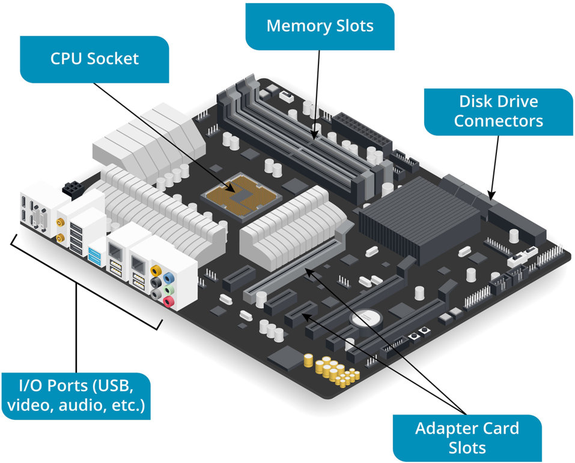

- **Volatile vs. persistent storage** {#mb-memory}
  - hu-title: Illékony és tartós tárolás
  - en: The CPU can hold only a few instructions internally, so running programs and open files are kept in **system memory (RAM)**. RAM is **nonpersistent (volatile)**: it holds data only while the PC is powered on. **Mass storage** devices keep data when the computer is off. CPU, cache and RAM are **fast but volatile**; mass and removable storage are **slower but permanent**.
  - hu: A CPU egyszerre csak kevés utasítást tud magában tárolni, ezért a futó programok és a megnyitott fájlok a **rendszermemóriában (RAM)** vannak. A RAM **nem tartós (illékony)**: csak addig őrzi az adatot, amíg a gép be van kapcsolva. A **háttértárak** kikapcsolt állapotban is megtartják az adatokat. A CPU, a gyorsítótár és a RAM **gyors, de illékony**; a háttértárak és a cserélhető tárolók **lassabbak, de tartósak**.
  - concepts: RAM | system memory | rendszermemória ; volatile | nonpersistent | illékony | felejtő ; mass storage | háttértár ; permanent | persistent | tartós | maradandó
  - figure: 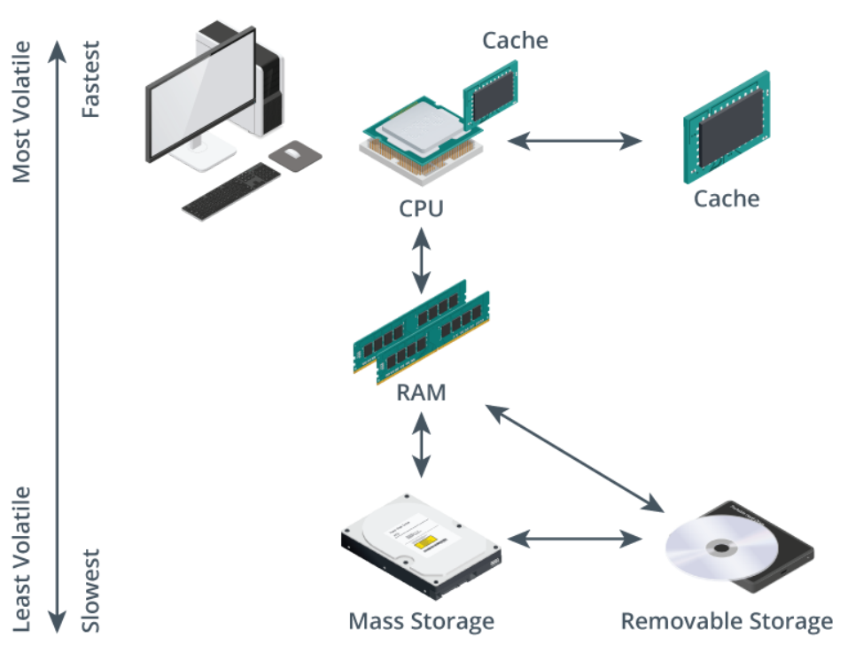

- **System clock and multipliers** {#mb-clock}
  - hu-title: Rendszeróra és órajelszorzók
  - en: The components are connected by **bus interfaces** on the motherboard. The **system clock** synchronizes all parts of the PC and provides the CPU's basic timing signal; clock speeds are measured in **MHz** or **GHz**. **Clock multipliers** apply a multiplication factor to this signal, so different types of bus can run at different speeds.
  - hu: Az alkatrészeket az alaplap **buszai** kötik össze. A **rendszeróra** szinkronizálja a PC összes részét, és ez adja a CPU alapvető órajelét; az órajelet **MHz**-ben vagy **GHz**-ben mérik. Az **órajelszorzók** egy szorzótényezővel ebből állítanak elő más órajeleket, így a különböző buszok eltérő sebességgel működhetnek.
  - concepts: system clock | rendszeróra | órajel ; synchronize | szinkronizál ; MHz | GHz | megahertz | gigahertz ; multiplier | szorzó

## Electrical Safety and ESD {#safety}
hu: Elektromos biztonság és ESD

- **Before opening the case** {#safety-power}
  - hu-title: Mielőtt kinyitod a házat
  - en: **Disconnect the PC from the power supply** before opening the case, then **hold the power button for a few seconds** so that all internal components are drained of charge. Never disassemble components that are **not field repairable**, such as the **power supply (PSU)**.
  - hu: A ház kinyitása előtt **áramtalanítsd a gépet** (húzd ki a tápkábelt), majd **tartsd nyomva néhány másodpercig a bekapcsológombot**, hogy a belső alkatrészek kisüljenek. Soha ne szedd szét a **helyszínen nem javítható** alkatrészeket, például a **tápegységet (PSU)**.
  - concepts: disconnect | unplug | power cord | áramtalanít | kihúz ; hold the power button | power button | bekapcsológomb ; drain | discharge | kisüt | kisülés ; power supply | PSU | tápegység

- **Electrostatic discharge (ESD)** {#safety-esd}
  - hu-title: Elektrosztatikus kisülés (ESD)
  - en: **ESD** happens when a static charge stored on your clothes or body is suddenly released into a circuit as you touch it. The **CPU, RAM, adapter cards and the motherboard** are all vulnerable. Handle components **by their edges or plastic parts** and use an **anti-ESD wrist strap** and other protective equipment.
  - hu: **ESD** akkor történik, amikor a ruhádon vagy a testeden felgyűlt statikus töltés érintéskor hirtelen egy áramkörbe sül ki. A **CPU, a RAM, a bővítőkártyák és maga az alaplap** is érzékeny rá. Az alkatrészeket **a szélüknél vagy a műanyag részeiknél** fogd meg, és használj **antisztatikus (ESD) csuklópántot** és más védőeszközöket.
  - concepts: static charge | static | statikus töltés | sztatikus ; edges | plastic parts | szélénél | műanyag ; wrist strap | csuklópánt

## Motherboard CPU and System Memory Connectors {#cpu-ram}
hu: Processzor- és memóriafoglalatok

- **CPU socket** {#cpu-socket}
  - hu-title: Processzorfoglalat (CPU socket)
  - en: Most PC CPUs are made by **Intel** and **AMD**, which use **different socket designs**. Because CPU technology changes fast, a motherboard supports only a **limited range of processor models**. The socket has a distinctive **square** shape; an installed CPU is covered by a **heat sink and fan**.
  - hu: A PC-processzorok többségét az **Intel** és az **AMD** gyártja, **eltérő foglalatkialakítással**. Mivel a CPU-technológia gyorsan változik, egy alaplap csak **korlátozott számú processzormodellt** támogat. A foglalat jellegzetesen **négyzet alakú**; a beszerelt CPU-t **hűtőborda és ventilátor** takarja.
  - concepts: Intel ; AMD ; limited range | limited | korlátozott ; square | négyzet ; heat sink | fan | hűtőborda | ventilátor

- **Chipset** {#cpu-chipset}
  - hu-title: Lapkakészlet (chipset)
  - en: The **chipset** is a set of controllers that handle data transfer between the CPU and other devices. It is **soldered** onto the motherboard and **cannot be upgraded**. It determines which **CPUs** can be used, the **type and maximum amount of RAM** and the **integrated interfaces** (video, sound, networking); anything else must be added as an **adapter card**.
  - hu: A **lapkakészlet (chipset)** vezérlők együttese, amelyek a CPU és a többi eszköz közötti adatátvitelt intézik. Az alaplapra van **forrasztva**, **nem cserélhető**. Ez határozza meg, milyen **processzorok** használhatók, milyen **típusú és legfeljebb mennyi RAM** tehető be, és milyen **beépített csatlakozók** (videó, hang, hálózat) vannak; ami ezen kívül kell, azt **bővítőkártyával** lehet hozzáadni.
  - concepts: controllers | vezérlő ; soldered | cannot be upgraded | forrasztott | nem cserélhető ; RAM | memória ; integrated | beépített | integrált ; adapter card | expansion card | bővítőkártya

- **DIMM slots** {#ram-dimm}
  - hu-title: DIMM-foglalatok
  - en: Program code is loaded into **RAM** so the CPU can execute it; RAM also holds data while it is being modified, e.g. an open document. System RAM is packaged as a **dual inline memory module (DIMM)**. A DIMM slot has **catches at either end**, sits **close to the CPU socket**, and is **numbered** and often **color-coded**.
  - hu: A programkód a **RAM**-ba töltődik, hogy a CPU végre tudja hajtani; a RAM tárolja a szerkesztés alatt álló adatokat is, például egy megnyitott dokumentumot. A rendszermemória **DIMM (dual inline memory module)** modulok formájában kerül a gépbe. A DIMM-foglalat **két végén rögzítőfül** van, **a processzorfoglalat közelében** található, **számozott** és gyakran **színkódolt**.
  - concepts: dual inline memory module | DIMM ; catches | latches | rögzítőfül | fül ; close to the CPU | near the CPU | processzor közelében | CPU mellett ; numbered | color-coded | számozott | színkódolt

- **RAM generations and capacity** {#ram-ddr}
  - hu-title: RAM-generációk és kapacitás
  - en: RAM technology comes in successive generations such as **DDR3, DDR4 and DDR5**. Each DIMM form factor is **specific to one DDR version**, and a **label next to the slots** shows which type is supported. The maximum amount of memory depends on the **memory controller** and the **number of physical slots**.
  - hu: A RAM-technológiának egymást követő generációi vannak, például **DDR3, DDR4 és DDR5**. Minden DIMM-kialakítás **egy adott DDR-verzióhoz tartozik**, és a **foglalatok melletti címke** jelzi, melyik típus támogatott. A beépíthető memória mennyiségét a **memóriavezérlő** képességei és a **fizikai foglalatok száma** határozza meg.
  - concepts: DDR3 | DDR4 | DDR5 ; specific to one version | not interchangeable | nem felcserélhető ; label | címke ; memory controller | memóriavezérlő ; number of slots | foglalatok száma

## Motherboard Storage Connectors {#storage}
hu: Tárolócsatlakozók az alaplapon

- **SATA ports** {#storage-sata}
  - hu-title: SATA-portok
  - en: Fixed disks (**SSD** or **HDD**) store the OS, software and data persistently. They connect to the motherboard's **Serial Advanced Technology Attachment (SATA)** ports, which can also connect removable drives such as **tape** and **optical (DVD/Blu-ray)** drives. A SATA drive sits in a **drive bay**, connects to a port with a **data cable** and to the PSU with a **SATA power or Molex** connector. Each SATA port connects **one** device.
  - hu: A beépített lemezek (**SSD** vagy **HDD**) tartósan tárolják az operációs rendszert, a programokat és az adatokat. Az alaplap **SATA (Serial Advanced Technology Attachment)** portjaihoz csatlakoznak, amelyekre cserélhető meghajtók is köthetők, például **szalagos** és **optikai (DVD/Blu-ray)** meghajtók. A SATA-meghajtó egy **meghajtórekeszbe** kerül, **adatkábellel** csatlakozik a porthoz, a tápegységhez pedig **SATA- vagy Molex-tápcsatlakozóval**. Egy SATA-portra **egy** eszköz köthető.
  - concepts: Serial Advanced Technology Attachment | SATA ; SSD | HDD ; optical | DVD | Blu-ray | optikai ; SATA power | Molex ; one device | egy eszköz

- **M.2 interface** {#storage-m2}
  - hu-title: M.2 csatlakozó
  - en: An SSD can come in an **adapter card form factor**, often using the **M.2** interface. The M.2 port is **horizontal**: insert the card **at an angle**, push it down and secure it with a **screw**. M.2 **supplies power over the bus**, so no separate power cable is needed.
  - hu: Az SSD **bővítőkártya formájában** is készülhet, ilyenkor gyakran **M.2** csatlakozót használ. Az M.2 port **vízszintes**: a kártyát **ferdén** kell bedugni, majd lenyomni és egy **csavarral** rögzíteni. Az M.2 **a buszon keresztül kapja a tápellátást**, ezért nem kell külön tápkábel.
  - concepts: SSD ; at an angle | angle | ferdén | szögben ; screw | csavar ; power over the bus | no power cable | buszon keresztül | nincs külön tápkábel
  - figure: 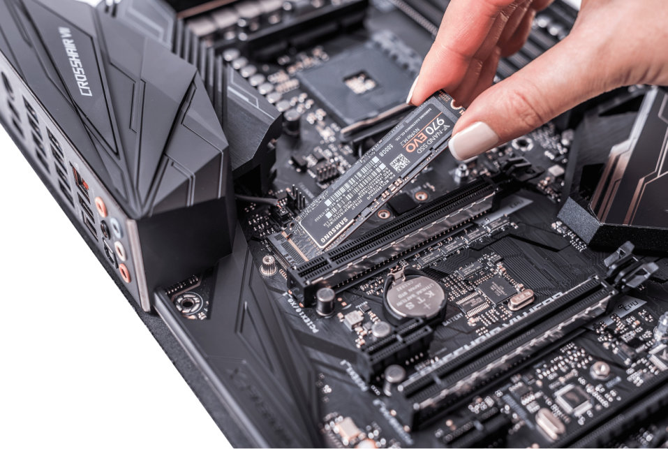

- **M.2 card lengths** {#storage-m2-sizes}
  - hu-title: M.2 kártyák hossza
  - en: M.2 adapters come in different lengths: **42 mm, 60 mm, 80 mm or 110 mm**. Check that an adapter will fit the motherboard; **labels** on the board show the supported sizes.
  - hu: Az M.2 kártyák különböző hosszúságúak lehetnek: **42 mm, 60 mm, 80 mm vagy 110 mm**. Ellenőrizd, hogy a kártya elfér-e az alaplapon; az alaplapon lévő **feliratok** mutatják a támogatott méreteket.
  - concepts: 42 mm ; 60 mm ; 80 mm ; 110 mm ; label | felirat | címke

- **External SATA (eSATA)** {#storage-esata}
  - hu-title: Külső SATA (eSATA)
  - en: The **eSATA** standard attaches **external drives** with a cable of up to **2 m (78 in.)**. You must use an **eSATA cable** to connect to an eSATA port; an internal SATA cable will not do.
  - hu: Az **eSATA** szabvány **külső meghajtók** csatlakoztatására szolgál, legfeljebb **2 m (78 hüvelyk)** hosszú kábellel. Az eSATA porthoz **eSATA kábelt** kell használni; belső SATA kábel nem jó hozzá.
  - concepts: external drives | külső meghajtó ; 2 m | 2 méter | 78 in | 78 inch | 78 hüvelyk ; eSATA cable | eSATA kábel

- **eSATA's main drawback** {#storage-esata-power}
  - hu-title: Az eSATA fő hátránya
  - en: Unlike USB or Thunderbolt, **eSATA does not supply power** over the cable. That matters little for **3.5-inch** drives, which need their own power supply anyway, but it limits eSATA for **2.5-inch portable** drives. **eSATAp** is a nonstandard **powered** port used by some vendors, compatible with both **USB and SATA** (with an eSATAp cable).
  - hu: Az USB-vel és a Thunderbolttal ellentétben **az eSATA kábel nem visz tápellátást**. A **3,5 hüvelykes** meghajtóknál ez nem nagy gond, mert azoknak úgyis külön táp kell, a **2,5 hüvelykes hordozható** meghajtóknál viszont korlátozza az eSATA használhatóságát. Az **eSATAp** egyes gyártók nem szabványos, **tápellátást is adó** portja, amely **USB-vel és SATA-val** is kompatibilis (eSATAp kábellel).
  - concepts: no power | not powered | nincs tápellátás | táp nélkül ; 2.5-inch | 2.5 inch | 2,5 hüvelyk | portable | hordozható ; eSATAp ; USB

## Motherboard Adapter Connectors {#adapters}
hu: Bővítőkártya-csatlakozók az alaplapon

- **PCI Express (PCIe) links and lanes** {#pcie}
  - hu-title: PCI Express (PCIe): linkek és sávok
  - en: **PCIe** is the mainstream interface for modern adapter cards. It uses **point-to-point serial** communication: each connection (a **link**) is dedicated and uses one or more **lanes**. A card supports a specific number of lanes, typically **x1, x4, x8 or x16**, and slots with more lanes are **physically longer**.
  - hu: A **PCIe** a mai bővítőkártyák általános csatlakozója. **Pont-pont közötti soros** kommunikációt használ: minden kapcsolat (**link**) dedikált, és egy vagy több **sávot (lane)** használ. Egy kártya meghatározott számú sávot támogat, jellemzően **x1, x4, x8 vagy x16**-ot, és a több sávos bővítőhelyek **fizikailag hosszabbak**.
  - concepts: point-to-point | pont-pont ; serial | soros ; lanes | lane | sáv ; x1 | x4 | x8 | x16 ; longer | hosszabb
  - figure: 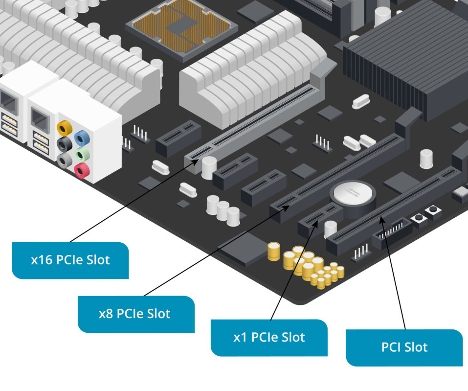

- **PCIe versions and throughput** {#pcie-versions}
  - hu-title: PCIe-verziók és átviteli sebesség
  - en: A lane's raw transfer rate is measured in **gigatransfers per second (GT/s)**; throughput in **GB/s** is what remains after the loss through **encoding**. Throughput roughly **doubles with each version**:
    - **PCIe 2:** 5 GT/s · 0.5 GB/s (x1) · **8 GB/s (x16)**
    - **PCIe 3:** 8 GT/s · 0.985 GB/s (x1) · 15.754 GB/s (x16)
    - **PCIe 4:** 16 GT/s · 1.969 GB/s (x1) · 31.508 GB/s (x16)
    - **PCIe 5:** 32 GT/s · 3.938 GB/s (x1) · 63.015 GB/s (x16)
  - hu: Egy sáv nyers átviteli sebességét **gigatranszfer/másodpercben (GT/s)** mérik; a **GB/s**-ban megadott tényleges átviteli sebesség a **kódolás** okozta veszteség levonása után marad. Az átviteli sebesség **verzióról verzióra nagyjából megduplázódik**:
    - **PCIe 2:** 5 GT/s · 0,5 GB/s (x1) · **8 GB/s (x16)**
    - **PCIe 3:** 8 GT/s · 0,985 GB/s (x1) · 15,754 GB/s (x16)
    - **PCIe 4:** 16 GT/s · 1,969 GB/s (x1) · 31,508 GB/s (x16)
    - **PCIe 5:** 32 GT/s · 3,938 GB/s (x1) · 63,015 GB/s (x16)
  - concepts: GT/s | gigatransfers | gigatranszfer ; GB/s ; encoding | kódolás ; doubles | double | duplázódik | kétszeres

- **Mismatched card and slot sizes** {#pcie-plugging}
  - hu-title: Eltérő kártya- és bővítőhelyméret
  - en: Ideally a card goes into a slot with the same number of lanes. **Up-plugging**: a card fits any slot with an **equal or greater** number of lanes, e.g. a **x8 card in a x16 slot**; it should work at x8, though sometimes only at x1. **Down-plugging** a longer card into a shorter slot may also work if nothing in the case obstructs it. A slot can support fewer lanes than its size suggests, labelled e.g. **x16/x8** or **x16 @ x8**.
  - hu: Ideális esetben a kártya ugyanannyi sávos bővítőhelybe kerül. **Up-plugging**: a kártya bármely **ugyanannyi vagy több** sávos helyre befér, például egy **x8-as kártya x16-os helyre**; x8-ként kell működnie, bár néha csak x1-ként megy. A **down-plugging**, vagyis hosszabb kártya rövidebb helyre tétele is működhet, ha semmi nem akadályozza a házban. Egy bővítőhely kevesebb sávot is támogathat, mint amennyit a mérete sugall; ezt felirat jelzi, pl. **x16/x8** vagy **x16 @ x8**.
  - concepts: up-plugging ; equal or greater | more lanes | több sáv | ugyanannyi ; down-plugging ; x16/x8 | x16 @ x8 | label | felirat

- **PCIe backward compatibility** {#pcie-compat}
  - hu-title: PCIe visszafelé kompatibilitás
  - en: All PCIe versions are **backwards-compatible**: a version 2 card works in a version 4 motherboard, and a version 3 card in a version 2 board. The bus then works at the speed of the **lowest-version** component.
  - hu: Minden PCIe-verzió **visszafelé kompatibilis**: egy 2-es verziójú kártya működik egy 4-es verziójú alaplapon, és egy 3-as kártya egy 2-es alaplapon is. A busz ilyenkor a **legalacsonyabb verziójú** alkatrész sebességével működik.
  - concepts: backwards-compatible | backward compatible | visszafelé kompatibilis ; lowest version | slowest | legalacsonyabb | leglassabb

- **Power through PCIe slots** {#pcie-power}
  - hu-title: Tápellátás a PCIe bővítőhelyeken
  - en: PCIe can supply up to **75 W** to a graphics card through a dedicated graphics adapter slot and up to **25 W** through other slots. A **PCIe power connector** can supply an extra **75 W**.
  - hu: A PCIe a dedikált grafikus bővítőhelyen legfeljebb **75 W**-ot tud adni a videókártyának, a többi bővítőhelyen legfeljebb **25 W**-ot. Egy **PCIe-tápcsatlakozó** további **75 W**-ot biztosíthat.
  - concepts: 75 W | 75 watt ; 25 W | 25 watt ; PCIe power connector | tápcsatlakozó

- **Legacy PCI bus** {#pci}
  - hu-title: A régi PCI busz
  - en: **Peripheral Component Interconnect (PCI)** is a legacy bus superseded by PCIe. PCIe is software-compatible with PCI, so a PCIe motherboard can include **PCI slots** for old cards, but **PCI cards do not fit PCIe slots**. PCI uses **parallel** communication: most PCI is **32-bit at 33.3 MHz**, giving up to **133 MBps** (32 bits ÷ 8 = 4 bytes × 33.3 MHz).
  - hu: A **PCI (Peripheral Component Interconnect)** régi busz, amelyet a PCIe váltott fel. A PCIe szoftveresen kompatibilis a PCI-jal, ezért egy PCIe-s alaplapon is lehetnek **PCI-bővítőhelyek** a régi kártyáknak, de **PCI-kártya nem fér bele PCIe-bővítőhelybe**. A PCI **párhuzamos** kommunikációt használ: többnyire **32 bites, 33,3 MHz**-es, így legfeljebb **133 MBps** (32 bit ÷ 8 = 4 bájt × 33,3 MHz).
  - concepts: legacy | superseded | régi | elavult ; parallel | párhuzamos ; 32-bit | 32 bit | 32 bites ; 33.3 MHz | 33,3 MHz ; 133 MBps | 133 MB/s

- **PCI voltage keying** {#pci-keying}
  - hu-title: PCI-kártyák feszültség szerinti kódolása (keying)
  - en: The earliest PCI cards were designed for **5V** signaling; **3.3V** and **dual-voltage** cards became more common later. The three types have **different keying** (notches in the edge connector), so an incompatible card, such as a 3.3V card in a 5V slot, cannot be inserted.
  - hu: A legkorábbi PCI-kártyák **5 V**-os jelszinttel működtek; később a **3,3 V**-os és a **kettős feszültségű** (dual voltage) kártyák terjedtek el. A három típus **eltérő kódolású** (más-más bevágás van a csatlakozóélen), így nem összeillő kártya – például 3,3 V-os kártya 5 V-os foglalatba – nem dugható be.
  - concepts: 5V | 5 V | 5 volt ; 3.3V | 3.3 V | 3,3 V ; dual voltage | dual-voltage | kettős feszültség ; keying | notch | bevágás | kódolás
  - figure: 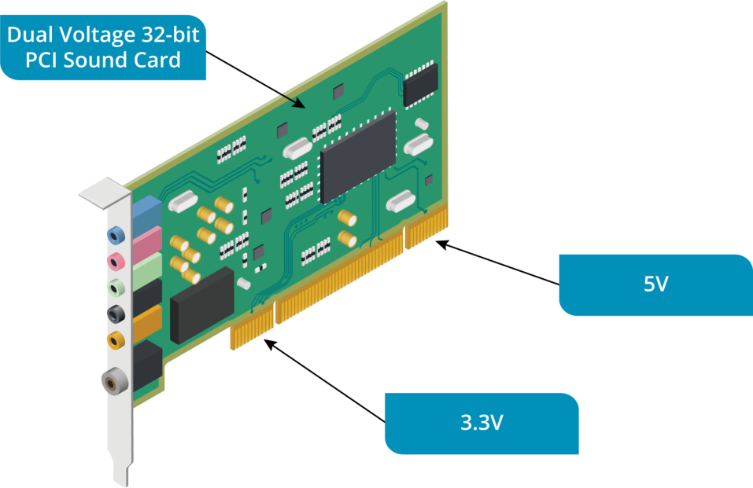

## Motherboard Form Factors {#form-factors}
hu: Alaplap-formátumok (form factor)

- **What a form factor defines** {#ff-definition}
  - hu-title: Mit határoz meg a form factor
  - en: A motherboard's **form factor** describes its **shape and layout**, the type of **case** and **power supply** that can be used with it, and the **number of adapter cards** that can be installed.
  - hu: Az alaplap **formátuma (form factor)** meghatározza az **alakját és elrendezését**, azt, hogy milyen **házzal** és **tápegységgel** használható, valamint hogy **hány bővítőkártya** szerelhető bele.
  - concepts: shape | layout | alak | elrendezés | méret ; case | ház ; power supply | PSU | tápegység ; number of adapter cards | expansion slots | bővítőkártya

- **ATX** {#ff-atx}
  - hu-title: ATX
  - en: **Advanced Technology eXtended (ATX)** is the standard form factor for most desktop PC motherboards and cases. A full-size ATX board is **12 × 9.6 inches (305 × 244 mm)** and can have up to **seven expansion slots**.
  - hu: Az **ATX (Advanced Technology eXtended)** a legtöbb asztali PC alaplapjának és házának szabványos formátuma. A teljes méretű ATX alaplap **12 × 9,6 hüvelyk (305 × 244 mm)**, és legfeljebb **hét bővítőhelye** lehet.
  - concepts: Advanced Technology eXtended | ATX ; 12 in | 12 inch | 305 mm ; 9.6 in | 9,6 | 244 mm ; seven | 7 | hét

- **Micro-ATX (mATX)** {#ff-matx}
  - hu-title: Micro-ATX (mATX)
  - en: **Micro-ATX (mATX)** boards are **9.6 inches (244 × 244 mm) square** and have at most **four expansion slots**. Most mATX boards can be mounted in **ATX cases**.
  - hu: A **Micro-ATX (mATX)** alaplapok **9,6 hüvelykes (244 × 244 mm) négyzet** alakúak, és legfeljebb **négy bővítőhelyük** van. A legtöbb mATX alaplap **ATX házba** is beszerelhető.
  - concepts: 9.6 in | 9,6 | 244 mm ; square | négyzet ; four | 4 | négy ; ATX case | ATX ház

- **Mini-ITX and smaller ITX boards** {#ff-itx}
  - hu-title: Mini-ITX és a kisebb ITX alaplapok
  - en: **Small form factor (SFF)** PCs, popular at home and as mini servers, often use Via's **Mini-ITX** (Information Technology eXtended): **6.7 inches (170 × 170 mm) square** with **one expansion slot**. Most Mini-ITX boards also fit **ATX cases**. **Nano-, pico- and mobile-ITX** are used in **embedded systems and portables**, not PCs; no boards were ever made to the plain ITX specification.
  - hu: A **kis formátumú (SFF, small form factor)** gépek – otthoni gépként és mini szerverként népszerűek – gyakran a Via **Mini-ITX** (Information Technology eXtended) formátumát használják: **6,7 hüvelykes (170 × 170 mm) négyzet**, **egy bővítőhellyel**. A legtöbb Mini-ITX alaplap **ATX házba** is beszerelhető. A **nano-, pico- és mobile-ITX** formátumokat **beágyazott rendszerekben és hordozható eszközökben** használják, nem PC-kben; a sima ITX szabvány szerint soha nem gyártottak alaplapot.
  - concepts: small form factor | SFF | kis formátum ; 6.7 in | 6,7 | 170 mm ; one slot | 1 | egy ; embedded | beágyazott | nano | pico
  - figure: 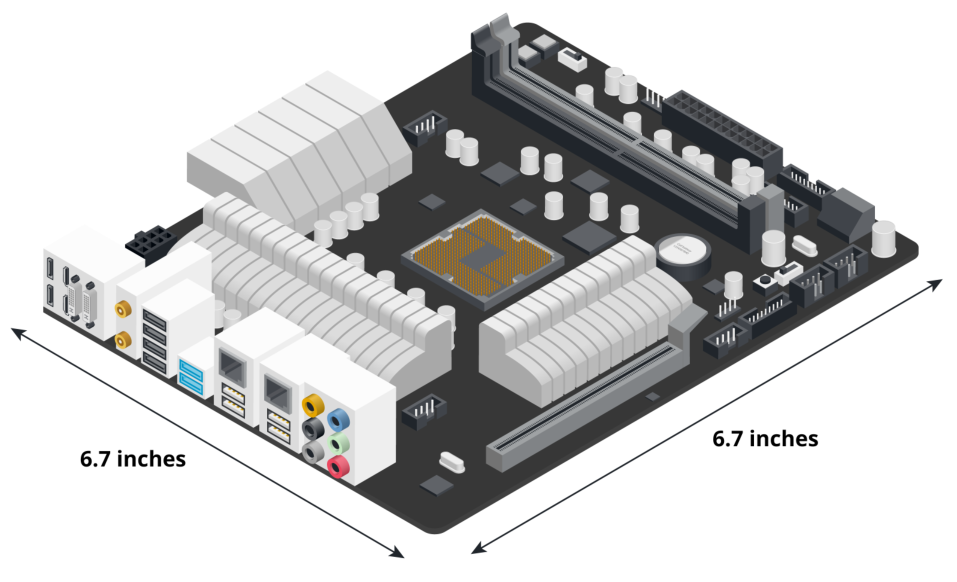

- **Standoffs** {#ff-standoffs}
  - hu-title: Távtartók (standoff)
  - en: The motherboard is attached to the case with **standoffs**, which hold it firmly and make sure **no other part of the board touches the case**. They sit in holes that line up in the case and the board when their form factors are compatible. Support the **corners, long edges and the centre**, and **never add a standoff where the board has no hole**. Standoffs are usually **threaded**; older cases may use push-down pegs.
  - hu: Az alaplapot **távtartókkal (standoff)** rögzítik a házhoz: ezek szilárdan tartják, és biztosítják, hogy **az alaplap más része ne érjen hozzá a házhoz**. Olyan furatokba kerülnek, amelyek kompatibilis formátumnál a házon és az alaplapon egy vonalba esnek. A **sarkokat, a hosszú éleket és a közepet** alá kell támasztani, és **soha ne tegyél távtartót oda, ahol az alaplapon nincs furat**. A távtartók általában **menetesek**; régebbi házakban benyomható tüskék is lehetnek.
  - concepts: touch the case | hozzáér a házhoz ; holes | furat | lyuk ; corners | edges | centre | center | sarkok | élek | közép ; no hole | nincs furat ; threaded | menetes
  - figure: 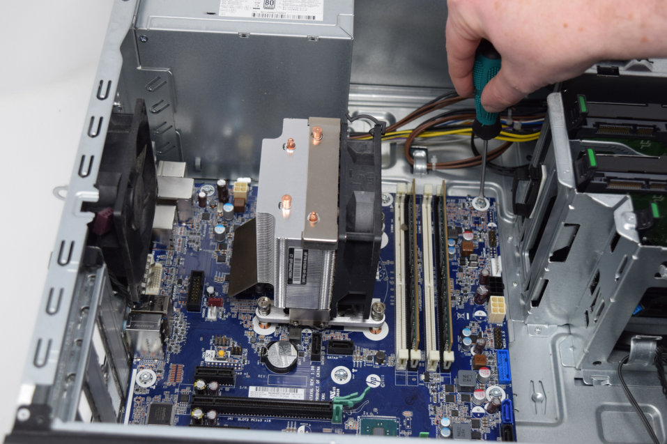

- **Motherboard installation steps** {#ff-install}
  - hu-title: Az alaplap beszerelésének lépései
  - en: Read the **documentation** first and check whether any **jumpers** need adjusting (a jumper is placed over header pins, e.g. to enable recovery mode), and take **anti-ESD** precautions. Fit the **I/O blanking plate**, with caps removed so the ports will be uncovered, into the rear cutout. Optionally add the **CPU and memory** before mounting, place the board on the standoffs and screw it down, but **do not overtighten** the screws or you risk cracking the board.
  - hu: Először olvasd el a **dokumentációt**, és nézd meg, kell-e **jumpert** átállítani (a jumper a tüskesor lábaira helyezett áthidaló, pl. helyreállítási mód engedélyezésére), és tartsd be az **ESD-védelmet**. Pattintsd be a hátsó kivágásba az **I/O takarólemezt**, amelyről előbb eltávolítod a fedőket, hogy a portok szabadok legyenek. Felszerelés előtt rárakhatod a **processzort és a memóriát**, majd tedd az alaplapot a távtartókra és csavarozd le, de **ne húzd túl** a csavarokat, mert megrepedhet az alaplap.
  - concepts: jumper | jumperek | áthidaló ; documentation | dokumentáció ; I/O blanking plate | I/O shield | I/O takarólemez ; overtighten | túlhúz | crack | reped

## Motherboard Headers and Power Connectors {#headers}
hu: Alaplapi tüskesorok (headerek) és tápcsatlakozók

- **Soft power button** {#hdr-power-button}
  - hu-title: Szoftveres bekapcsológomb (soft power)
  - en: The case's power button connects to a header as **soft power**: pressing it sends a signal that the **OS interprets as a shutdown command** instead of switching the PC off. **Holding it down for a few seconds** cuts the power.
  - hu: A ház bekapcsológombja **soft power** módon csatlakozik a headerre: megnyomásakor olyan jelet küld, amelyet az **operációs rendszer leállítási parancsként értelmez**, nem pedig közvetlenül kikapcsolja a gépet. Ha **néhány másodpercig nyomva tartod**, az megszakítja a tápellátást.
  - concepts: soft power ; shutdown | shut down | leállítás ; hold | few seconds | nyomva tart | néhány másodperc ; cut the power | power off | kikapcsol

- **Front panel headers** {#hdr-front-panel}
  - hu-title: Előlapi headerek
  - en: Components on the case's front and rear panels connect to **headers** on the motherboard: the power button, **drive (HDD) activity lights** and **audio ports** for speakers, headphones and a microphone. Before disassembling, **draw a diagram** of the position and orientation of each header connector; otherwise you must rely on the documentation or on labels printed on wires and headers, which are not always easy to follow.
  - hu: A ház elő- és hátlapjának elemei az alaplap **headereire (tüskesoraira)** csatlakoznak: a bekapcsológomb, a **meghajtó (HDD) működését jelző LED-ek** és a hangszórók, fejhallgató és mikrofon **audio portjai**. Szétszerelés előtt **készíts rajzot** az egyes csatlakozók helyéről és irányáról; különben a dokumentációra vagy a vezetékekre és headerekre nyomtatott, nem mindig egyértelmű feliratokra kell hagyatkoznod.
  - concepts: HDD activity | drive activity | LED | meghajtó ; audio | hang ; diagram | rajz | ábra ; orientation | irány | tájolás

- **Internal USB headers** {#hdr-usb}
  - hu-title: Belső USB-headerek
  - en: Internal **USB 2** connections use **9-pin headers**, each accepting up to **two 4-pin port connections**; the 9th pin makes sure the cable is oriented correctly. **USB 3** headers use a **2×10 format** and can also be cabled to two ports.
  - hu: A belső **USB 2** csatlakozások **9 tűs headert** használnak, amely legfeljebb **két 4 tűs portcsatlakozást** fogad; a 9. tű a kábel helyes irányú csatlakoztatását biztosítja. Az **USB 3** headerek **2×10-es** kialakításúak, és szintén két portra köthetők.
  - concepts: 9-pin | 9 pin | 9 tűs ; two ports | 2 ports | két port ; 4-pin | 4 pin | 4 tűs ; 2x10 | 2 x 10 | 20-pin | 20 pin | 20 tűs
  - figure: 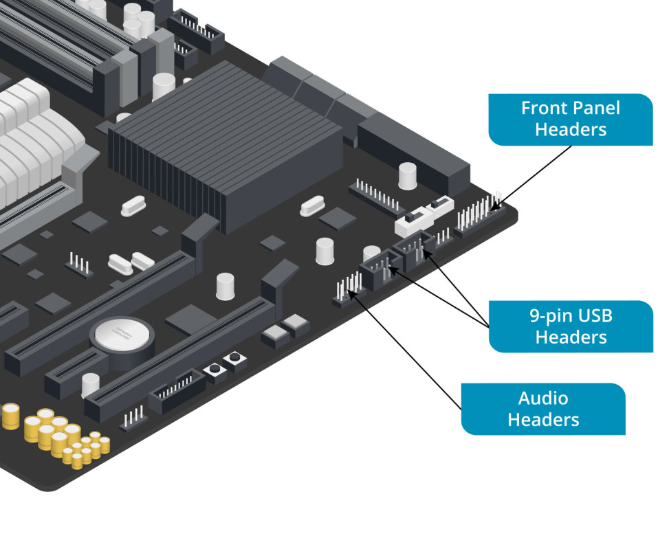

- **Main motherboard power connector (P1)** {#pwr-p1}
  - hu-title: Fő alaplapi tápcsatlakozó (P1)
  - en: The main **P1** motherboard power connector is a distinctive **2 × 12-pin (24-pin)** block with **square pin receptacles**.
  - hu: A fő **P1** alaplapi tápcsatlakozó jellegzetes, **2 × 12 tűs (24 tűs)** blokk **négyzetes tűfoglalatokkal**.
  - concepts: P1 ; 24-pin | 24 pin | 2x12 | 2 x 12 | 24 tűs ; square | négyzet

- **Fan connectors** {#pwr-fan}
  - hu-title: Ventilátorcsatlakozók
  - en: Fan connectors are **3- or 4-pin Molex KK** format: one for the **CPU** fan and one or more for case fans and components such as memory and video adapters. **4-pin** connectors allow precise speed control via a **pulse width modulation (PWM)** signal carried by the **blue wire**; **3-pin** fans are controlled by **varying the voltage**.
  - hu: A ventilátorcsatlakozók **3 vagy 4 tűs Molex KK** kivitelűek: egy a **CPU**-ventilátoré, egy vagy több a házventilátoroké és az olyan alkatrészeké, mint a memória vagy a videókártya. A **4 tűs** csatlakozók a **kék vezetéken** érkező **impulzusszélesség-modulációs (PWM)** jellel pontos fordulatszám-szabályozást tesznek lehetővé; a **3 tűs** ventilátorokat a **feszültség változtatásával** szabályozzák.
  - concepts: Molex KK ; PWM | pulse width modulation | impulzusszélesség ; blue wire | kék vezeték ; voltage | feszültség

- **Mixing 3-pin and 4-pin fans** {#pwr-fan-mix}
  - hu-title: 3 és 4 tűs ventilátorok vegyesen
  - en: A **3-pin fan on a 4-pin header** usually works, but the system may not be able to **vary the fan speed** (or needs special configuration). A **4-pin fan on a 3-pin header** usually works too, but **cannot use PWM**.
  - hu: **3 tűs ventilátor 4 tűs headeren** általában működik, de a rendszer esetleg **nem tudja szabályozni a fordulatszámát** (vagy ehhez külön beállítás kell). **4 tűs ventilátor 3 tűs headeren** is általában működik, de **nem tudja használni a PWM-et**.
  - concepts: works | működik ; fan speed | speed | fordulatszám ; no PWM | without PWM | PWM nélkül

## Video Cards and Capture Cards {#video}
hu: Videókártyák és capture kártyák

- **Onboard vs. add-on graphics** {#video-card}
  - hu-title: Integrált és bővítőkártyás grafika
  - en: The **video card (graphics adapter)** generates the signal that drives a monitor or projector. Low-end graphics is often built into the **chipset or the CPU** (**onboard graphics**). For **3-D gaming, CAD or digital artwork** you need a more powerful **add-on card in a PCIe slot**; most graphics adapters are based on **AMD (ATI), NVIDIA or Intel** chipsets.
  - hu: A **videókártya (grafikus adapter)** állítja elő a monitort vagy projektort meghajtó jelet. Az alsó kategóriás grafika gyakran a **lapkakészletbe vagy a processzorba** van építve (**integrált grafika**). **3D-s játékhoz, CAD-hez vagy digitális grafikához** erősebb, **PCIe-bővítőhelyre szerelt kártya** kell; a legtöbb grafikus adapter **AMD (ATI), NVIDIA vagy Intel** lapkakészletre épül.
  - concepts: onboard | integrated | integrált | beépített ; chipset | CPU | lapkakészlet | processzor ; gaming | CAD | 3-D | 3D | játék ; PCIe ; NVIDIA | AMD | Intel

- **Graphics processing unit (GPU)** {#video-gpu}
  - hu-title: Grafikus processzor (GPU)
  - en: The **GPU** is a microprocessor optimized for rendering **2-D and 3-D** images and effects on screen. Its basic performance test is the **frame rate** it achieves in a particular game or application; support for **texture and lighting effects** also matters.
  - hu: A **GPU** olyan mikroprocesszor, amely **2D-s és 3D-s** képek és effektusok megjelenítésére van optimalizálva. Teljesítményének alapvető mércéje az adott játékban vagy alkalmazásban elért **képkockasebesség (frame rate)**; számít a **textúra- és fényeffektusok** támogatása is.
  - concepts: microprocessor | processzor ; 2-D | 3-D | 2D | 3D ; frame rate | FPS | képkocka ; texture | lighting | textúra | fény

- **Graphics memory** {#video-memory}
  - hu-title: Grafikus memória
  - en: 3-D cards need a lot of memory for processing and textures. High-end dedicated cards have up to **12 GB of GDDR RAM**; **4–6 GB** is typical for current mid-range cards. Low-end cards use **shared memory** (system RAM), and some mix dedicated and shared memory. **GDDR (Graphics Double Data Rate)** is similar to the DDR modules used for system RAM.
  - hu: A 3D-s kártyáknak sok memória kell a feldolgozáshoz és a textúrákhoz. A felső kategóriás, saját memóriás kártyákon akár **12 GB GDDR RAM** is lehet; a mai középkategóriában **4–6 GB** a jellemző. Az alsó kategóriás kártyák **megosztott memóriát** (a rendszer RAM-ját) használnak, egyesek pedig vegyesen saját és megosztott memóriát. A **GDDR (Graphics Double Data Rate)** a rendszermemória DDR moduljaihoz hasonló technológia.
  - concepts: GDDR | Graphics Double Data Rate ; 12 GB ; 4-6 GB | 4–6 GB | mid-range | középkategória ; shared memory | system RAM | megosztott memória | rendszermemória

- **Video card slot and ports** {#video-interface}
  - hu-title: A videókártya bővítőhelye és portjai
  - en: Most modern graphics cards use a **PCIe x16** slot, which usually has a **retaining latch** at the end to hold the card securely; dual cards occupying **two or more slots** also exist. Cards differ in the type and number of video ports, such as **HDMI**, **DisplayPort** and **Thunderbolt** (and **DVI** on older cards).
  - hu: A legtöbb mai videókártya **PCIe x16**-os bővítőhelyet használ, amelynek a végén általában **rögzítőretesz** tartja biztosan a kártyát; léteznek **két vagy több bővítőhelyet** elfoglaló kártyák is. A kártyák a videoportok típusában és számában különböznek: például **HDMI**, **DisplayPort** és **Thunderbolt** (régebbieken **DVI**).
  - concepts: PCIe x16 | x16 ; latch | retaining latch | retesz | rögzítő ; HDMI ; DisplayPort | DP ; Thunderbolt | DVI
  - figure: 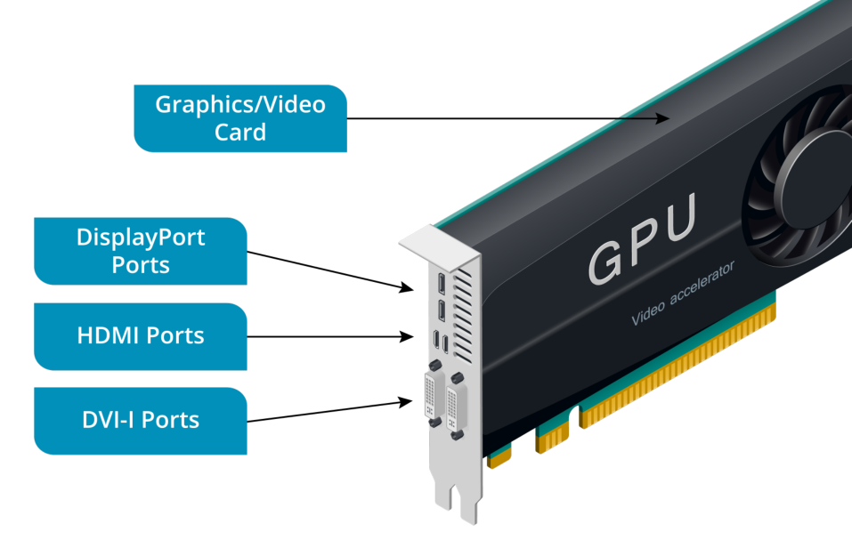

- **Capture cards** {#video-capture}
  - hu-title: Capture kártyák (videórögzítő kártyák)
  - en: A graphics card *outputs* video; a **capture card** **records video input** and saves it as a movie or streaming media file. Many record **game footage** from PC games or a console's **HDMI** output, others record from live HDMI cameras (camcorder, security camera); another class works as a **TV tuner**. A capture card can be an **internal PCIe** card or an **external unit on USB/Thunderbolt**.
  - hu: A videókártya *kiadja* a képet; a **capture kártya** viszont **videobemenetet rögzít**, és film- vagy streamingfájlként menti. Sokuk **játékfelvételt** készít PC-s játékokból vagy konzolok **HDMI**-kimenetéről, mások élő HDMI-s kameraképet rögzítenek (kamkorder, biztonsági kamera); egy másik csoportjuk **TV-tunerként** működik. A capture kártya lehet **belső PCIe-s** kártya vagy **USB/Thunderbolt** csatlakozású **külső egység**.
  - concepts: record | rögzít | felvétel ; video input | bemenet ; HDMI ; TV tuner | tévétuner ; USB | Thunderbolt | external | külső

## Sound Cards {#sound}
hu: Hangkártyák

- **Audio jacks** {#sound-jacks}
  - hu-title: Audio jackek
  - en: Speakers or headphones connect to a **sound card** through an **audio jack**; sound cards also record **microphone** input. Most audio jacks are **3.5 mm (1/8 inch)** mono or stereo jacks, also called **phone plugs** or **mini TRS** (tip, ring, sleeve) connectors.
  - hu: A hangszórók és fejhallgatók **audio jackkel** csatlakoznak a **hangkártyához**; a hangkártya a **mikrofon** jelét is rögzíti. A legtöbb audio jack **3,5 mm-es (1/8 hüvelykes)** mono vagy sztereó jack, más néven **phone plug** vagy **mini TRS** (tip, ring, sleeve – csúcs, gyűrű, hüvely) csatlakozó.
  - concepts: 3.5 mm | 3,5 mm | 1/8 inch | 1/8 ; TRS | tip ring sleeve ; mono | stereo | sztereó ; microphone | mikrofon

- **Sound card jack colours** {#sound-colors}
  - hu-title: A hangkártya jackjeinek színei
  - en: Sound card jacks are colour-coded: **pink = microphone in**, **light blue = audio (line) in** and **green = main audio out** for speakers or headphones. Extra outputs such as **black** and **orange** feed additional speakers in surround systems.
  - hu: A hangkártya jackjei színkódoltak: **rózsaszín = mikrofonbemenet**, **világoskék = audio- (vonal-) bemenet**, **zöld = fő audiokimenet** a hangszóróknak vagy fejhallgatónak. A további kimenetek, például a **fekete** és a **narancssárga**, a térhatású rendszerek további hangszóróit hajtják.
  - concepts: pink | rózsaszín | microphone | mikrofon ; blue | kék | line in | audio in | bemenet ; green | zöld | audio out | kimenet ; black | orange | fekete | narancs
  - figure: 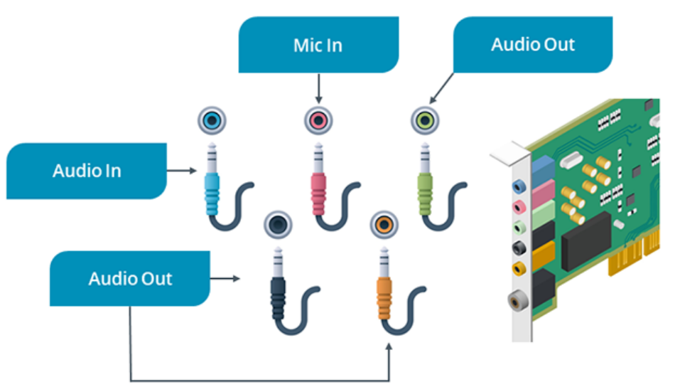

- **Playback channels** {#sound-surround}
  - hu-title: Lejátszási csatornák
  - en: Sound cards with multiple **output channels** and a matching speaker system can play **mono** (legacy systems), **stereo** or some type of **surround sound**. Surround sound uses **multiple speakers positioned around the listener** for a "cinematic" experience.
  - hu: A több **kimeneti csatornás** hangkártyák megfelelő hangszórórendszerrel **mono** (régi rendszereken), **sztereó** vagy valamilyen **térhatású (surround)** hangot adhatnak. A térhatású hang **a hallgató körül elhelyezett több hangszóróval** ad „mozis” élményt.
  - concepts: mono ; stereo | sztereó ; surround | térhatású ; around the listener | multiple speakers | több hangszóró | körül

- **Onboard, add-on and external audio** {#sound-types}
  - hu-title: Beépített, bővítőkártyás és külső hang
  - en: A basic **sound chip** may be part of the motherboard chipset; better audio comes as a **PCIe or PCI expansion card**. Pro-level cards may add onboard memory, **flash memory storing sound samples (wavetables)** and extra jack types. Because built-in audio can pick up **noise from other internal components** when recording, most **professional audio interfaces are external** units on **USB or Thunderbolt**.
  - hu: Egy egyszerű **hangchip** az alaplap lapkakészletének része lehet; jobb minőségű hangot **PCIe- vagy PCI-bővítőkártya** ad. A profi kártyákon lehet saját memória, **hangmintákat (wavetable) tároló flash memória** és többféle bemeneti jack. Mivel a beépített hanghardver felvételkor **zajt szedhet össze a többi belső alkatrésztől**, a legtöbb **professzionális audio interfész külső** egység, **USB-n vagy Thunderbolton** csatlakozik.
  - concepts: sound chip | chipset | hangchip | lapkakészlet ; wavetable | sound samples | hangminta ; noise | zaj ; external | külső ; USB | Thunderbolt

## Network Interface Cards {#nic}
hu: Hálózati kártyák (NIC)

- **Add-on network interface cards** {#nic-card}
  - hu-title: Bővítő hálózati kártyák
  - en: Most computers already have an **Ethernet** adapter as part of the motherboard chipset. An add-on **network interface card (NIC)** is needed to use a different type of network or **cabling/connector**, such as **copper vs. fiber optic**. A dedicated NIC can provide **multiple ports**, which can be **bonded** into a single higher-bandwidth link.
  - hu: A legtöbb számítógépben eleve van **Ethernet**-adapter az alaplap lapkakészletében. Bővítő **hálózati kártya (NIC)** akkor kell, ha más hálózattípust vagy **kábelezést/csatlakozót** akarsz használni, például **réz helyett optikai szálat**. Egy külön hálózati kártyán **több port** is lehet, amelyek **összevonhatók (bonding)** egyetlen, nagyobb sávszélességű kapcsolattá.
  - concepts: Ethernet ; network interface card | NIC | hálózati kártya ; copper | fiber | fibre | réz | optikai | üvegszál ; bonded | bonding | összevon
  - figure: 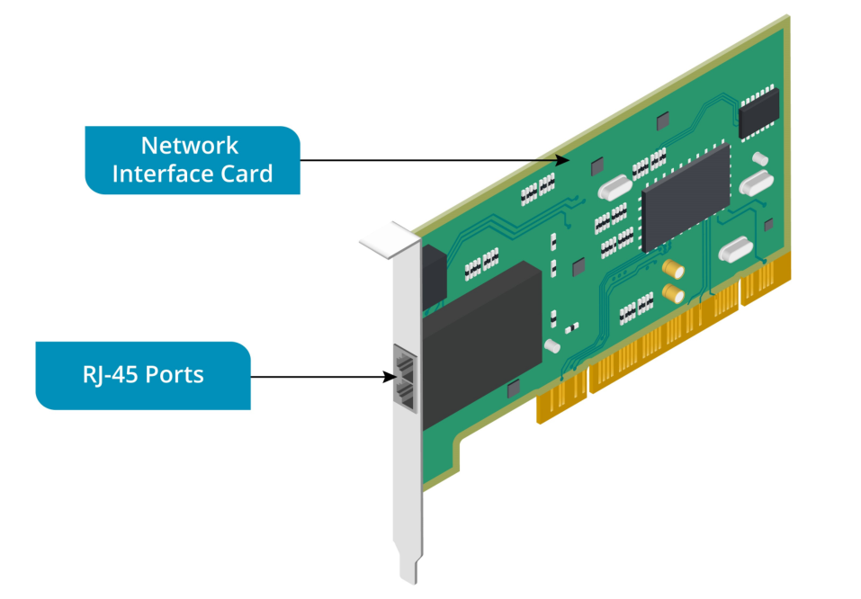

- **Wireless and cellular adapters** {#nic-wireless}
  - hu-title: Vezeték nélküli és mobilhálózati adapterek
  - en: A **Wi-Fi adapter** can be added to connect the PC to a wireless network; Wi-Fi adapters are developed to different **802.11** standards. There are also cards that connect to **cellular data networks**.
  - hu: **Wi-Fi-adapterrel** a gép vezeték nélküli hálózatra csatlakoztatható; a Wi-Fi-adapterek különböző **802.11**-es szabványok szerint készülnek. Vannak **mobil adathálózathoz** csatlakozó kártyák is.
  - concepts: Wi-Fi | WiFi | wireless | vezeték nélküli ; 802.11 ; cellular | mobile | mobil | cellás
