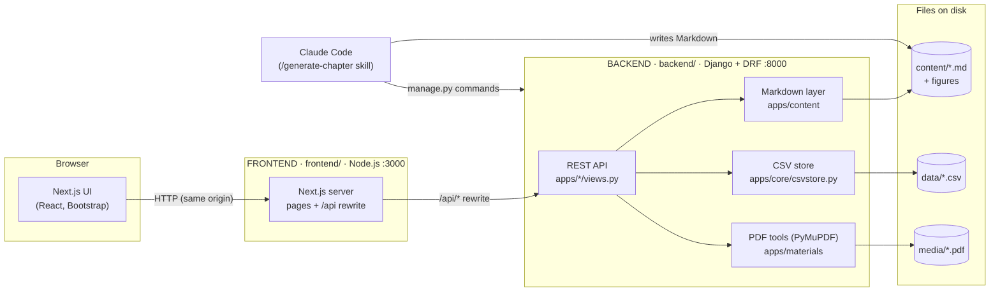
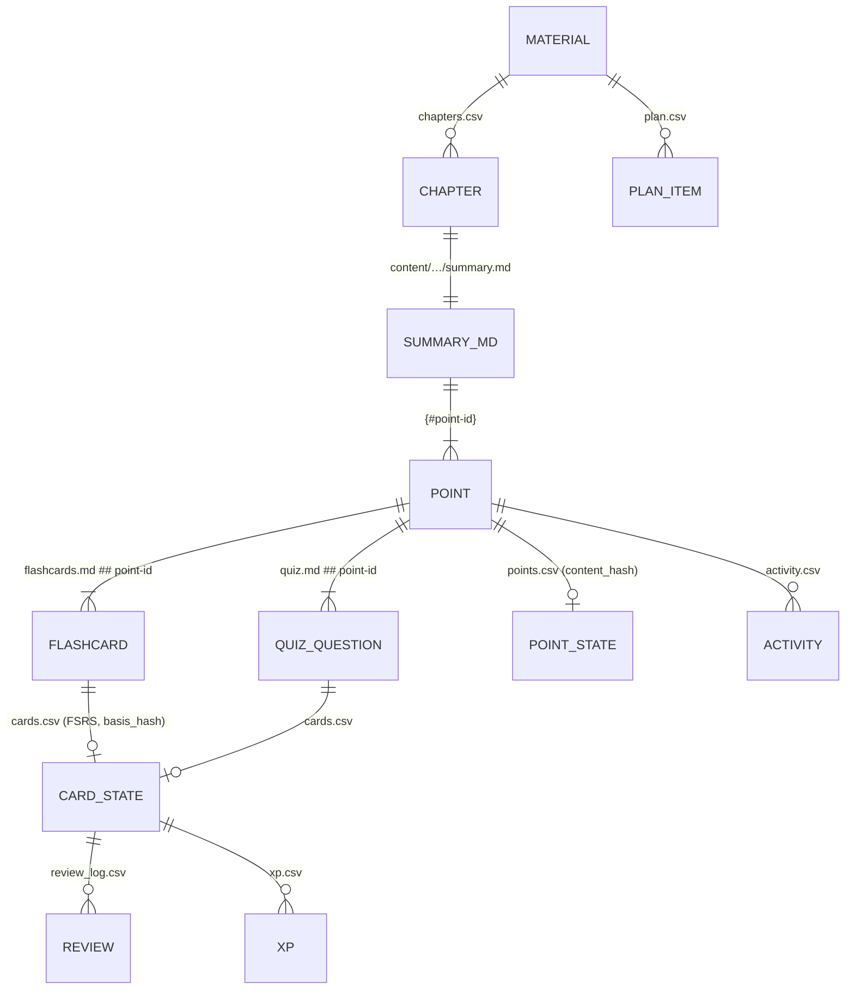
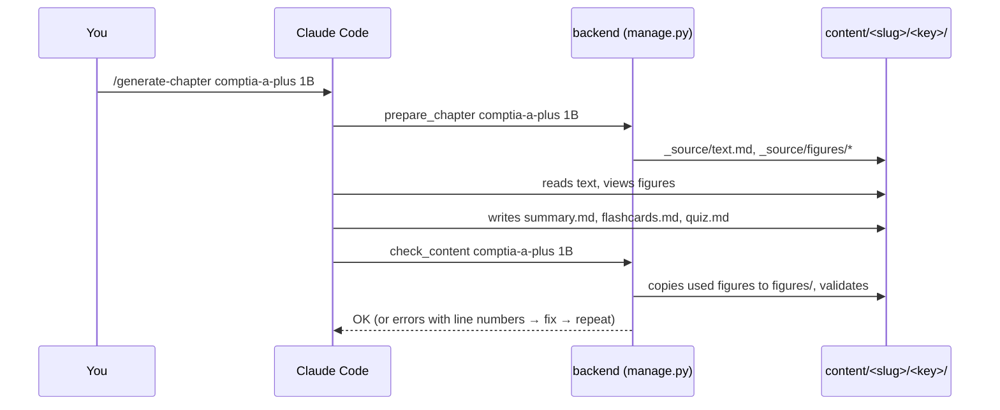

# Architecture

StudyDesk is a single-user learning app. You import a PDF textbook, study it chapter by chapter, and
practise with bilingual (English + Hungarian) summaries, flashcards and quizzes that use spaced
repetition and earn XP.

It has **no database and no AI integration of its own**:

* **Learning content** (summaries, flashcards, quizzes, notes) consists of **Markdown files** in
  `content/`. Claude Code writes them; the app reads them and lets you edit them.
* **State** (chapters, progress, spaced-repetition schedule, XP, study plan) is kept in **CSV files** in
  `data/`.
* **Uploaded PDFs** and cached chapter slices are plain files in `media/`.

## The big picture



| | Frontend | Backend |
|---|---|---|
| Folder | `frontend/` | `backend/` |
| Technology | Next.js 16 (App Router, TypeScript), React 19, Bootstrap 5.3, TanStack Query | Django 5.2 LTS, Django REST Framework, PyMuPDF, FSRS, RapidFuzz |
| Runs as | `npm run dev` / `next start` on port 3000 | `manage.py runserver` / gunicorn on port 8000 |
| Responsible for | Every screen and interaction: dashboard, study plan, PDF reader, summary modes, editors, practice sessions, printing, language and theme toggles | Login, files, PDF processing, parsing/validating/writing Markdown, progress, spaced repetition, XP, study plan, statistics |
| Stores data? | No (only UI preferences in `localStorage`) | Yes: `content/`, `data/`, `media/` |

The browser only talks to Next.js. Every request to `/api/...` is forwarded to Django (in development
by the rewrite in `frontend/next.config.ts`, in production by nginx), so the session cookie and the
CSRF cookie are same-origin.

## Repository layout

```
study-app/
├── README.md                    Quickstart: install, run, generate content, test
├── CLAUDE.md                    Instructions for Claude Code working in this repo
├── .gitignore                   Ignores venv, .env, data/, media/, content/**/_source/
├── .claude/skills/generate-chapter/SKILL.md
│                                The workflow Claude Code follows to write a chapter's content
├── docs/
│   ├── ARCHITECTURE.md          This document
│   ├── CONTENT_FORMAT.md        Exact Markdown syntax of summary/flashcards/quiz files
│   └── DATA_FORMAT.md           Every CSV file and column
├── content/                     LEARNING CONTENT (Markdown, git-tracked)
├── data/                        STATE (CSV, not in git — back it up)
├── media/                       UPLOADED PDFs + cached chapter slices (not in git)
├── backend/                     BACKEND (Django + DRF)
└── frontend/                    FRONTEND (Next.js)
```

### `content/` — learning content (Markdown)

```
content/<material-slug>/
├── notes/<note-id>.md           Material-level notes written in the app
└── <chapter-key>/               e.g. comptia-a-plus/1A
    ├── summary.md               Sections → bullet points (EN + HU), key concepts, figures
    ├── flashcards.md            ≥ 1 card per bullet point
    ├── quiz.md                  ≥ 1 four-option question per bullet point
    ├── notes.md                 Chapter notes written in the app
    ├── figures/                 Images used by the three files above
    └── _source/                 (gitignored) text + candidate figures extracted for Claude Code
```

These files are the **single source of truth** for content. Edits made in the app are written back to
them, and edits made in the files (by you or Claude Code) appear in the app on the next request — there
is no import step. The syntax is specified in [CONTENT_FORMAT.md](CONTENT_FORMAT.md).

### `data/` — state (CSV)

`materials.csv`, `chapters.csv`, `plan.csv`, `doc_index.csv`, `points.csv`, `cards.csv` (mutable
tables) and `review_log.csv`, `activity.csv`, `xp.csv` (append-only logs). Columns are listed in
[DATA_FORMAT.md](DATA_FORMAT.md). `.lock` is the lock file that serializes writes.

### `media/`

`media/<slug>/source.pdf` is the uploaded PDF; `slices/<key>-<start>-<end>.pdf` are cached single-chapter
PDFs for the reader; `decorative_xrefs.json` caches which images are repeated icons.

### `backend/` — BACKEND

| Path | What it does |
|---|---|
| `manage.py` | Django command-line entry point (`runserver`, `import_pdf`, `check_content`, …). |
| `requirements.txt` | Python dependencies. |
| `.env.example` → `.env` | Settings: secret key, allowed hosts, password hash, storage roots, XP values. |
| `pytest.ini`, `tests/` | Test suite (`.venv/bin/python -m pytest`). Every test runs against temporary storage folders. |
| `config/settings.py` | Django settings. `DATABASES = {}`, signed-cookie sessions, DRF defaults, storage roots. |
| `config/urls.py` | Mounts every app's API under `/api/`. |
| `config/wsgi.py`, `asgi.py` | Server entry points (gunicorn uses `wsgi.py`). |

**`apps/core/` — shared foundations**

| File | What it does |
|---|---|
| `csvstore.py` | The tiny CSV "database": typed tables, cached reads, atomic writes (temp file + rename), cross-process lock (`data_lock()`). |
| `tables.py` | Definition of every CSV table as a dataclass (= the data model). |
| `auth.py` | Single-user login: password check against `OWNER_PASSWORD_HASH`, session flag, DRF authentication class. |
| `views.py`, `urls.py` | `/api/auth/csrf/`, `login/`, `logout/`, `me/`. |
| `files.py` | Safe path joining and authenticated file responses (optionally via nginx `X-Accel-Redirect`). |
| `paths.py` | Where things live on disk (`content/<slug>/<key>/…`, `media/<slug>/…`). |
| `exceptions.py` | `Conflict` (409, file changed meanwhile) and `InvalidDocument` (422, Markdown errors). |
| `management/commands/set_password.py` | `manage.py set_password` — stores a hashed password in `.env`. |

**`apps/materials/` — materials, PDFs, chapters**

| File | What it does |
|---|---|
| `outline.py` | Turns the PDF outline into chapters (pure functions): picks the outline level, merges "Topic 1A" + its title, finds page ranges and lesson groups. |
| `pdf.py` | PyMuPDF work: read outline, cut chapter slices, extract chapter text, extract figures with captions, crop page regions. |
| `services.py` | Create/update/delete materials, attach a PDF, (re)build chapters, change chapter status. |
| `views.py`, `urls.py` | Materials, PDF upload/download, outline, chapter detail/status, chapter PDF, figures, figure files. |
| `management/commands/import_pdf.py` | `manage.py import_pdf <slug> <file.pdf>` — create a material from a local PDF. |
| `management/commands/prepare_chapter.py` | Extracts text + candidate figures of a chapter into `_source/` for Claude Code. |
| `management/commands/crop_figure.py` | Renders a page region as an extra figure (for vector diagrams). |

**`apps/content/` — the Markdown documents**

| File | What it does |
|---|---|
| `mdformat/model.py` | Dataclasses for the parsed documents (`SummaryDoc`, `Point`, `Flashcard`, `QuizQuestion`, …) and content hashes. |
| `mdformat/parse.py` | Strict line-based parsers with line-numbered errors. |
| `mdformat/render.py` | Canonical Markdown writer (parse → render → parse is lossless). |
| `mdformat/validate.py` | Rules: required fields, unique ids, 4 options / 1 correct, figures exist, every point has cards. |
| `repository.py` | Read (cached by file stamp) and write (atomic, guarded by `base_sha` → 409 on conflicts) documents. |
| `sync.py` | Keeps `points.csv` / `cards.csv` in step with the Markdown; detects **stale** cards. |
| `ops.py` | Structured edits used by the editor UI (add/update/move/delete points, sections, cards). |
| `notes.py` | Material-level notes as Markdown files. |
| `answer_check.py` | Offline scoring of a written-out bullet point against its key concepts (fuzzy, accent-insensitive). |
| `serializers.py` | JSON shapes of points, flashcards and quiz questions for the API. |
| `views.py`, `urls.py` | Summary/flashcards/quiz read + edit endpoints, raw Markdown editor, answer check, memorize activity, notes. |
| `management/commands/check_content.py` | Validate a chapter, adopt referenced figures, reindex; exits non-zero on problems. |
| `management/commands/stale_report.py` | List cards that are outdated after summary edits. |
| `management/commands/reindex_content.py` | Rebuild the CSV index from the Markdown. |

**`apps/study/` — learning progress**

| File | What it does |
|---|---|
| `srs.py` | Spaced repetition (FSRS algorithm via the `fsrs` package) behind two functions. |
| `services.py` | `record_answer()` (SRS + logs + XP + learned check), memorize activity, per-point progress, levels. |
| `plan.py` | Generates the study plan (chapters spread over study days, weighted by page count) and its status. |
| `stats.py` | Dashboard numbers: XP, level, streak, due reviews, XP per day, recent activity. |
| `views.py`, `urls.py` | Practice sessions, answers, study plan, dashboard. |

### `frontend/` — FRONTEND

| Path | What it does |
|---|---|
| `package.json` | Dependencies and scripts (`dev`, `build`, `start`, `lint`). |
| `next.config.ts` | `/api/*` → Django rewrite, no trailing-slash redirects (Django needs them), Cache Components settings. |
| `src/proxy.ts` | Redirects to `/login` when there is no session cookie (Next.js 16 name for middleware). |
| `src/app/layout.tsx` | Root HTML: fonts, Bootstrap + icon CSS, theme script, providers. |
| `src/app/providers.tsx` | Browser-only boundary (`use(browser())`), TanStack Query, preferences, toasts. |
| `src/app/login/page.tsx` | Password-only login page. |
| `src/app/(app)/layout.tsx` | App shell (sidebar + top bar) around every signed-in page. |
| `src/app/(app)/page.tsx` | Dashboard: XP/level, due reviews, chapters learned, streak, continue studying, XP chart, activity. |
| `src/app/(app)/materials/page.tsx` | List of study materials + "New material". |
| `src/app/(app)/materials/[slug]/page.tsx` | One material: Study plan · PDF & chapters · Notes tabs. |
| `src/app/(app)/chapters/[material]/[key]/page.tsx` | Chapter workspace: Read · Summary · Flashcards · Quiz · Notes steps, status, outdated-cards banner. |
| `src/app/(app)/practice/page.tsx` | Practice session for a chapter or selected points (flashcards, quiz, write-out). |
| `src/app/(app)/review/page.tsx` | Spaced-repetition review of all due cards. |
| `src/app/print/chapters/[material]/[key]/page.tsx` | Printable summary (EN / HU / both). |
| `src/components/layout/AppShell.tsx` | Sidebar, top bar, language switch (EN/HU/EN+HU), dark mode, logout. |
| `src/components/summary/SummaryTab.tsx` | Summary with Read / Memorize / Select & practice / Edit modes and per-point progress chips. |
| `src/components/summary/MemorizeBody.tsx` | Hidden text with "Reveal all", "Word by word" and "Write it" (+ answer check). |
| `src/components/summary/PointEditor.tsx` | Edit a bullet point together with its linked flashcard and quiz question. |
| `src/components/flashcards/CardsTab.tsx` | Flashcard and quiz lists with editors, "Still valid", raw Markdown, "Practice all". |
| `src/components/practice/PracticeRunner.tsx` | Runs a session: flip cards + 4 ratings, quiz with shuffled options, write-out; XP toasts. |
| `src/components/plan/StudyPlan.tsx` | Plan generator and Lesson → Topic tree with status and dates. |
| `src/components/plan/PdfTab.tsx` | PDF upload (with progress) and choice of outline level. |
| `src/components/notes/*` | Material notes and chapter notes (Markdown editor + preview). |
| `src/components/editor/*` | CodeMirror Markdown editor, raw-file editor modal, figure picker, shared form fields. |
| `src/components/common/ui.tsx` | Small shared pieces: bilingual text `Bi`, Markdown `Md`, figures, badges, loaders. |
| `src/lib/api.ts` | `fetch` wrapper: CSRF header, JSON, errors, redirect to login on 401, upload with progress. |
| `src/lib/queries.ts` | TanStack Query hooks for every API resource. |
| `src/lib/types.ts` | TypeScript types of the API responses. |
| `src/lib/prefs.tsx` | Language (EN / HU / both) and theme preferences, saved in `localStorage`. |
| `src/lib/toast.tsx` | Toast notifications (XP, saves, errors). |
| `src/styles/tokens.css` | Design tokens (colors, radii, shadows, light + dark) ported from the EduManage reference design. |
| `src/styles/app.css` | Layout and component styles (sidebar, KPI cards, summary, memorize, practice). |
| `src/styles/print.css` | Print layout for summaries. |
| `AGENTS.md` | Generated by Next.js: tells coding agents to read the bundled Next.js docs. |

## Data model

Content and state are linked by **stable ids** written in the Markdown (`{#usb-2}`, `## usb-2`).



## Main flows

### 1. Importing a PDF

`manage.py import_pdf` or the upload on the material's "PDF & chapters" tab stores the file in
`media/`, reads the PDF outline and creates chapters at the chosen outline level (for the CompTIA book:
64 Topics in 20 Lessons). Each chapter gets a page range and its lesson as group. The reader shows a
cached single-chapter PDF slice.

### 2. Generating content (Claude Code)



### 3. Learning a chapter

1. **Read** the PDF slice → "I have read it" sets the chapter to *read*.
2. **Summary** — *Read* mode shows everything; *Memorize* mode hides the text below each bullet title
   (reveal all, word by word, or write it and get it checked against the key concepts); *Select &
   practice* starts flashcards / quiz / write-out for chosen points only.
3. **Flashcards / Quiz** — practise all items of the chapter.
4. A chapter becomes **learned** automatically when every bullet point has been through the quiz, **or**
   through flashcards, **or** revealed/written in memorize mode. It can also be set manually.

Each answer goes through `study/services.py::record_answer()`: the FSRS schedule in `cards.csv` is
updated, the answer is logged in `review_log.csv` and `activity.csv`, and a correct flashcard or quiz
answer adds XP to `xp.csv` (10 XP each, configurable). Cards come back in **Review** when they are due.

### 4. Editing and outdated cards

Every edit goes parse → change → render → atomic write. Each write carries the sha256 of the version
you edited; if the file changed in the meantime (for example Claude Code edited it) the API returns
409 instead of overwriting.

`cards.csv` stores, for each flashcard / quiz question, the hash of the bullet point it was written for
(`basis_hash`). When a bullet point changes and its cards do not, they are **outdated**: badges and a
banner appear in the app, and `manage.py stale_report` lists them. Fix them by editing the card in the
app, pressing "Still valid", or running `/generate-chapter --refresh <slug> <key>` in Claude Code.

### 5. Login

One password, stored hashed in `backend/.env` (`manage.py set_password`). Login stores a flag and a
fingerprint of the password hash in a **signed session cookie** (no server-side session store).
Changing the password changes the fingerprint and logs out every browser. All API endpoints except
login require the session; all writes require the CSRF token.

## API overview

| Method & path | Purpose |
|---|---|
| `GET /api/auth/csrf/` · `POST login/` · `POST logout/` · `GET me/` | Authentication |
| `GET POST /api/materials/` · `GET PATCH DELETE /api/materials/<slug>/` | Materials |
| `GET POST /api/materials/<slug>/pdf/` · `GET …/outline/` · `POST …/chapters/build/` | PDF and chapters |
| `GET POST /api/materials/<slug>/plan/` | Study plan |
| `GET POST /api/materials/<slug>/notes/` · `GET PUT DELETE …/notes/<id>/` | Material notes |
| `GET PATCH /api/chapters/<slug>/<key>/` | Chapter detail, manual status |
| `GET …/pdf/` · `GET …/files/<path>` · `GET POST …/figures/` | Chapter PDF slice, figure files, figure picker |
| `GET POST …/summary/` | Summary (+ progress, stale flags) / structured edits (`op`) |
| `GET POST …/flashcards/` · `GET POST …/quiz/` | Cards / structured edits |
| `POST …/cards/confirm/` | "Still valid" |
| `GET PUT …/documents/<summary\|flashcards\|quiz\|notes>/` | Raw Markdown read / replace |
| `POST …/points/<point>/check-answer/` · `POST …/points/<point>/activity/` | Memorize mode |
| `GET /api/practice/session/` · `POST /api/practice/answer/` | Practice and review |
| `GET /api/stats/dashboard/` | Dashboard numbers |

(`…` = `/api/chapters/<slug>/<key>`)

## Deploying to a VPS (outline)

```
              ┌──────────────── nginx (TLS, :443) ────────────────┐
  browser ──▶ │  /api/*            → gunicorn :8000 (Django)       │
              │  /protected/media/   internal → MEDIA_ROOT         │
              │  /protected/content/ internal → CONTENT_ROOT       │
              │  everything else   → next start :3000 (Next.js)    │
              └────────────────────────────────────────────────────┘
```

1. Copy the repository; create `backend/.venv`, `pip install -r requirements.txt`; `npm ci && npm run build`
   in `frontend/`.
2. `backend/.env`: `DEBUG=false`, a long `SECRET_KEY`, `ALLOWED_HOSTS=<your domain>`,
   `CSRF_TRUSTED_ORIGINS=https://<your domain>`, `USE_X_ACCEL_REDIRECT=true`, and absolute
   `CONTENT_ROOT` / `DATA_ROOT` / `MEDIA_ROOT` (e.g. under `/srv/study-app/`). Run `manage.py set_password`.
3. systemd services:
   `gunicorn config.wsgi --bind 127.0.0.1:8000 --workers 1 --threads 4` (in `backend/`) and
   `npm start -- --port 3000` (in `frontend/`). One worker with threads is plenty for one user; the CSV
   lock also makes several workers safe.
4. nginx: `client_max_body_size 500M;` for PDF uploads, `location /api/` → `127.0.0.1:8000`,
   `location /protected/media/ { internal; alias /srv/study-app/media/; }` (same for content),
   `location /` → `127.0.0.1:3000`.
5. Backups: `content/`, `data/`, `media/` and `backend/.env` contain everything. `content/` can also be
   synced with git between your laptop (where Claude Code generates) and the server.

## Design decisions

* **Markdown + CSV instead of a database** — content stays human-readable, diffable and directly
  editable by Claude Code; for a single user the data is tiny (≈2–3k cards for a whole book), so loading
  a CSV file per request takes milliseconds. Atomic writes and a file lock protect against corruption.
* **No Claude API calls at runtime** — content is generated ahead of time by Claude Code, so the app
  has no API costs or keys. The written-answer check therefore works offline (key concepts + fuzzy
  matching) and you confirm or override its verdict.
* **FSRS** for spaced repetition — the modern successor of SM-2 (also used by Anki), isolated in
  `study/srs.py`.
* **Browser-only rendering** — all pages show private data loaded from the API, so the React tree is
  rendered in the browser behind one Suspense boundary (`use(browser())`); Next.js still provides
  routing, the dev server, the `/api` proxy and production serving.
