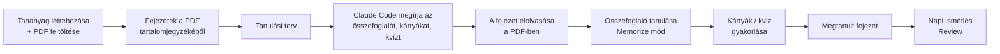

# StudyDesk — Funkciók

[English](FEATURES.md) · **Magyar**

A StudyDesk egy tankönyv PDF-ből tanfolyamot készít. Feltöltöd a PDF-et, az app fejezetekre bontja, és
minden fejezethez kétnyelvű (angol + magyar) összefoglaló, tanulókártyák és kvíz tartozik. A fejezetet
lépésről lépésre tanulod meg, gyakorlod, az időzített ismétlés (spaced repetition) pedig épp akkor
hozza vissza a kártyákat, mielőtt elfelejtenéd őket. Az XP, a szintek és a napi sorozat mutatja, hogy
haladsz.

Ez az útmutató azt írja le, mit lehet csinálni az appban. A felépítéséről az
[ARCHITECTURE.md](ARCHITECTURE.md) szól (angolul).

Az app felülete angol nyelvű, ezért a gombok és menük nevét itt is angolul írjuk, **félkövéren**.

## Tartalom

1. [A tanulás menete röviden](#1-a-tanulás-menete-röviden)
2. [Belépés és tájékozódás](#2-belépés-és-tájékozódás)
3. [Dashboard (kezdőlap)](#3-dashboard-kezdőlap)
4. [Tananyagok és PDF-import](#4-tananyagok-és-pdf-import)
5. [Tanulási terv](#5-tanulási-terv)
6. [A fejezet oldala](#6-a-fejezet-oldala)
7. [Az összefoglaló: Read, Memorize, Select & practice, Edit](#7-az-összefoglaló-read-memorize-select--practice-edit)
8. [Tanulókártyák és kvíz](#8-tanulókártyák-és-kvíz)
9. [Gyakorlás](#9-gyakorlás)
10. [Review — időzített ismétlés](#10-review--időzített-ismétlés)
11. [Haladás: megtanult fejezetek, XP, szintek, sorozat](#11-haladás-megtanult-fejezetek-xp-szintek-sorozat)
12. [A tartalom szerkesztése és az elavult kártyák](#12-a-tartalom-szerkesztése-és-az-elavult-kártyák)
13. [Jegyzetek](#13-jegyzetek)
14. [Nyomtatás](#14-nyomtatás)
15. [Tartalom generálása Claude Code-dal](#15-tartalom-generálása-claude-code-dal)
16. [Billentyűparancsok](#16-billentyűparancsok)
17. [Az adataid és a mentés](#17-az-adataid-és-a-mentés)

---

## 1. A tanulás menete röviden



1. **Hozz létre egy tananyagot**, és töltsd fel a PDF-jét. A fejezetek a PDF tartalomjegyzékéből készülnek.
2. **Készíts tanulási tervet.** A fejezetek elosztva kerülnek a tanulási napjaidra, egészen a vizsga napjáig.
3. **Generáltasd le a tartalmat.** Claude Code megírja a fejezet összefoglalóját, kártyáit és kvízét.
4. **Tanuld meg a fejezetet:** olvasd el a PDF-oldalakat, menj végig az összefoglalón, aztán gyakorolj.
5. **Ismételj** minden nap az esedékes kártyákkal, hogy megmaradjon, amit megtanultál.

## 2. Belépés és tájékozódás

**Belépés.** A StudyDesk egyfelhasználós app, egyetlen jelszó védi (felhasználónév nincs). Kilépni a
jobb felső sarokban lévő fiók menüben a **Log out** gombbal lehet. A jelszót a szerveren a
`manage.py set_password` paranccsal lehet beállítani. Ha megváltoztatod, minden böngészőből kijelentkeztet.

**Oldalsáv** (bal oldalon; telefonon a ☰ gombbal nyílik):

| Elem | Mi ez |
|---|---|
| **Dashboard** | A napi áttekintés. |
| **Review** | Időzített ismétlés. A számláló mutatja, hány kártya esedékes. |
| **Study materials** | Az összes tananyagod, alattuk mindegyik külön is, hogy gyorsan elérd. |
| Alul | A jelenlegi **szinted**, az összes **XP**-d és a haladás a következő szintig. |

**Felső sáv:**

| Vezérlő | Mit csinál |
|---|---|
| **EN / HU / EN+HU** | A tananyag nyelve (összefoglaló, kártyák, kvíz). **EN+HU** módban a magyar szöveg az angol alatt jelenik meg. Az app menüi és gombjai angolul maradnak. |
| ☾ / ☀ | Váltás világos és sötét mód között. |

A nyelvet és a témát böngészőnként megjegyzi az app.

## 3. Dashboard (kezdőlap)

A kezdőlap arra felel, hogy „mit csináljak ma?”.

- **Üdvözlő sor:** hány kártya vár ismétlésre, és mennyi XP-t szereztél ma. A **Review due cards**
  gomb elindítja az ismétlést.
- **Level (szint):** a jelenlegi szint, az összes XP, és hogy mennyi hiányzik a következő szintig.
- **Due reviews (esedékes ismétlések):** a most esedékes kártyák, külön a tanulókártyák és a
  kvízkérdések, valamint hogy ma hányat ismételtél.
- **Chapters learned (megtanult fejezetek):** a megtanult fejezetek száma az összesből, minden tananyagban.
- **Study streak (sorozat):** hány egymást követő napon tanultál.
- **Continue studying (folytatás):** minden tananyag következő, még meg nem tanult fejezete, azzal együtt,
  hogy a tananyag fejezeteiből hány van már megtanulva, mikorra van tervezve, és piros figyelmeztetéssel,
  ha le vagy maradva a tervtől.
- **XP in the last 14 days:** oszlopdiagram az elmúlt két hétről (egy oszlop fölé állva látod a pontos értéket).
- **Recent activity (legutóbbi tevékenység):** az utolsó 12 válaszod (tanulókártya, kvíz, felfedés,
  leírás) és az eredményük.

## 4. Tananyagok és PDF-import

A **Study materials** oldal minden tananyagot kártyaként mutat a fejezetek és oldalak számával, és
hogy a fejezetek hány százaléka van megtanulva.

**New material (új tananyag):** add meg a címet és ha akarod, egy leírást, majd **Create**. Az app rögtön
a PDF fülre visz.

Minden tananyagnak három füle van: **Study plan** (tanulási terv), **PDF & chapters** (PDF és
fejezetek), **Notes** (jegyzetek). A **Continue with …** gomb a következő, még meg nem tanult fejezethez ugrik.

### PDF & chapters fül

- **Import / Replace PDF:** PDF feltöltése vagy cseréje (folyamatjelző mutatja a feltöltést, aztán
  beolvassa a tartalomjegyzéket). Az **Open** új lapon megnyitja a teljes PDF-et.
- **Chapters from the outline:** a PDF tartalomjegyzékének szintjei vannak (például *Lesson* →
  *Topic*). A táblázat szintenként megmutatja, hány fejezetet adna, mennyi az átlagos oldalszám, és
  hoz néhány példát. Az ajánlott szint jelölése **suggested**, a használatban lévőé **in use**. A
  **Use** gombbal újraépítheted a fejezeteket egy másik szint alapján. Azoknál a fejezeteknél, amelyek
  kulcsa nem változik, megmarad a haladás.

Minden fejezetnek van kulcsa (pl. `1A`), címe, oldaltartománya és csoportja (pl. a leckéje).

## 5. Tanulási terv

A **Study plan** fül a teljes tananyagot mutatja, és azt, hogy melyik fejezetre mikor kerül sor.

**Összesítő kártyák:**

- **Learned:** megtanult fejezetek az összesből.
- **Schedule:** **On track** (tartod a tervet), vagy hány fejezettel vagy **lemaradva** (amelyek egy
  korábbi napra voltak tervezve, de még nincsenek megtanulva; a mai fejezet még nem számít késésnek).
- **Target:** a vizsga / célnap, az oldalak és a fejezetek száma.

**Terv készítése / újratervezése:**

| Mező | Jelentés |
|---|---|
| **Start** | Az első tanulási nap. |
| **Exam / target date** | Nem kötelező. A hátralévő fejezetek egyenletesen oszlanak el eddig a napig. |
| **Study days** | A hét mely napjain tanulsz (H–V). |

A még meg nem tanult fejezetek **oldalszám szerint súlyozva** oszlanak el a tanulási napokon, így egy
40 oldalas fejezet több időt kap, mint egy 5 oldalas. Céldátum nélkül a tempó nagyjából **25 oldal
tanulási naponként**. A megtanult fejezetek megtartják a dátumukat. Ha lemaradtál, csak nyomd meg a
**Regenerate** gombot.

**Fejezetlista:** leckék szerint csoportosítva (leckénként „megtanult / összes”). Minden sorban ott az
állapot ikonja, a fejezet kulcsa és címe, az oldalak, a **summary ready** jelzés, ha már kész a
tartalma, és a tervezett dátum (piros, ha elmúlt, és a fejezet még nincs megtanulva). Egy sorra
kattintva megnyílik a fejezet.

## 6. A fejezet oldala

A fejezet oldalán zajlik a tanulás.

**Fejléc:** a fejezet kódja és címe, az állapota, hogy miből lett megtanulva („learned via quiz”), a
pontok, tanulókártyák és kvízkérdések száma, valamint a tervezett dátum.

- **Progress** menü: az állapotot kézzel is beállíthatod: *Not started* (nem kezdted el), *In
  progress* (folyamatban), *Mark as read* (elolvasva), *Mark as learned* (megtanulva). Az állapot
  magától is változik, lásd a [11. részt](#11-haladás-megtanult-fejezetek-xp-szintek-sorozat).
- **‹ ›** gombok: előző / következő fejezet.

**Lépések:** **Read · Summary · Flashcards · Quiz · Notes** (olvasás, összefoglaló, tanulókártyák,
kvíz, jegyzetek). Ha egy lépés kész, ✓ jelet kap.

### Read (olvasás)

Az oldalba ágyazva a PDF-nek csak az ehhez a fejezethez tartozó oldalai jelennek meg, nem az egész
könyv. Az **Open in new tab** teljes méretben nyitja meg. Ha végeztél, kattints az **I have read it**
gombra: a fejezet *Read* állapotba kerül, és továbblépsz az összefoglalóra.

### Figyelmeztetések

Sárga sáv jelenik meg, ha:

- egyes tanulókártyák / kvízkérdések **elavultak**, mert a hozzájuk tartozó pontot átírták, vagy
- egyes pontokhoz még **nincs tanulókártya vagy kvízkérdés**.

A javításukról a [12. rész](#12-a-tartalom-szerkesztése-és-az-elavult-kártyák) szól.

## 7. Az összefoglaló: Read, Memorize, Select & practice, Edit

Az összefoglaló **szakaszokra**, a szakaszok **pontokra** oszlanak. Egy pontnak van rövid címe,
hosszabb magyarázata (angolul és magyarul), lehet hozzá egy ábra a könyvből, és van egy
**kulcsfogalom**-listája, amivel az app az írásos válaszokat ellenőrzi.

Az eszköztáron négy mód közül választhatsz. Módváltáskor az oldal ott marad, ahol olvastál.

### Read mód (olvasás)

Minden látszik: címek, magyarázatok, ábrák. Minden pont mellett három kis **haladásjelző** mutatja a
legutóbbi eredményedet az adott pontnál:

| Jelző | Jelentés | Szín |
|---|---|---|
| **M** | Memorize (felfedve vagy leírva) | zöld = jó, kék = megnézve, sárga = részben, piros = rossz, szürke = még nem |
| **F** | Flashcard (tanulókártya) | ugyanígy |
| **Q** | Quiz (kvíz) | ugyanígy |

### Memorize mód (memorizálás)

Csak a pontok címe marad látható, a magyarázatot szürke sávok takarják. Próbáld felidézni, majd
kattints a sávokra, és válassz:

- **Reveal all:** megmutatja a szöveget („megnézve”-ként számít).
- **Word by word:** kattintásonként (vagy <kbd>Szóköz</kbd>-re) egy-egy szót fed fel. A **Reveal all**
  felfedi a többit.
- **Write it:** írd le a magyarázatot a saját szavaiddal, és kattints a **Check** gombra. Az app megmutatja:
  - a javasolt értékelést: **Looks correct** (jónak tűnik), **Partly correct** (részben jó) vagy
    **Missing key concepts** (hiányoznak kulcsfogalmak),
  - hogy a kulcsfogalmak hány százalékát említetted,
  - az eltalált (zöld) és a kihagyott (piros) fogalmakat,
  - az eredeti szöveget.

  A végső eredményt te döntöd el a **Correct / Partly / Wrong** gombokkal (a javaslat ki van emelve,
  de felülbírálhatod).

Az eszköztáron látszik, hány pontot memorizáltál (**x/y points memorized**), a **Hide all** pedig
mindent újra eltakar. Egyetlen pontot a **Hide again** takar el.

> **Hogyan működik az ellenőrzés?** Offline fut, mesterséges intelligencia nélkül. Minden
> kulcsfogalomnak több elfogadott megfogalmazása van, mindkét nyelven (pl. `480 Mbps | 480 Mb/s`). Az
> összevetés nem figyel az ékezetekre és a kis- és nagybetűkre, elnézi az apró elírásokat, és a
> mértékegységes számokat is rugalmasan kezeli (`5 m` = `5m` = `5 méter`). Ha a fogalmak legalább 75%-a
> megvan, *jó* a javaslat, 40–75% között *részben jó*, ez alatt *rossz*. Angolul és magyarul is
> írhatsz. A **Word by word** **HU** módban a magyar, egyébként az angol szöveget fedi fel.

### Select & practice mód (kiválasztás és gyakorlás)

Minden pont (és minden szakaszcím) mellé jelölőnégyzet kerül. Válaszd ki, amit gyakorolni akarsz,
például csak azokat a pontokat, amelyeket elrontottál, majd használd az alsó sávot:

- **Select all** (mind) / **Clear** (törlés)
- **Practice:** **Flashcards**, **Quiz** vagy **Write out** (leírás), csak a kiválasztott pontokra.

### Edit mód (szerkesztés)

Lásd a [12. részt](#12-a-tartalom-szerkesztése-és-az-elavult-kártyák).

A **Print** gomb a nyomtatható változatot nyitja meg ([14. rész](#14-nyomtatás)).

## 8. Tanulókártyák és kvíz

A **Flashcards** és a **Quiz** lépés a fejezet összes elemét listázza.

- **Tanulókártya:** melyik ponthoz tartozik, az eleje (kérdés) és a hátulja (válasz), és ha van, ábra.
- **Kvízkérdés:** a kérdés, négy válaszlehetőség (a helyes zölddel, ✓ jellel), és a magyarázat, hogy
  miért az a helyes.
- Minden elem alatt az ismétlési állapota: **new** (új) vagy **„N reviews · due &lt;dátum&gt;”**
  (N ismétlés · esedékes ekkor).
- **outdated** (elavult) jelzés és **Still valid** (még érvényes) gomb, ha a pontot az elem megírása
  után módosították.
- ✎ szerkesztés, 🗑 törlés. Törléskor az ismétlési előzmények megmaradnak, csak többé nem kerül gyakorlásra.

Eszköztár: **Edit Markdown** (a teljes fájl szerkesztése), **Add** (új elem egy kiválasztott ponthoz),
**Practice all** (gyakorlás az összes elemmel).

## 9. Gyakorlás

A gyakorlás egymás után hozza az elemeket, folyamatjelzővel és egy **✕** gombbal a kilépéshez.
Indítható a **Practice all** gombbal (Flashcards / Quiz lépés) vagy az összefoglaló **Select & practice**
módjából.

### Tanulókártyák

1. Megjelenik a kérdés. Kattints a kártyára, vagy nyomd meg a <kbd>Szóköz</kbd>t a válaszhoz.
2. Értékeld, mennyire tudtad:

| Gomb | Billentyű | Jelentés | Minek számít |
|---|---|---|---|
| **Again** | <kbd>1</kbd> | elfelejtettem | rossz |
| **Hard** | <kbd>2</kbd> | nehezen jött | jó |
| **Good** | <kbd>3</kbd> | eszembe jutott | jó |
| **Easy** | <kbd>4</kbd> | azonnal tudtam | jó |

Az értékelésed dönti el, mikor jön vissza a kártya a **Review**-ban.

### Kvíz

A négy válasz minden alkalommal **véletlen sorrendben** jelenik meg (A–D, vagy az <kbd>1</kbd>–<kbd>4</kbd>
billentyűk). Válasz után a helyes zöld lesz, a rossz választás piros, és megjelenik a magyarázat.
A **Next** (<kbd>Enter</kbd>) visz tovább. A jó válasz *Good*-ként, a rossz *Again*-ként ütemezi a kártyát.

### Leírás (Write out)

Csak a pont címét látod, és leírod, amire emlékszel. A **Check** összeveti a kulcsfogalmakkal
(ugyanúgy, mint a Memorize módban), az **I don't know** pedig egyből a megoldáshoz ugrik. Ezután te
döntöd el: **Correct / Partly / Wrong**.

### A gyakorlás vége

Az összesítő megmutatja az elemek számát, a jó válaszokat és a szerzett XP-t. A **Done** visszavisz
a fejezethez, az **Again** megismétli ugyanazt a kört.

Minden jó tanulókártya- és kvízválasz után **+10 XP** üzenet jelenik meg. Ha egy gyakorlással a
fejezet teljesen megtanulttá válik, **„Chapter learned!”** üzenetet kapsz.

## 10. Review — időzített ismétlés

A **Review** (oldalsávon vagy a kezdőlapon) összegyűjti az összes tanulókártyát és kvízkérdést,
amelynek eljött az ismétlési ideje, **minden tananyagból**, a legrégebben esedékessel kezdve
(egy körben legfeljebb 100-at). Pontosan úgy működik, mint a gyakorlás.

- Egy kártya csak **azután kerül az ismétlések közé, hogy legalább egyszer gyakoroltad**, így a még
  el nem kezdett fejezetek nem árasztják el a sort.
- Az ütemezés az **FSRS** nevű modern algoritmussal történik (ezt használja az Anki is), 90%-os
  felidézési arányra törekedve. Amit jól tudsz, egyre ritkábban jön vissza; amit elfelejtesz, hamar.
- A fejezeten belüli gyakorlás ugyanezt az ütemezést frissíti, így a tanulás és az ismétlés nem ütik egymást.

## 11. Haladás: megtanult fejezetek, XP, szintek, sorozat

**A fejezet állapota:** *Not started* → *In progress* → *Read* → *Learned*.

- Az első válasz vagy memorizálás *Not started*-ból *In progress*-be teszi a fejezetet.
- Az **I have read it** *Read*-re állítja.
- A fejezet **magától Learned (megtanult) lesz**, ha **minden pontja** átment az alábbiak **egyikén**:
  - a **kvízen**, vagy
  - a **tanulókártyákon**, vagy
  - a **Memorize módon** (felfedve vagy leírva).

  Minden ponthoz legalább egy próbálkozás kell, akár jó, akár rossz. A fejezeten látszik, melyik út
  zárta le („learned via quiz”).
- Az állapotot bármikor kézzel is beállíthatod a **Progress** menüben.

**XP:** minden jó tanulókártya-válasz (Hard/Good/Easy) és minden jó kvízválasz **10 XP**-t ér (a
szerveren módosítható). A memorizálás és a leírás nem ad XP-t, de beszámít a *Learned* állapotba.

**Szintek:** az *n*-edik szint 50 × (n − 1)² XP-nél kezdődik.

| Szint | 1 | 2 | 3 | 4 | 5 | 6 |
|---|---|---|---|---|---|---|
| XP-től | 0 | 50 | 200 | 450 | 800 | 1250 |

**Sorozat (streak):** hány egymást követő napon válaszoltál vagy memorizáltál legalább egyszer. A mai
nap csak akkor szakítja meg, ha véget ér úgy, hogy nem tanultál.

## 12. A tartalom szerkesztése és az elavult kártyák

Mindent, amit Claude Code generált, az appban is módosíthatsz.

### Összefoglaló → Edit mód

- **Pontok:** ↑ ↓ mozgatás, ✎ szerkesztés, 🗑 törlés (a hozzá tartozó tanulókártya és kvízkérdés is
  törlődik), minden szakasz végén **Add point** (új pont).
- **Szakaszok:** mozgatás, átnevezés (angol + magyar cím), törlés, **Add section** (új szakasz).
- Minden pont alatt látszanak a **kulcsfogalmai**.
- Az **Edit Markdown** a nyers `summary.md`-t nyitja meg.

**A pontszerkesztő** egy ablakban szerkeszti a pontot **a hozzá tartozó tanulókártyával és kvízkérdéssel együtt**:

- cím és magyarázat **angolul és magyarul** (Markdown is használható),
- **kulcsfogalmak:** a fogalmakat `;`, az alternatív megfogalmazásokat `|` választja el, pl.
  `480 Mbps | 480 Mb/s ; 5 m | 5 méter ; Hi-Speed`,
- **ábra:** választhatsz a fejezet ábrái közül, vagy az **Extract from PDF** gombbal képjelölteket
  nyerhetsz ki a fejezet oldalairól, és átveheted valamelyiket,
- a kapcsolódó tanulókártya és kvízkérdés (vagy **add one**, ha még nincs).

Ha a szöveget átírod, a kártyákat viszont nem, az ablak figyelmeztet, hogy azok elavultnak lesznek jelölve.

### Nyers Markdown-szerkesztő

Az összefoglalóhoz, a tanulókártyákhoz és a kvízhez érhető el. A hibákat sorszámmal listázza, és
hibás fájlt nem ment el. Ha a fájl közben a lemezen megváltozott (például Claude Code épp módosította),
az app nem írja felül, hanem elutasítja a mentést. A **Reload from disk** betölti a legfrissebb
változatot. A `{#id}` jelölőket ne változtasd meg: ezekhez kötődik a haladás és az ismétlési előzmény.

### Elavult kártyák

Minden tanulókártya és kvízkérdés megjegyzi, hogy a pontja melyik változatához készült. Ha a pontot
átírod, a kártyái **elavultak** lesznek (sárga jelzés és figyelmeztető sáv a fejezeten). Így javíthatod:

- szerkeszd a kártyát, vagy
- kattints a **Still valid** gombra, ha még helyes, vagy
- futtasd Claude Code-ban: `/generate-chapter --refresh <tananyag> <fejezet>`.

## 13. Jegyzetek

- **Tananyag-jegyzetek** (a tananyag *Notes* füle): tetszőleges számú jegyzet, mindegyiknek címe és
  Markdown-szövege van. **Write** (írás) és **Preview** (előnézet) között válthatsz, aztán **Save**
  (mentés) vagy **Delete** (törlés).
- **Fejezetjegyzet** (a fejezet *Notes* lépése): fejezetenként egy szabad Markdown-jegyzet, ugyanilyen
  írás/előnézet szerkesztővel.

A jegyzetek Markdown-fájlként a tananyag mellett tárolódnak.

## 14. Nyomtatás

A **Print** gomb (az összefoglaló eszköztárán) a fejezet összefoglalójának tiszta, nyomtatható
változatát nyitja meg, minden szakasszal, ponttal és ábrával. Fent válaszd ki a nyelvet (**EN**,
**HU** vagy **EN+HU**), majd **Print / Save as PDF**. A nyomat mindig világos témájú.

## 15. Tartalom generálása Claude Code-dal

Magában az appban nincs mesterséges intelligencia, és nem hív külső API-t. A tananyagot előre írja meg
Claude Code, ebben a repóban:

```
/generate-chapter comptia-a-plus 1B            # új fejezet
/generate-chapter --refresh comptia-a-plus 1A  # kártyák/kvíz frissítése az összefoglaló átírása után
```

Claude Code kiolvassa a fejezet szövegét és ábráit a PDF-ből, megírja a kétnyelvű összefoglalót, a
tanulókártyákat (pontonként legalább egyet) és a kvízkérdéseket (pontonként legalább egyet), majd
ellenőrzi őket. Az új tartalom azonnal megjelenik az appban, importálni nem kell. Az üres fejezetek
megmutatják a pontos parancsot. A `summary.md`-t az appból kézzel is megírhatod.

## 16. Billentyűparancsok

| Hol | Billentyű | Mit csinál |
|---|---|---|
| Tanulókártyák | <kbd>Szóköz</kbd> / <kbd>Enter</kbd> | Válasz megmutatása |
| Tanulókártyák | <kbd>1</kbd> <kbd>2</kbd> <kbd>3</kbd> <kbd>4</kbd> | Again / Hard / Good / Easy |
| Kvíz | <kbd>1</kbd>–<kbd>4</kbd> | Az A–D válasz kiválasztása |
| Kvíz | <kbd>Enter</kbd> | Következő kérdés |
| Memorize → Word by word | <kbd>Szóköz</kbd> / <kbd>Enter</kbd> | Következő szó |

Amíg szövegmezőbe gépelsz, a billentyűparancsok nem működnek.

## 17. Az adataid és a mentés

Adatbázis nincs: minden közönséges fájl, amit elolvashatsz, lementhetsz vagy gitbe tehetsz.

| Mappa | Tartalom |
|---|---|
| `content/` | Tananyag és jegyzetek (Markdown) |
| `data/` | Haladás, ismétlési ütemezés, XP, tanulási terv (CSV) |
| `media/` | A feltöltött PDF-ek |
| `backend/.env` | Beállítások és a jelszó hash-e |

Ezt a négy helyet kell átmásolnod, ha menteni akarod az appot, vagy át akarod költöztetni egy másik
gépre vagy szerverre.
