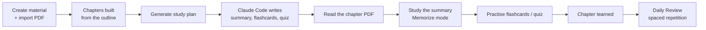

# StudyDesk — Features

**English** · [Magyar](FEATURES.hu.md)

StudyDesk turns a textbook PDF into a study course. You import the PDF, the app splits it into
chapters, and each chapter gets a bilingual (English + Hungarian) summary, flashcards and a quiz. You
learn a chapter step by step, practise it, and spaced repetition brings the cards back right before you
would forget them. XP, levels and a daily streak track your progress.

This guide describes what you can do in the app. For how it is built, see
[ARCHITECTURE.md](ARCHITECTURE.md).

## Contents

1. [The learning flow at a glance](#1-the-learning-flow-at-a-glance)
2. [Signing in and finding your way around](#2-signing-in-and-finding-your-way-around)
3. [Dashboard](#3-dashboard)
4. [Study materials and PDF import](#4-study-materials-and-pdf-import)
5. [Study plan](#5-study-plan)
6. [The chapter workspace](#6-the-chapter-workspace)
7. [The summary: Read, Memorize, Select & practice, Edit](#7-the-summary-read-memorize-select--practice-edit)
8. [Flashcards and quiz](#8-flashcards-and-quiz)
9. [Practice sessions](#9-practice-sessions)
10. [Review (spaced repetition)](#10-review-spaced-repetition)
11. [Progress: learned chapters, XP, levels, streak](#11-progress-learned-chapters-xp-levels-streak)
12. [Editing content and outdated cards](#12-editing-content-and-outdated-cards)
13. [Notes](#13-notes)
14. [Printing](#14-printing)
15. [Generating content with Claude Code](#15-generating-content-with-claude-code)
16. [Keyboard shortcuts](#16-keyboard-shortcuts)
17. [Your data and backups](#17-your-data-and-backups)

---

## 1. The learning flow at a glance



1. **Create a study material** and import its PDF. Chapters are built from the PDF's table of contents.
2. **Generate a study plan.** Chapters are spread over your study days up to your exam date.
3. **Generate the content.** Claude Code writes the summary, flashcards and quiz for a chapter.
4. **Learn the chapter:** read the PDF pages, go through the summary, then practise.
5. **Review** due cards every day to keep what you learned.

## 2. Signing in and finding your way around

**Sign-in.** StudyDesk is a single-user app protected by one password (no username). Use the account
menu (person icon, top right) to **Log out**. The password is set on the server with
`manage.py set_password`. Changing it logs you out in every browser.

**Sidebar** (left; on a phone, open it with the ☰ button):

| Item | What it is |
|---|---|
| **Dashboard** | Your daily overview. |
| **Review** | Spaced-repetition session. The badge shows how many cards are due. |
| **Study materials** | All your materials, with each one listed underneath for quick access. |
| Bottom | Your current **level**, total **XP** and progress to the next level. |

**Top bar:**

| Control | What it does |
|---|---|
| **EN / HU / EN+HU** | Language of the learning content (summaries, cards, quiz). In **EN+HU** mode the Hungarian text appears under the English text. The app's menus and buttons stay in English. |
| ☾ / ☀ | Switch between light and dark mode. |

Language and theme are remembered per browser.

## 3. Dashboard

The start page answers "what should I do today?".

- **Greeting line:** how many cards are waiting for review and how much XP you earned today. The
  **Review due cards** button starts the review session.
- **Level:** current level, total XP, and how much XP is left to the next level.
- **Due reviews:** cards due now, split into flashcards and quiz questions, plus how many you reviewed today.
- **Chapters learned:** learned chapters out of all chapters, across all materials.
- **Study streak:** consecutive days with study activity.
- **Continue studying:** the next unlearned chapter of each material, with how many of the material's
  chapters are learned, the planned date, and a red "behind plan" warning if you are late.
- **XP in the last 14 days:** bar chart (hover a bar for the exact value).
- **Recent activity:** your last 12 answers (flashcard, quiz, revealed, wrote out) and their results.

## 4. Study materials and PDF import

**Study materials** lists every material as a card with its chapter count, page count and the
percentage of chapters learned.

**New material:** enter a title and an optional description, then click **Create**. You are taken
straight to the PDF tab.

Each material has three tabs: **Study plan**, **PDF & chapters**, **Notes**. The **Continue with …**
button jumps to the next chapter you haven't learned yet.

### PDF & chapters tab

- **Import / Replace PDF:** upload a PDF (a progress bar shows the upload, then the outline is read).
  **Open** shows the whole PDF in a new tab.
- **Chapters from the outline:** a PDF's table of contents has levels (for example *Lesson* →
  *Topic*). The table shows, for each level, how many chapters it would give, their average page count
  and a few examples. The recommended level is marked **suggested**, and the current one **in use**.
  Click **Use** to rebuild the chapters from another level. Progress is kept for chapters whose key
  stays the same.

Each chapter gets a key (e.g. `1A`), a title, a page range and its group (e.g. its lesson).

## 5. Study plan

The **Study plan** tab shows the whole course and when to do each chapter.

**Summary cards:**

- **Learned:** learned chapters out of all chapters.
- **Schedule:** **On track**, or how many chapters you are **behind** (chapters planned for an earlier
  day that aren't learned yet; today's chapter doesn't count as late).
- **Target:** your exam/target date, the page count and the chapter count.

**Generate / Reschedule the plan:**

| Field | Meaning |
|---|---|
| **Start** | First study day. |
| **Exam / target date** | Optional. The remaining chapters are spread evenly up to this date. |
| **Study days** | The weekdays you study on (Mon–Sun). |

Chapters you haven't learned yet are spread over your study days **weighted by page count**, so a
40-page chapter gets more time than a 5-page one. Without a target date the pace is about **25 pages
per study day**. Learned chapters keep their dates. Fell behind? Just click **Regenerate**.

**Chapter list:** grouped by lesson (with "learned / total" per lesson). Each row shows a status icon,
the chapter key and title, the pages, **summary ready** when its content exists, and the planned date
(red if it has passed and the chapter isn't learned yet). Click a row to open the chapter.

## 6. The chapter workspace

The chapter page is where you study.

**Header:** chapter code and title, status badge, how it was learned ("learned via quiz"), the number
of bullet points, flashcards and quiz questions, and the planned date.

- **Progress** menu: set the status by hand: *Not started*, *In progress*, *Mark as read*, *Mark as
  learned*. (It also changes automatically, see [section 11](#11-progress-learned-chapters-xp-levels-streak).)
- **‹ ›** buttons: previous / next chapter.

**Steps:** **Read · Summary · Flashcards · Quiz · Notes**. A step gets a ✓ when it is done.

### Read

The chapter's own pages of the PDF are shown right in the page (only this chapter, not the whole
book). **Open in new tab** gives a full-size view. When you have finished, click **I have read it**:
the chapter becomes *Read* and you move on to the summary.

### Warnings

A yellow banner appears when:

- some flashcards / quiz questions are **outdated** because their bullet point was edited, or
- some bullet points have **no flashcard or quiz question** yet.

See [section 12](#12-editing-content-and-outdated-cards) for how to fix them.

## 7. The summary: Read, Memorize, Select & practice, Edit

A summary is split into **sections**, and each section into **bullet points**. A bullet point has a
short title, a longer explanation (both in English and Hungarian), optionally a figure from the book,
and a list of **key concepts** used to check written answers.

The toolbar has four modes. Switching modes keeps your place on the page.

### Read mode

Everything is visible: titles, explanations, figures. Next to every point, three small **progress
chips** show your latest result for that point:

| Chip | Meaning | Colour |
|---|---|---|
| **M** | Memorize (revealed or written out) | green = correct, blue = seen, yellow = partly, red = wrong, grey = not yet |
| **F** | Flashcard | same |
| **Q** | Quiz | same |

### Memorize mode

Only the bullet point titles stay visible; the explanations are hidden behind grey bars. Try to
recall the explanation, then click the bars and choose:

- **Reveal all:** shows the text (counts as "seen").
- **Word by word:** reveals one word per click (or per <kbd>Space</kbd>). **Reveal all** finishes it.
- **Write it:** type the explanation in your own words and click **Check**. The app shows:
  - a suggested verdict: **Looks correct**, **Partly correct** or **Missing key concepts**,
  - the percentage of key concepts you covered,
  - the concepts you hit (green) and missed (red),
  - the original text.

  You decide the final result with **Correct / Partly / Wrong** (the suggestion is highlighted, but
  you can override it).

The toolbar shows **x/y points memorized**, and **Hide all** covers everything again. **Hide again**
covers a single point.

> **How the answer check works.** It runs offline, without AI. Each key concept has accepted wordings
> in both languages (e.g. `480 Mbps | 480 Mb/s`). Matching ignores accents and capitals and tolerates
> small typos, and numbers with units are flexible (`5 m` = `5m` = `5 méter`). 75% or more of the
> concepts suggests *correct*, 40–75% *partly*, less is *wrong*. You can write in English or
> Hungarian. **Word by word** reveals the Hungarian text in **HU** mode and the English text otherwise.

### Select & practice mode

Each point (and each section heading) gets a checkbox. Pick what you want to practise, for example
only the points you got wrong, then use the bar at the bottom:

- **Select all** / **Clear**
- **Practice:** **Flashcards**, **Quiz** or **Write out** for only the selected points.

### Edit mode

See [section 12](#12-editing-content-and-outdated-cards).

The **Print** button opens the printable version ([section 14](#14-printing)).

## 8. Flashcards and quiz

The **Flashcards** and **Quiz** steps list every item of the chapter.

- **Flashcard:** the bullet point it belongs to, the front (question) and back (answer), optional figure.
- **Quiz question:** the question, four options (the correct one in green with ✓), and an
  explanation of why it is correct.
- Under each item: its spaced-repetition state, either **new** or **"N reviews · due &lt;date&gt;"**.
- **outdated** badge and a **Still valid** button when the bullet point changed after the item was written.
- ✎ edit, 🗑 delete. Deleting keeps the review history; the item just stops being practised.

Toolbar: **Edit Markdown** (edit the whole file), **Add** (new item for a chosen bullet point),
**Practice all** (start a session with every item).

## 9. Practice sessions

A session runs one item after another with a progress bar and an **✕** to exit. It can be started from
**Practice all** (Flashcards / Quiz step) or from **Select & practice** in the summary.

### Flashcards

1. The question is shown. Click the card or press <kbd>Space</kbd> to see the answer.
2. Rate how well you knew it:

| Button | Key | Meaning | Counts as |
|---|---|---|---|
| **Again** | <kbd>1</kbd> | forgot | wrong |
| **Hard** | <kbd>2</kbd> | barely | correct |
| **Good** | <kbd>3</kbd> | recalled | correct |
| **Easy** | <kbd>4</kbd> | instantly | correct |

Your rating decides when the card comes back in **Review**.

### Quiz

Four options in **random order** every time (A–D, or keys <kbd>1</kbd>–<kbd>4</kbd>). After you answer,
the correct option turns green, a wrong pick red, and the explanation appears. **Next**
(<kbd>Enter</kbd>) continues. A correct answer schedules the card as *Good*, a wrong one as *Again*.

### Write out

You see only the bullet point title and type what you remember. **Check** compares it with the key
concepts (same check as in Memorize mode); **I don't know** skips straight to the solution. Then you
confirm **Correct / Partly / Wrong**.

### End of session

A summary shows the number of items, correct answers and XP earned. **Done** returns to the chapter;
**Again** repeats the same session.

Correct flashcard and quiz answers pop up a **+10 XP** message. When a session completes a chapter you
get a **"Chapter learned!"** message.

## 10. Review (spaced repetition)

**Review** (sidebar or dashboard) collects every flashcard and quiz question whose review date has
come, **across all materials**, most overdue first (up to 100 per session). It works exactly like a
practice session.

- A card joins Review only **after you have practised it at least once**, so untouched chapters don't
  flood your queue.
- Scheduling uses **FSRS**, a modern spaced-repetition algorithm (also used by Anki), aiming at 90%
  recall. Cards you know well come back after longer and longer gaps; cards you forget come back soon.
- Practising in a chapter updates the same schedule, so learning and reviewing never compete.

## 11. Progress: learned chapters, XP, levels, streak

**Chapter status:** *Not started* → *In progress* → *Read* → *Learned*.

- The first answer or memorize activity moves a chapter from *Not started* to *In progress*.
- **I have read it** sets *Read*.
- A chapter becomes **Learned automatically** when **every bullet point** has been through **one** of:
  - the **quiz**, or
  - the **flashcards**, or
  - **Memorize mode** (revealed or written out).

  Each point needs at least one attempt, right or wrong. The chapter shows which route completed
  it ("learned via quiz").
- You can always set the status by hand in the **Progress** menu.

**XP:** each correct flashcard (Hard/Good/Easy) and each correct quiz answer gives **10 XP** (the
amount can be changed on the server). Memorize and write-out give no XP but count towards *Learned*.

**Levels:** level *n* starts at 50 × (n − 1)² XP.

| Level | 1 | 2 | 3 | 4 | 5 | 6 |
|---|---|---|---|---|---|---|
| From XP | 0 | 50 | 200 | 450 | 800 | 1250 |

**Streak:** the number of days in a row on which you answered or memorized at least one thing.
Today's streak isn't broken until the day is over.

## 12. Editing content and outdated cards

Everything Claude Code generates can be changed in the app.

### Summary → Edit mode

- **Bullet points:** ↑ ↓ move, ✎ edit, 🗑 delete (deletes its flashcard and quiz question too),
  **Add point** at the end of each section.
- **Sections:** move, rename (English + Hungarian heading), delete, **Add section**.
- Below each point you see its **key concepts**.
- **Edit Markdown** opens the raw `summary.md`.

**The point editor** edits a point **together with its linked flashcard and quiz question**, in one dialog:

- title and explanation in **English and Hungarian** (Markdown allowed),
- **key concepts:** separate concepts with `;` and alternative wordings with `|`, e.g.
  `480 Mbps | 480 Mb/s ; 5 m | 5 méter ; Hi-Speed`,
- **figure:** choose one of the chapter's figures, or click **Extract from PDF** to get candidate
  images from the chapter's pages and adopt one,
- the linked flashcard and quiz question (or **add one** if missing).

If you change the text but not the cards, the dialog warns you that the cards will be marked outdated.

### Raw Markdown editor

Available for the summary, flashcards and quiz. Problems are listed with line numbers, and a file
with errors is not saved. If the file changed on disk in the meantime (for example, Claude Code just edited
it), your save is refused instead of overwriting it. Use **Reload from disk** to get the latest
version. Keep the `{#id}` markers unchanged: progress and review history are attached to them.

### Outdated cards

Every flashcard and quiz question remembers which version of its bullet point it was written for. When
you edit the point, its cards become **outdated** (yellow badges and a banner on the chapter). Fix them by:

- editing the card, or
- clicking **Still valid** if it is still correct, or
- running `/generate-chapter --refresh <material> <chapter>` in Claude Code.

## 13. Notes

- **Material notes** (*Notes* tab of a material): any number of notes, each with a title and a
  Markdown body. Switch between **Write** and **Preview**, then **Save** or **Delete**.
- **Chapter notes** (*Notes* step of a chapter): one free-form Markdown note per chapter, with the same
  write/preview editor.

Notes are stored as Markdown files next to the learning content.

## 14. Printing

**Print** (summary toolbar) opens a clean printable page of the chapter summary with all sections,
points and figures. Choose **EN**, **HU** or **EN+HU** at the top, then **Print / Save as PDF**. The
printout is always light-themed.

## 15. Generating content with Claude Code

The app itself contains no AI and makes no API calls. Learning content is written ahead of time by
Claude Code, in this repository:

```
/generate-chapter comptia-a-plus 1B            # new chapter
/generate-chapter --refresh comptia-a-plus 1A  # update flashcards/quiz after editing the summary
```

Claude Code reads the chapter's text and figures from the PDF, writes the bilingual summary,
flashcards (at least one per bullet point) and quiz questions (at least one per bullet point), and
validates them. The new content appears in the app immediately, with no import step. Empty chapters
show the exact command to run. You can also write `summary.md` by hand from the app.

## 16. Keyboard shortcuts

| Where | Key | Action |
|---|---|---|
| Flashcard session | <kbd>Space</kbd> / <kbd>Enter</kbd> | Show the answer |
| Flashcard session | <kbd>1</kbd> <kbd>2</kbd> <kbd>3</kbd> <kbd>4</kbd> | Again / Hard / Good / Easy |
| Quiz session | <kbd>1</kbd>–<kbd>4</kbd> | Pick option A–D |
| Quiz session | <kbd>Enter</kbd> | Next question |
| Memorize → Word by word | <kbd>Space</kbd> / <kbd>Enter</kbd> | Next word |

Shortcuts are ignored while you are typing in a text field.

## 17. Your data and backups

There is no database. Everything is ordinary files you can read, back up, or put in git:

| Folder | Contents |
|---|---|
| `content/` | Learning content and notes (Markdown) |
| `data/` | Progress, review schedule, XP, study plan (CSV) |
| `media/` | Uploaded PDFs |
| `backend/.env` | Settings and the hashed password |

Copy these four to back up the app or move it to another computer or server.
